# Review sheet: advanced benchmark

Check every question against the original PDF page, not only against this sheet.
Each question has one main group; the answer, the grading rule and the evidence must agree with the page.

## dev: 23 questions

### ad-d01 (Bảng, so sánh)

**Câu hỏi:** Trong Bảng 1 (so sánh phát thải giữa các nước), nước nào có phát thải carbon trên mỗi triệu USD GDP cao nhất và giá trị đó là bao nhiêu?

**Đáp án:** Đông Timor, 4.271,0 tCO2e/triệu $GDP (cao hơn Mông Cổ 4.250,9).

**Cách chấm:** Đúng nước và giá trị (4.271,0), đúng cột phát thải carbon tCO2e/triệu $GDP. Chọn Mông Cổ là sai.

**Lý do thuộc nhóm:** Tra đúng hàng và cột của một bảng có đơn vị; hai giá trị gần nhau (Mông Cổ 4.250,9) nên phải so sánh cả cột.

- **Evidence:** Hàng Đông Timor, cột Phát thải Carbon (tCO2e/triệu $GDP)
  - PDF trang 19 (số trang in: 9); vị trí: Bảng 1, hàng Đông Timor, cột 3; giá trị: 4.271,0
  - chunk: CCDR-p019-B1
  - 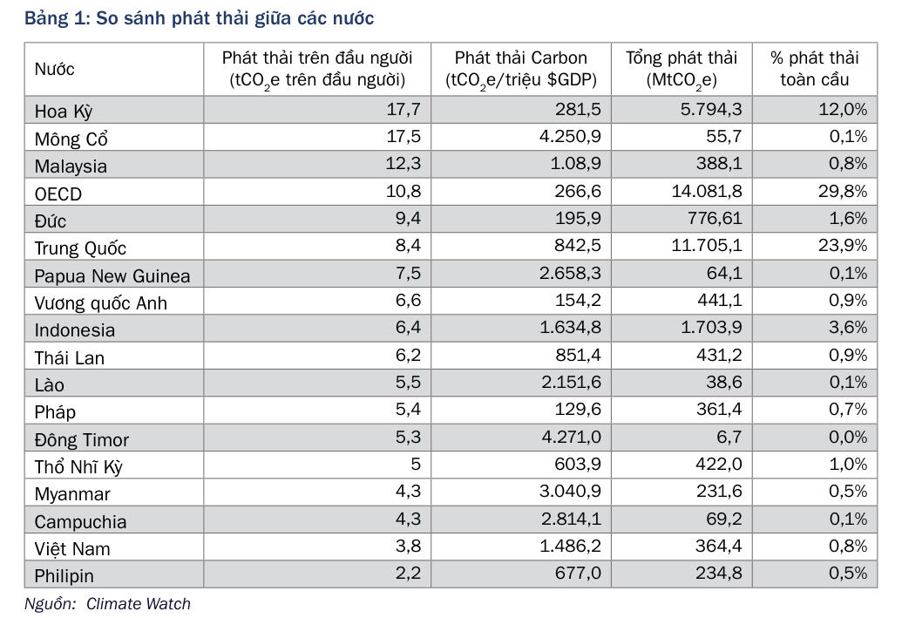

### ad-d02 (Bảng, bảng nhiều trang)

**Câu hỏi:** Theo Bảng 5, tổng chi phí ròng (sau khi trừ khoản tiết kiệm chi phí nhiên liệu) tăng bao nhiêu tỷ USD và bao nhiêu phần trăm?

**Đáp án:** Tăng 33 tỷ USD, tương ứng +13%.

**Cách chấm:** Cả hai giá trị (+33 tỷ USD; +13%) và đúng hàng "Tổng chi phí ròng" (không phải "Tổng chi phí" +65 / +56%).

**Lý do thuộc nhóm:** Tra một hàng của bảng nằm ở trang tiếp theo của bảng chính (Bảng 5 chạy từ trang 56 sang 57); có hai hàng tổng gần nhau (+65 và +33).

- **Evidence:** Hàng Tổng chi phí ròng của Bảng 5, ở phần bảng tiếp trang sau
  - PDF trang 57 (số trang in: 47); vị trí: Bảng 5 (tiếp), hàng 11; giá trị: +33; +13%
  - chunk: CCDR-p057-B5c
  - 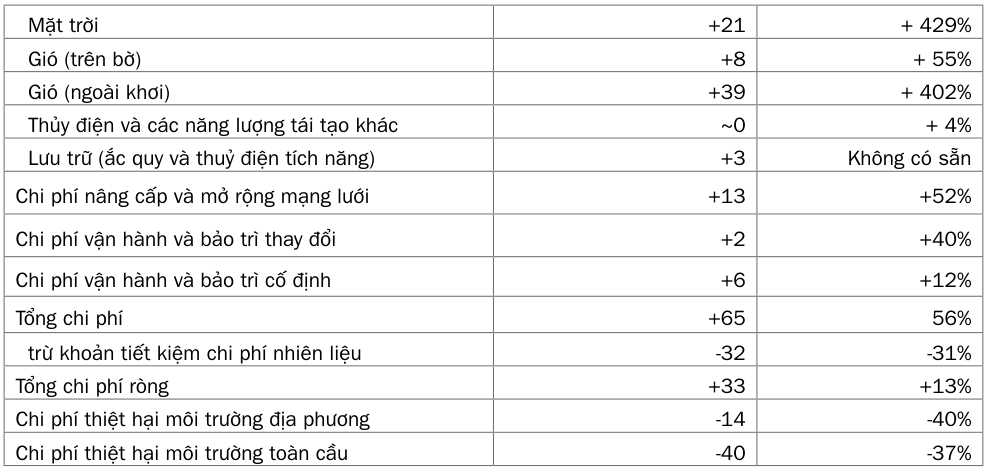

### ad-d03 (Bảng, tính toán)

**Câu hỏi:** Trong bảng so sánh lượng khí thải ước tính của Việt Nam theo từng nguồn thông tin (Phụ lục 3), nguồn nào cho ước tính thấp nhất và thấp hơn con số của Chính phủ (NDC cập nhật 2020) bao nhiêu triệu tấn CO2?

**Đáp án:** Climate Transparency (2018): 61 triệu tấn CO2; thấp hơn NDC cập nhật (104,5) 43,5 triệu tấn CO2.

**Cách chấm:** Đúng nguồn (61) và đúng hiệu 104,5 − 61 = 43,5.

**Lý do thuộc nhóm:** Tra hai ô trong bảng không đánh số rồi tính hiệu.

- **Evidence:** Bảng ước tính lượng khí thải theo nguồn
  - PDF trang 98 (số trang in: 88); vị trí: Bảng cuối Phụ lục 3 (không có số hiệu), cột 2; giá trị: 61; 104,5
  - chunk: CCDR-p098-bang
  - 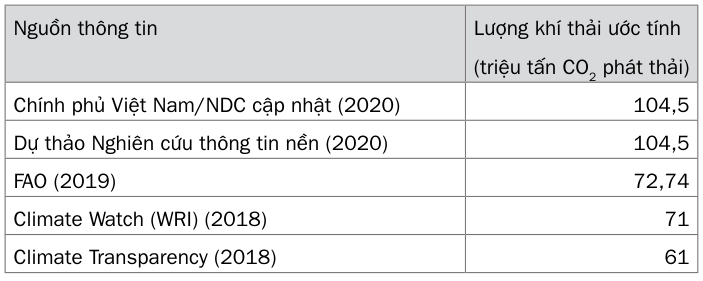

### ad-d04 (Ảnh, sơ đồ, sơ đồ)

**Câu hỏi:** Mô hình phát triển mới cho Việt Nam trong Hình 1 gồm hai lộ trình nào?

**Đáp án:** Lộ trình xây dựng khả năng chống chịu và Lộ trình khử carbon.

**Cách chấm:** Nêu đủ hai lộ trình, đúng tên.

**Lý do thuộc nhóm:** Sơ đồ khái niệm: hai lộ trình nằm ở hai mũi tên cong hai bên, không phải trong một đoạn văn.

- **Evidence:** Hai mũi tên bên trái và bên phải của sơ đồ Hình 1
  - PDF trang 13 (số trang in: 3); vị trí: Hình 1; giá trị: Lộ trình xây dựng khả năng chống chịu; Lộ trình khử carbon
  - chunk: CCDR-p013-H1
  - 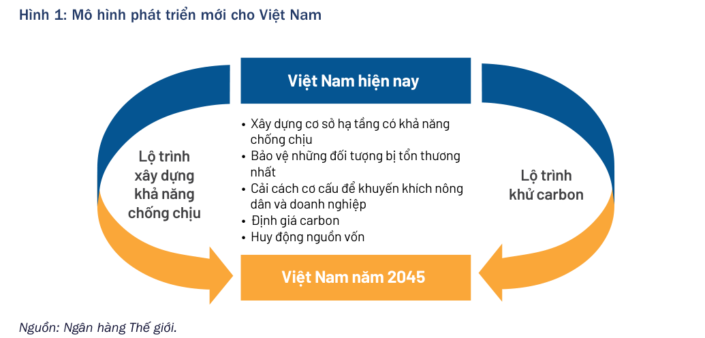

### ad-d05 (Ảnh, sơ đồ, đếm, sơ đồ)

**Câu hỏi:** Trong sơ đồ Hình 1, danh sách các hành động ở giữa có mấy mục và mục thứ tư là gì?

**Đáp án:** Có 5 mục; mục thứ tư là "Định giá carbon".

**Cách chấm:** Đúng số mục (5) và đúng mục thứ tư (Định giá carbon).

**Lý do thuộc nhóm:** Đếm và đọc thứ tự các mục trong một sơ đồ.

- **Evidence:** Danh sách gạch đầu dòng giữa hai khối "Việt Nam hiện nay" và "Việt Nam năm 2045"
  - PDF trang 13 (số trang in: 3); vị trí: Hình 1, danh sách giữa; giá trị: 5 mục; thứ tư: Định giá carbon
  - chunk: CCDR-p013-H1
  - 

### ad-d06 (Ảnh, sơ đồ, sơ đồ)

**Câu hỏi:** Theo sơ đồ Hình 21, khu vực nào cần nhiều tài chính nhất trong tổng nhu cầu 2022–2040, cần bao nhiêu tỷ USD và tương đương khoảng bao nhiêu phần trăm GDP mỗi năm?

**Đáp án:** Khu vực tư nhân: 184 tỷ USD, khoảng 3,4% GDP mỗi năm (so với khu vực công 130 tỷ USD, bên ngoài 54 tỷ USD).

**Cách chấm:** Đúng khu vực (tư nhân), 184 tỷ USD và ~3,4% GDP/năm.

**Lý do thuộc nhóm:** Sơ đồ cây gồm các ô có số; phải so ba ô con.

- **Evidence:** Ba ô nguồn tài chính dưới ô nhu cầu tài chính 368 tỷ USD
  - PDF trang 77 (số trang in: 67); vị trí: Hình 21, ô KHU VỰC TƯ NHÂN; giá trị: 184 tỷ USD; ~3,4% GDP mỗi năm
  - chunk: CCDR-p077-H21
  - 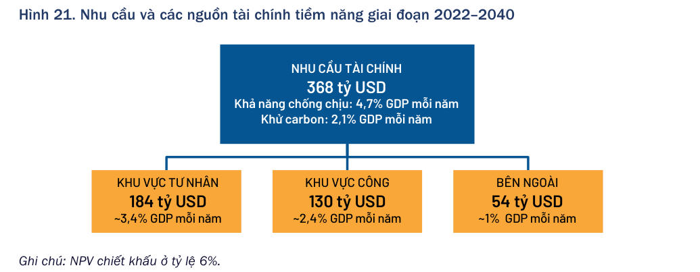

### ad-d07 (Biểu đồ, tính toán, đơn vị)

**Câu hỏi:** Cộng tất cả các hạng mục trong Hình 3 thì tổng chi phí ước tính do biến đổi khí hậu năm 2020 là bao nhiêu triệu USD, và hạng mục nào lớn nhất?

**Đáp án:** 10.903 triệu USD (4.219 + 2.807 + 1.474 + 837 + 518 + 447 + 235 + 218 + 148); lớn nhất là Thủy sản (4.219 triệu USD).

**Cách chấm:** Tổng 10.903 (dung sai ±0 vì các số in rõ) và hạng mục lớn nhất là Thủy sản.

**Lý do thuộc nhóm:** Biểu đồ treemap: đọc chín giá trị rồi cộng; có đơn vị (triệu USD).

- **Evidence:** Chín ô của biểu đồ treemap, mỗi ô ghi giá trị
  - PDF trang 17 (số trang in: 7); vị trí: Hình 3; giá trị: 4219; 2807; 1474; 837; 518; 447; 235; 218; 148
  - chunk: CCDR-p017-H3
  - 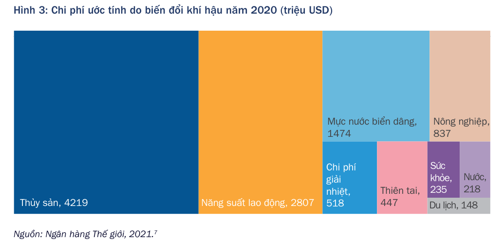

### ad-d08 (Biểu đồ, chú giải)

**Câu hỏi:** Trong Hình 6, bao nhiêu phần trăm doanh nghiệp cho biết tác động "Thiếu nguồn cung nguyên liệu đầu vào" ở mức "Hầu như không"?

**Đáp án:** 33%.

**Cách chấm:** Đúng 33% và đúng hàng "Thiếu nguồn cung nguyên liệu đầu vào", mức "Hầu như không" (đoạn xanh đậm).

**Lý do thuộc nhóm:** Biểu đồ cột chồng 100%: phải khớp hàng, màu chú giải và giá trị.

- **Evidence:** Hàng cuối của biểu đồ cột chồng, đoạn đầu (Hầu như không)
  - PDF trang 25 (số trang in: 15); vị trí: Hình 6, hàng Thiếu nguồn cung nguyên liệu đầu vào; giá trị: 33
  - chunk: CCDR-p025-H6
  - 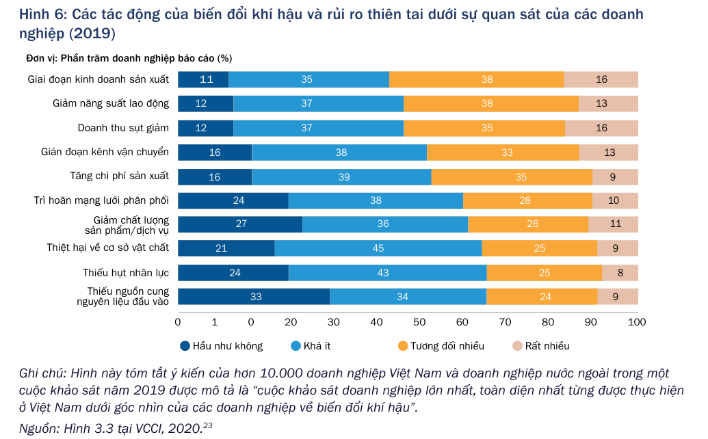

### ad-d09 (Biểu đồ, đọc trục, chú giải)

**Câu hỏi:** Trong Hình 8, đến năm 2050 thiệt hại GDP theo kịch bản RCP 4.5 và theo kịch bản RCP 2.6 khoảng bao nhiêu phần trăm?

**Đáp án:** RCP 4.5: khoảng 12,3%; RCP 2.6: khoảng 9,9% (RCP 4.5 cao hơn).

**Cách chấm:** Biểu đồ không in số: chấp nhận RCP 4.5 trong 11,8–12,8% và RCP 2.6 trong 9,4–10,4%, đúng kịch bản nào cao hơn.

**Lý do thuộc nhóm:** Biểu đồ đường hai chuỗi không in số; phải đọc giá trị từ trục và gắn đúng chuỗi theo chú giải.

- **Evidence:** Điểm cuối năm 2050 của hai đường RCP 2.6 (xanh đậm) và RCP 4.5 (cam)
  - PDF trang 30 (số trang in: 20); vị trí: Hình 8; giá trị: RCP 4.5 ≈ 12,3; RCP 2.6 ≈ 9,9 (đọc từ trục)
  - chunk: CCDR-p030-H8; **chỉ kiểm tra được bằng mắt trên hình**
  - 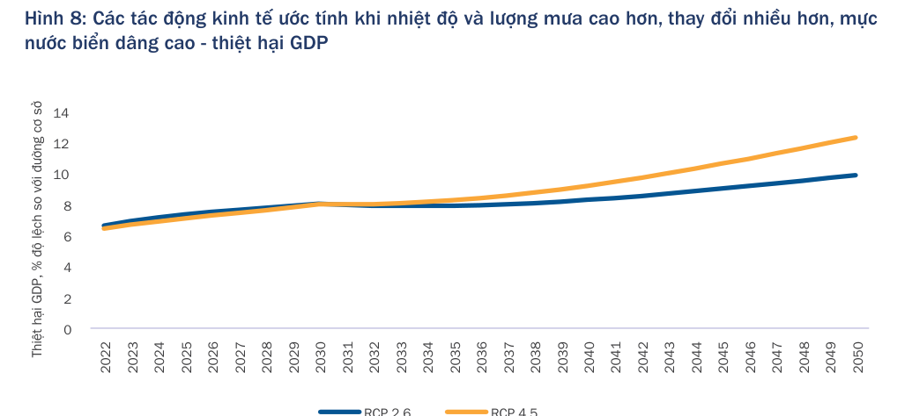

### ad-d10 (Biểu đồ, đọc trục)

**Câu hỏi:** Trong Hình 16, biện pháp giảm phát thải từ sản xuất lúa gạo nào có chi phí (USD/tCO2e) cao nhất và mức đó khoảng bao nhiêu?

**Đáp án:** Chuyển từ trồng lúa sang ngô, khoảng 390 USD/tCO2e.

**Cách chấm:** Đúng biện pháp; giá trị chấp nhận trong khoảng 350–420 USD/tCO2e (không in nhãn số, đọc từ trục).

**Lý do thuộc nhóm:** Đọc một giá trị từ trục khi biểu đồ không in số; nhãn trục xoay dọc.

- **Evidence:** Cột cao nhất của biểu đồ cột (cột cuối)
  - PDF trang 65 (số trang in: 55); vị trí: Hình 16, cột Chuyển từ trồng lúa sang ngô; giá trị: ~390 $/tCO2e (đọc từ trục)
  - chunk: CCDR-p065-H16; **chỉ kiểm tra được bằng mắt trên hình**
  - 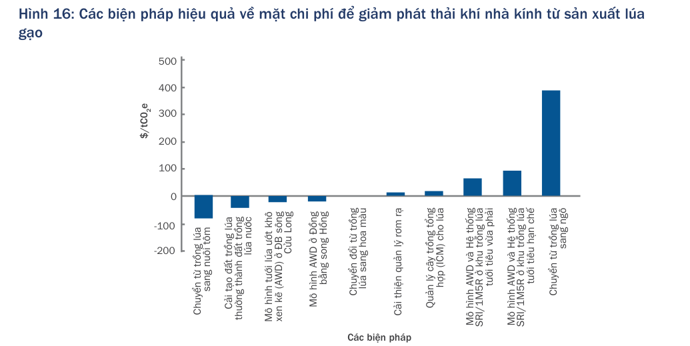

### ad-d11 (Multi-hop, tính toán)

**Câu hỏi:** Nhu cầu tài chính của khu vực tư nhân giai đoạn 2022–2040 (Hình 21) gấp khoảng bao nhiêu lần dư nợ tín dụng xanh đầu năm 2021 (Hình 22)?

**Đáp án:** 184 tỷ USD / 14,5 tỷ USD ≈ 12,7 lần.

**Cách chấm:** Đúng hai số (184 và 14,5) và tỷ số 12,6–12,8.

**Lý do thuộc nhóm:** Kết hợp một sơ đồ ở trang 77 với một biểu đồ ở trang 78 rồi tính tỷ số.

- **Evidence:** Khu vực tư nhân: 184 tỷ USD
  - PDF trang 77 (số trang in: 67); vị trí: Hình 21; giá trị: 184
  - chunk: CCDR-p077-H21
  - 
- **Evidence:** Dư nợ tín dụng xanh 2021:Q1: 14,5 tỷ USD
  - PDF trang 78 (số trang in: 68); vị trí: Hình 22, biểu đồ trái, cột 2021:Q1; giá trị: 14,5
  - chunk: CCDR-p078-H22
  - 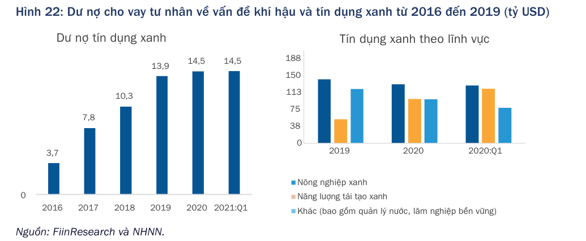

### ad-d12 (Multi-hop, tính toán)

**Câu hỏi:** Điện từ than năm 2040 trong kịch bản BAU (Hình 13) gấp khoảng bao nhiêu lần điện từ than năm 2020, tính từ Hình 12?

**Đáp án:** Hình 12: 59% × 200 TWh = 118 TWh năm 2020; Hình 13: 550 TWh (BAU 2040); 550 / 118 ≈ 4,7 lần.

**Cách chấm:** Hai giá trị đúng (118 và 550 TWh) và tỷ số 4,6–4,7.

**Lý do thuộc nhóm:** Kết hợp hai biểu đồ ở hai trang khác nhau (54 và 56) và hai năm.

- **Evidence:** Than 59% của 200 TWh năm 2020
  - PDF trang 54 (số trang in: 44); vị trí: Hình 12, biểu đồ phải; giá trị: 59%; 200 TWh
  - chunk: CCDR-p054-H12
  - 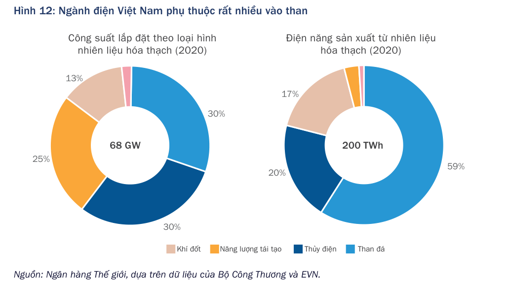
- **Evidence:** BAU 2040, đoạn Than: 550 TWh
  - PDF trang 56 (số trang in: 46); vị trí: Hình 13, cột BAU, đoạn xanh đậm; giá trị: 550
  - chunk: CCDR-p056-H13
  - 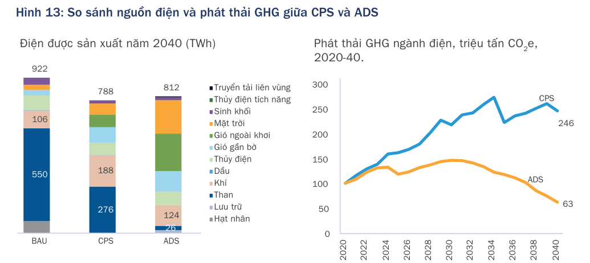

### ad-d13 (Text, điều kiện)

**Câu hỏi:** Năm 2020, ngành năng lượng chiếm khoảng bao nhiêu phần trăm lượng phát thải GHG của cả nước và ngành nào là ngành phát thải lớn thứ hai?

**Đáp án:** Năng lượng khoảng 65%; nông nghiệp là ngành lớn thứ hai, khoảng 19%.

**Cách chấm:** Đúng 65%, nông nghiệp và 19%.

**Lý do thuộc nhóm:** Tìm điều kiện (năm 2020) và hai số trong một đoạn văn.

- **Evidence:** Đoạn nêu cơ cấu phát thải năm 2020
  - PDF trang 18 (số trang in: 8); vị trí: Đoạn đầu trang 8 in (PDF 18); giá trị: 65%; nông nghiệp 19%
  - chunk: CCDR-p018-t01
  - đoạn: "vào với các công nghệ phát thải cao trong thập kỷ tới. Năm 2020, năng lượng chiếm khoảng 65% lượng phát thải GHG của cả nước.8 Nông nghiệp là ngành phát thải lớn thứ hai, chiếm khoảng 19%, tiếp đến là giao thông, công n"

### ad-d14 (Text, tổng hợp)

**Câu hỏi:** Thuế Bảo vệ Môi trường hiện hành tương đương bao nhiêu USD/tCO2e đối với than, xăng và dầu diesel?

**Đáp án:** Khoảng 0,5 USD/tCO2e đối với than, 77,60 USD/tCO2e đối với xăng và 32,90 USD/tấn CO2e đối với dầu diesel.

**Cách chấm:** Đủ ba giá trị đúng nhiên liệu.

**Lý do thuộc nhóm:** Tổng hợp ba giá trị theo ba loại nhiên liệu.

- **Evidence:** Đoạn về thuế carbon hiện tại (EPT)
  - PDF trang 24 (số trang in: 14); vị trí: Đoạn thứ hai của mục 2.1; giá trị: 0,5; 77,60; 32,90
  - chunk: CCDR-p024-t02
  - đoạn: ", nhưng các công cụ này vẫn chưa được thực hiện trên quy mô lớn. Thuế carbon hiện tại - Thuế Bảo vệ Môi trường (EPT) - vào khoảng 0,5 USD/tCO2e đối với than, 77,60 USD/tCO2e đối với xăng và 32,90 USD/ tấn CO2e đối với dầu diesel, thấp hơn hầu hết các quốc gia "

### ad-d15 (Text, điều kiện)

**Câu hỏi:** Việt Nam xếp hạng bao nhiêu theo Sáng kiến Thích ứng Biến đổi Khí hậu Toàn cầu Notre Dame (ND-GAIN) và theo Chỉ số Rủi ro Khí hậu Toàn cầu Germanwatch giai đoạn 2000–2019?

**Đáp án:** Hạng 127 trong 182 quốc gia (ND-GAIN) và hạng 13 trong 180 quốc gia (Germanwatch).

**Cách chấm:** Đúng hai hạng và hai tổng số quốc gia.

**Lý do thuộc nhóm:** Hai chỉ số khác nhau trong cùng một đoạn.

- **Evidence:** Đoạn nêu xếp hạng dễ bị tổn thương
  - PDF trang 16 (số trang in: 6); vị trí: Mục 1.2; giá trị: 127/182; 13/180
  - chunk: CCDR-p016-t04
  - đoạn: "Việt Nam là một trong số những quốc gia dễ bị tổn thương nhất bởi biến đổi khí hậu trên thế giới, xếp hạng 127 trong số 182 quốc gia theo Sáng kiến Thích ứng Biến đổi Khí hậu Toàn cầu Notre Dame (ND- GAIN) và đứng thứ 13 trong số 180 quố"

### ad-d19 (Biểu đồ, đọc trục, chú giải)

**Câu hỏi:** Trong Hình 2, đến cuối giai đoạn (khoảng T+54) đường của Thái Lan đạt GDP bình quân đầu người khoảng bao nhiêu USD (USD 2015 cố định)?

**Đáp án:** Khoảng 5.500 USD (đường Thái Lan 1958-2012 kết thúc ở cuối trục thời gian).

**Cách chấm:** Chấp nhận 4.800-6.200 USD; hình không in số, đọc từ trục tung.

**Lý do thuộc nhóm:** Biểu đồ đường 5 chuỗi không in số: phải gắn đúng chuỗi theo chú giải và đọc giá trị từ trục.

- **Evidence:** Điểm cuối của đường Thái Lan (1958-2012)
  - PDF trang 15 (số trang in: 5); vị trí: Hình 2; giá trị: ~5.500 (đọc từ trục)
  - chunk: CCDR-p015-H2; **chỉ kiểm tra được bằng mắt trên hình**
  - 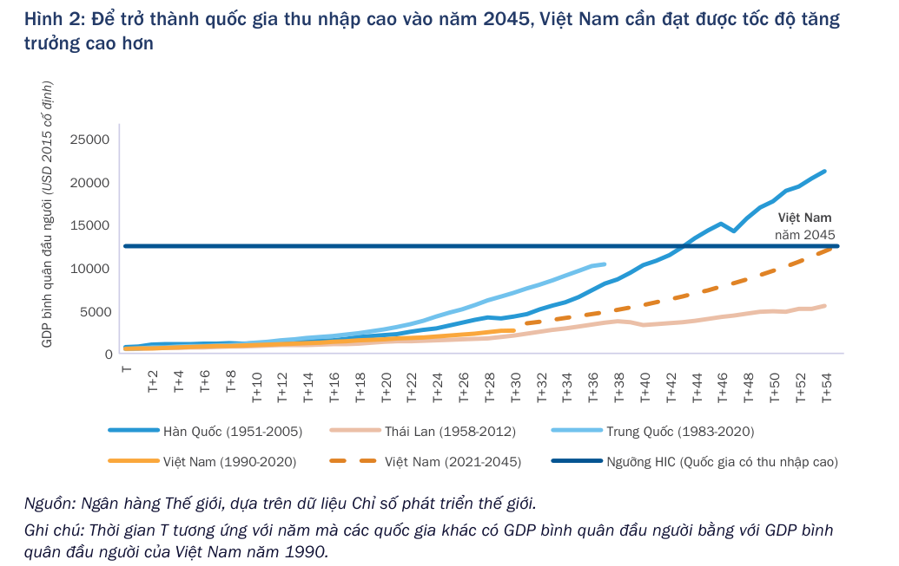

### ad-d20 (Biểu đồ, đọc trục)

**Câu hỏi:** Trong Hình 17, biện pháp giảm phát thải từ chăn nuôi nào có chi phí cao nhất và mức đó khoảng bao nhiêu USD/tCO2e?

**Đáp án:** Cải thiện chất lượng khẩu phần ăn cho trâu nuôi lấy thịt (TMR), khoảng 725 USD/tCO2e.

**Cách chấm:** Đúng biện pháp; giá trị chấp nhận 650-800 USD/tCO2e (không in nhãn số).

**Lý do thuộc nhóm:** Giá trị chỉ có trong hình (không in số, không có trong văn bản); nhãn trục xoay dọc.

- **Evidence:** Cột cao nhất (cột cuối) của biểu đồ cột
  - PDF trang 65 (số trang in: 55); vị trí: Hình 17, cột ngoài cùng bên phải; giá trị: ~725 $/tCO2e (đọc từ trục)
  - chunk: CCDR-p065-H17; **chỉ kiểm tra được bằng mắt trên hình**
  - 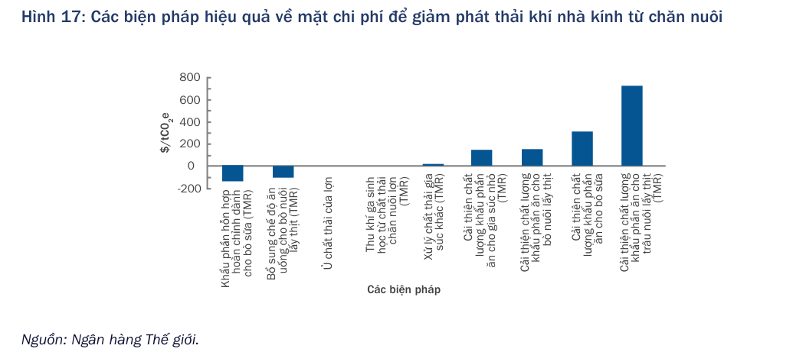

### ad-d21 (Biểu đồ, đọc trục)

**Câu hỏi:** Trong Hình 17, những biện pháp nào có chi phí âm (tiết kiệm chi phí)?

**Đáp án:** Khẩu phần hỗn hợp hoàn chỉnh dành cho bò sữa (TMR) và bổ sung chế độ ăn uống cho bò nuôi lấy thịt (TMR).

**Cách chấm:** Nêu đủ hai biện pháp; thêm biện pháp khác là sai.

**Lý do thuộc nhóm:** Phải nhận ra cột nằm dưới trục 0 và gắn với nhãn xoay dọc; thông tin chỉ có trong hình.

- **Evidence:** Hai cột đầu nằm dưới trục 0
  - PDF trang 65 (số trang in: 55); vị trí: Hình 17, hai cột bên trái; giá trị: khẩu phần hỗn hợp bò sữa; bổ sung chế độ ăn bò thịt
  - chunk: CCDR-p065-H17; **chỉ kiểm tra được bằng mắt trên hình**
  - 

### ad-d22 (Ảnh, sơ đồ, màu, ảnh raster)

**Câu hỏi:** Trong Hình 4, phần diện tích nằm dưới trục 0 trong giai đoạn 1990-2000 thuộc ngành nào theo chú giải?

**Đáp án:** Thay đổi mục đích sử dụng đất và lâm nghiệp (LULUCF).

**Cách chấm:** Đúng ngành; nhầm với Điện/Nhiệt hoặc một ngành phát thải khác là sai.

**Lý do thuộc nhóm:** Ảnh raster: phải khớp màu vùng với màu trong chú giải (nhiều sắc tím gần nhau).

- **Evidence:** Vùng màu tím nhạt dưới trục 0, khớp màu chú giải cuối
  - PDF trang 18 (số trang in: 8); vị trí: Hình 4; giá trị: Thay đổi mục đích sử dụng đất và lâm nghiệp
  - chunk: CCDR-p018-H4; **chỉ kiểm tra được bằng mắt trên hình**
  - 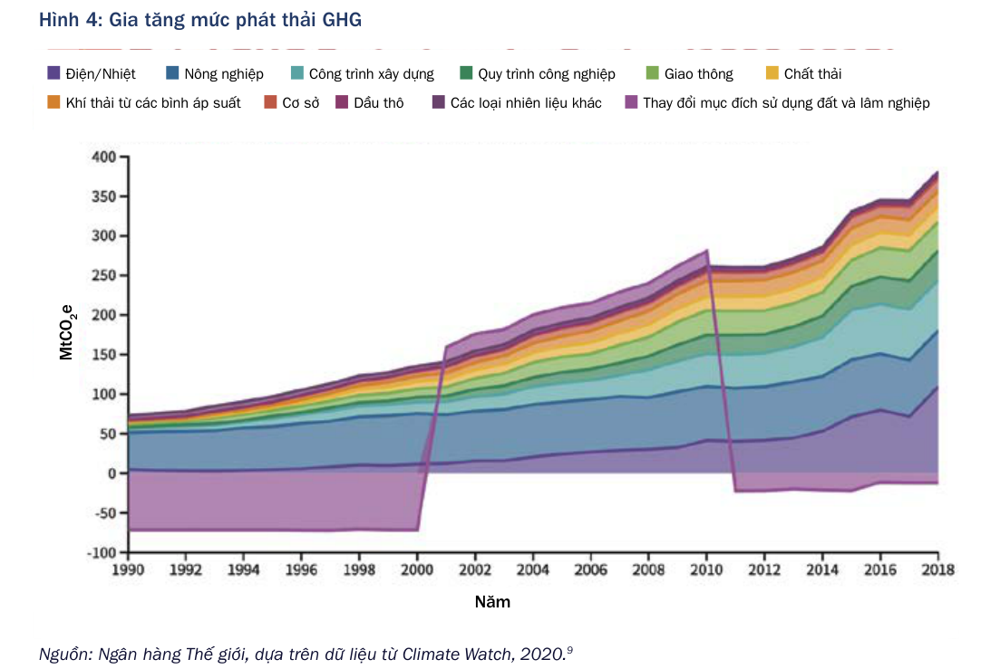

### ad-d23 (Ảnh, sơ đồ, màu, chú giải)

**Câu hỏi:** Trong Hình 15, lớp màu xanh dương đậm nằm trên cùng, sát trục 0 vào năm 2030, là biện pháp nào theo chú giải?

**Đáp án:** 1.1 Tiết kiệm nhiên liệu và tiêu chuẩn khí thải mới.

**Cách chấm:** Đúng biện pháp 1.1; nhầm với 3.1/3.2 (xanh dương sáng hơn) là sai.

**Lý do thuộc nhóm:** Biểu đồ vùng xếp chồng với 12 chú giải: phải khớp màu lớp với màu chú giải, thông tin không có trong văn bản.

- **Evidence:** Lớp xanh dương đậm trên cùng, khớp ô vuông cuối chú giải
  - PDF trang 62 (số trang in: 52); vị trí: Hình 15; giá trị: 1.1 Tiết kiệm nhiên liệu và tiêu chuẩn khí thải mới
  - chunk: CCDR-p062-H15; **chỉ kiểm tra được bằng mắt trên hình**
  - 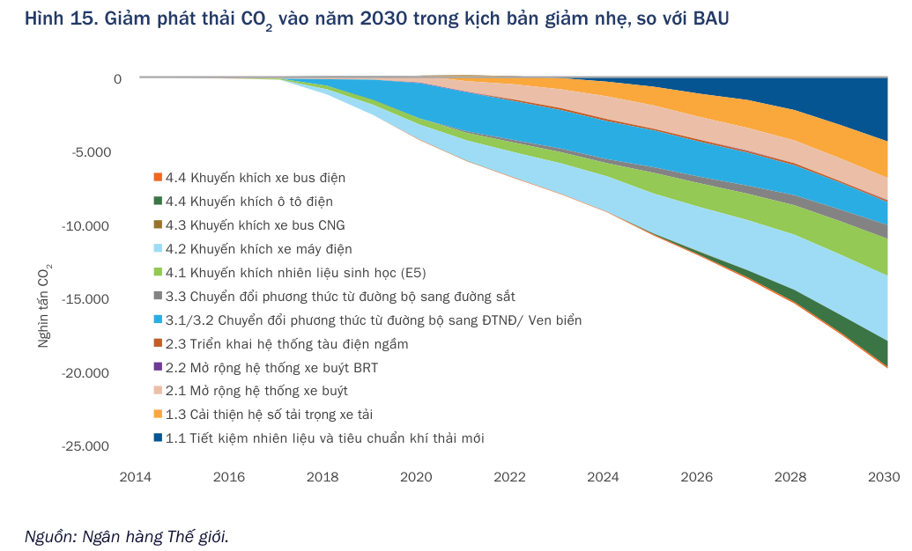

### ad-d16 (Thiếu bằng chứng)

**Câu hỏi:** Bão Yagi năm 2024 đã gây thiệt hại bao nhiêu phần trăm GDP của Việt Nam?

**Hành vi mong đợi:** Từ chối: tài liệu không có thông tin này; không thêm khẳng định vô căn cứ.

**Vì sao không trả lời được:** Báo cáo xuất bản 07/2022, trước cơn bão.

**Từ khóa đã tìm trong toàn bộ tài liệu (0 kết quả):** yagi, bão yagi

**Gần chủ đề ở:** p17: thiệt hại 2020 tương đương 3,2% GDP

### ad-d17 (Thiếu bằng chứng)

**Câu hỏi:** Giá điện bán lẻ bình quân hiện nay ở Việt Nam là bao nhiêu đồng mỗi kWh?

**Hành vi mong đợi:** Từ chối: tài liệu không có thông tin này; không thêm khẳng định vô căn cứ.

**Vì sao không trả lời được:** Báo cáo chỉ nêu thay đổi tương đối của giá điện (ADS cao hơn CPS 26% năm 2040), không nêu giá tuyệt đối.

**Từ khóa đã tìm trong toàn bộ tài liệu (0 kết quả):** đồng/kwh, giá điện bán lẻ, đồng một kwh

**Gần chủ đề ở:** p56: giá điện ADS cao hơn CPS 26%

### ad-d18 (Thiếu bằng chứng)

**Câu hỏi:** Chi phí đầu tư điện gió ngoài khơi ở Việt Nam là bao nhiêu USD cho mỗi MW?

**Hành vi mong đợi:** Từ chối: tài liệu không có thông tin này; không thêm khẳng định vô căn cứ.

**Vì sao không trả lời được:** Bảng 5 chỉ nêu thay đổi tổng chi phí vốn (tỷ USD), không có đơn giá theo MW.

**Từ khóa đã tìm trong toàn bộ tài liệu (0 kết quả):** usd/mw, usd mỗi mw

**Gần chủ đề ở:** p57, Bảng 5: gió ngoài khơi +39 tỷ USD

## test: 30 questions

### ad-t01 (Bảng, tính toán, đơn vị)

**Câu hỏi:** Theo Bảng 2, lấy tổng nhu cầu tài chính trừ đi nguồn tài chính hiện có thì chênh lệch là bao nhiêu tỷ USD (giá trị tích lũy NPV)?

**Đáp án:** 479,2–547,6 trừ 136,9 = 342,3–410,7 tỷ USD (bằng hàng "Nhu cầu tài chính tăng thêm").

**Cách chấm:** Đúng khoảng 342,3–410,7 tỷ USD; đơn vị tỷ USD theo NPV.

**Lý do thuộc nhóm:** Tra hai hàng và một cột, có đơn vị và điều kiện (NPV, chiết khấu 6%), rồi trừ.

- **Evidence:** Hàng Tổng nhu cầu tài chính và hàng Nguồn tài chính hiện có, cột giá trị tích lũy
  - PDF trang 32 (số trang in: 22); vị trí: Bảng 2, cột 2; giá trị: 479,2–547,6; 136,9
  - chunk: CCDR-p032-B2
  - 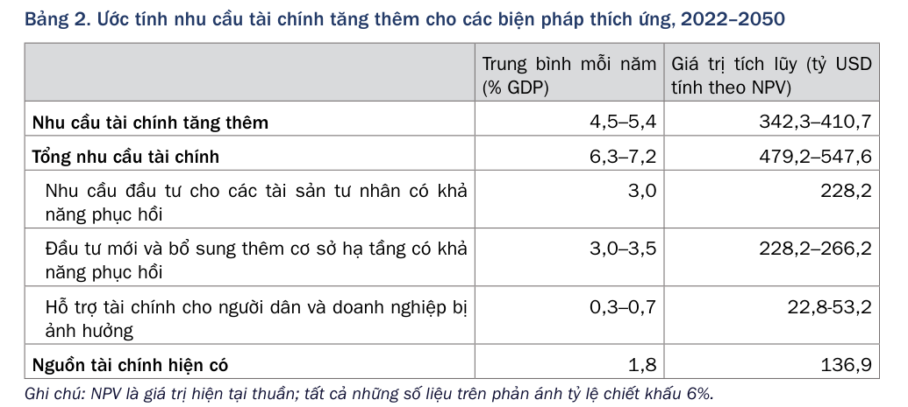

### ad-t02 (Bảng, nhiều khối)

**Câu hỏi:** Trong Bảng 3, với kịch bản NZP có những cải cách hỗ trợ, tác động kinh tế ròng giai đoạn 2031–2040 là bao nhiêu tỷ USD?

**Đáp án:** +19,3 tỷ USD (NPV, chiết khấu 6%).

**Cách chấm:** Đúng 19,3 và dấu dương; đúng khối "NZP với những cải cách hỗ trợ" (không phải khối NZP, −95,5).

**Lý do thuộc nhóm:** Bảng có hai khối và ba cột thời kỳ; phải chọn đúng khối, hàng và cột.

- **Evidence:** Khối NZP với những cải cách hỗ trợ, hàng Tác động kinh tế ròng, cột 2031–2040
  - PDF trang 50 (số trang in: 40); vị trí: Bảng 3; giá trị: 19,3
  - chunk: CCDR-p050-B3
  - 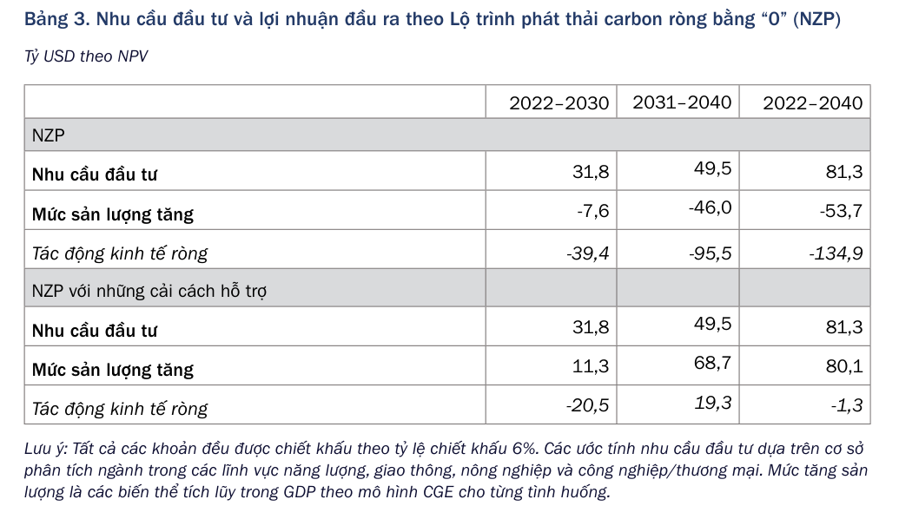

### ad-t03 (Bảng, tính toán)

**Câu hỏi:** Theo Bảng 3, các cải cách hỗ trợ làm tác động kinh tế ròng của NZP giai đoạn 2022–2040 tốt hơn bao nhiêu tỷ USD?

**Đáp án:** −1,3 − (−134,9) = 133,6 tỷ USD.

**Cách chấm:** Đúng 133,6 tỷ USD (dung sai ±0,1).

**Lý do thuộc nhóm:** So sánh hai khối của một bảng bằng phép trừ với số âm.

- **Evidence:** Tác động kinh tế ròng 2022–2040 của hai khối
  - PDF trang 50 (số trang in: 40); vị trí: Bảng 3, cột 2022–2040; giá trị: -134,9; -1,3
  - chunk: CCDR-p050-B3
  - 

### ad-t04 (Bảng, bảng rộng)

**Câu hỏi:** Trong bảng kết quả mô hình CGE ở Phụ lục 3 ("Những thiệt hại chính và kết quả kinh tế vĩ mô"), GDP bình quân đầu người thực tế đường cơ sở năm 2050 là bao nhiêu và dưới kịch bản RCP 4.5 năm 2050 thấp hơn đường cơ sở bao nhiêu phần trăm?

**Đáp án:** 11.095 (đồng đô không đổi 2020); thấp hơn 9,47% dưới RCP 4.5.

**Cách chấm:** Đúng 11.095 và −9,47% (cột RCP 4.5, năm 2050, không phải RCP 2.6 −7,95%).

**Lý do thuộc nhóm:** Bảng rộng 12 cột số với ba khối (đường cơ sở, RCP 2.6, RCP 4.5) và bốn năm; phải chọn đúng khối và năm.

- **Evidence:** Hàng GDP bình quân đầu người thực tế: cột Đường cơ sở 2050 và RCP 4.5 2050
  - PDF trang 95 (số trang in: 85); vị trí: Bảng Phụ lục 3 trang 85, nhóm Mức thu nhập; giá trị: 11.095; -9,47
  - chunk: CCDR-p095-bang-r1
  - 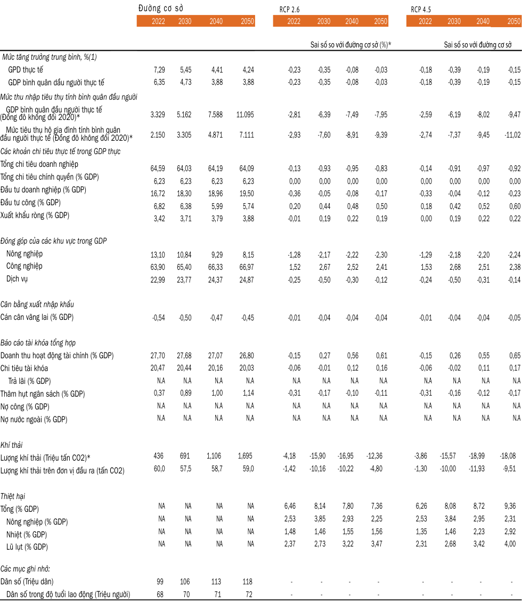

### ad-t05 (Bảng, đơn vị)

**Câu hỏi:** Theo Bảng 1, Việt Nam phát thải bao nhiêu tCO2e bình quân đầu người và chiếm bao nhiêu phần trăm phát thải toàn cầu?

**Đáp án:** 3,8 tCO2e bình quân đầu người; 0,8% phát thải toàn cầu.

**Cách chấm:** Đúng 3,8 và 0,8%.

**Lý do thuộc nhóm:** Tra một hàng theo tên nước và hai cột có đơn vị khác nhau.

- **Evidence:** Hàng Việt Nam của Bảng 1
  - PDF trang 19 (số trang in: 9); vị trí: Bảng 1, hàng Việt Nam; giá trị: 3,8; 0,8%
  - chunk: CCDR-p019-B1
  - 

### ad-t06 (Bảng, ma trận)

**Câu hỏi:** Trong Bảng 6 (tiêu chí ưu tiên), hành động có mức khẩn cấp Trung bình nhưng tác động Cao được mô tả thế nào?

**Đáp án:** "Các hành động cần thời gian để hình thành và thực hiện nhưng có thể mang lại tác động lớn".

**Cách chấm:** Đúng ô (hàng Khẩn cấp Trung bình, cột Tác động Cao); nhầm hàng hoặc cột là sai.

**Lý do thuộc nhóm:** Ma trận 2×2 có tiêu đề hàng và cột; phải xác định đúng ô theo hàng và cột.

- **Evidence:** Ô giao của hàng Khẩn cấp Trung bình và cột Tác động Cao
  - PDF trang 84 (số trang in: 74); vị trí: Bảng 6; giá trị: Các hành động cần thời gian để hình thành và thực hiện nhưng có thể mang lại tác động lớn
  - chunk: CCDR-p084-B6; **chỉ kiểm tra được bằng mắt trên hình**
  - 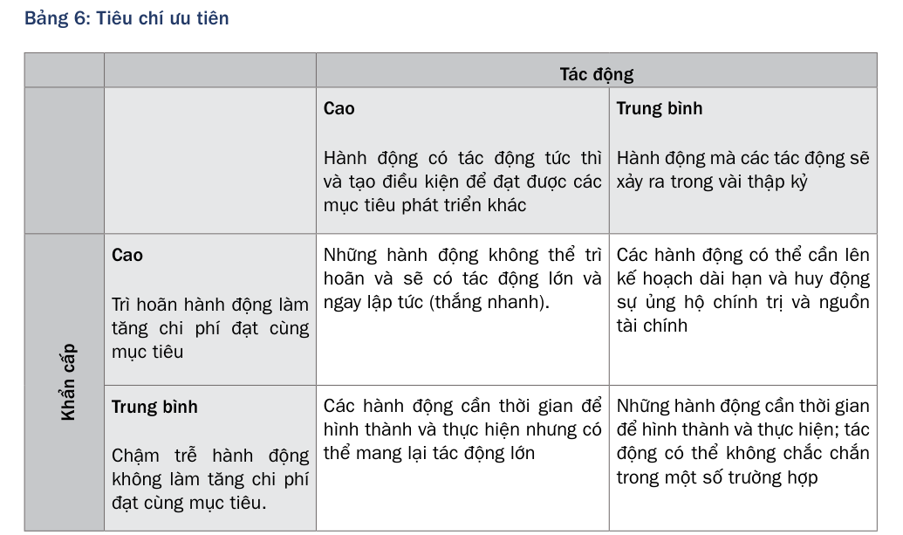

### ad-t07 (Ảnh, sơ đồ, bản đồ)

**Câu hỏi:** Trên bản đồ Hình 14, tỉnh nào được ghi chú là tỉnh sản xuất than chính?

**Đáp án:** Quảng Ninh.

**Cách chấm:** Đúng Quảng Ninh.

**Lý do thuộc nhóm:** Bản đồ có nhãn địa danh và một chú thích; phải gắn chú thích với địa danh.

- **Evidence:** Ô ghi "Quảng Ninh" cạnh chú thích "Tỉnh sản xuất than chính"
  - PDF trang 59 (số trang in: 49); vị trí: Hình 14, bên phải bản đồ; giá trị: Quảng Ninh
  - chunk: CCDR-p059-H14
  - 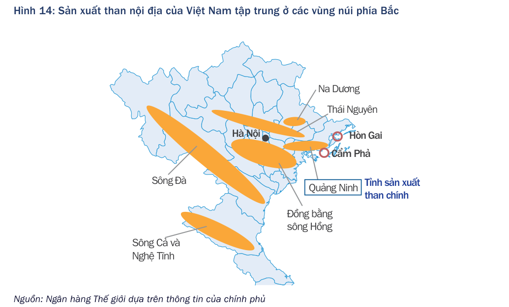

### ad-t08 (Ảnh, sơ đồ, bản đồ, hướng)

**Câu hỏi:** Trên bản đồ Hình 14, vùng than nào được vẽ ở xa nhất về phía nam, ở dưới cùng bản đồ?

**Đáp án:** Sông Cả và Nghệ Tĩnh.

**Cách chấm:** Đúng "Sông Cả và Nghệ Tĩnh" (không phải Sông Đà).

**Lý do thuộc nhóm:** Câu hỏi về vị trí tương đối (hướng) trên bản đồ.

- **Evidence:** Hình elip cam thấp nhất, nhãn Sông Cả và Nghệ Tĩnh
  - PDF trang 59 (số trang in: 49); vị trí: Hình 14, góc dưới bên trái; giá trị: Sông Cả và Nghệ Tĩnh
  - chunk: CCDR-p059-H14
  - 

### ad-t09 (Ảnh, sơ đồ, bản đồ, ảnh)

**Câu hỏi:** Trong Hình 11 (rủi ro ngập lụt tại các vùng ven biển), dải lãnh thổ nào có màu đậm nhất, tức rủi ro ngập lụt tương đối cao nhất?

**Đáp án:** Dải ven biển miền Trung (Trung Bộ, khoảng từ phía bắc Đà Nẵng đến Nam Trung Bộ).

**Cách chấm:** Chấp nhận "miền Trung / Trung Bộ"; sai nếu nêu miền Bắc hay Đồng bằng sông Cửu Long.

**Lý do thuộc nhóm:** Đọc thang màu của bản đồ chuyên đề và liên hệ với vị trí địa lý; thông tin chỉ nằm trong ảnh.

- **Evidence:** Các tỉnh màu xanh lục đậm nhất trên bản đồ
  - PDF trang 42 (số trang in: 32); vị trí: Hình 11; giá trị: miền Trung
  - chunk: CCDR-p042-H11; **chỉ kiểm tra được bằng mắt trên hình**
  - 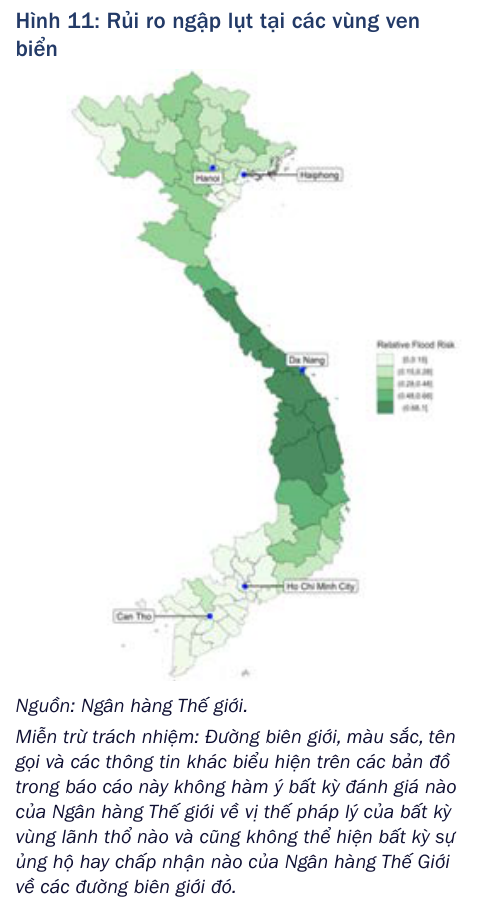

### ad-t10 (Ảnh, sơ đồ, ảnh raster)

**Câu hỏi:** Trên bản đồ Hình 10, biển ở phía đông được ghi tên là gì và nước nào được ghi tên ở phía tây bắc?

**Đáp án:** "BIỂN ĐÔNG" và "CAM PU CHIA".

**Cách chấm:** Đúng cả hai nhãn (viết hoa trên bản đồ).

**Lý do thuộc nhóm:** Chữ nằm trong ảnh raster nên không có trong văn bản trích từ PDF; phải đọc ảnh.

- **Evidence:** Hai nhãn chữ trong ảnh bản đồ
  - PDF trang 40 (số trang in: 30); vị trí: Hình 10; giá trị: BIỂN ĐÔNG; CAM PU CHIA
  - chunk: CCDR-p040-H10; **chỉ kiểm tra được bằng mắt trên hình**
  - 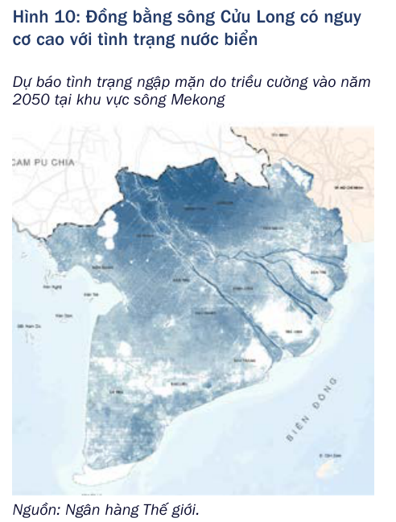

### ad-t11 (Ảnh, sơ đồ, ảnh, màu)

**Câu hỏi:** Hình 9 gồm ba bản đồ về ba loại thiên tai. Bản đồ nào dùng thang màu xanh lục?

**Đáp án:** Bản đồ "Bão lũ" (bản đồ bên phải).

**Cách chấm:** Đúng "Bão lũ"; "Lũ lụt 1.000 năm" dùng thang xanh dương và "Lở đất" thang cam.

**Lý do thuộc nhóm:** Phải nhận ra thang màu của từng bản đồ trong ảnh và gắn với tiêu đề.

- **Evidence:** Ba bản đồ có ba thang màu: cam (Lở đất), xanh dương (Lũ lụt 1.000 năm), xanh lục (Bão lũ)
  - PDF trang 37 (số trang in: 27); vị trí: Hình 9; giá trị: Bão lũ
  - chunk: CCDR-p037-H9; **chỉ kiểm tra được bằng mắt trên hình**
  - 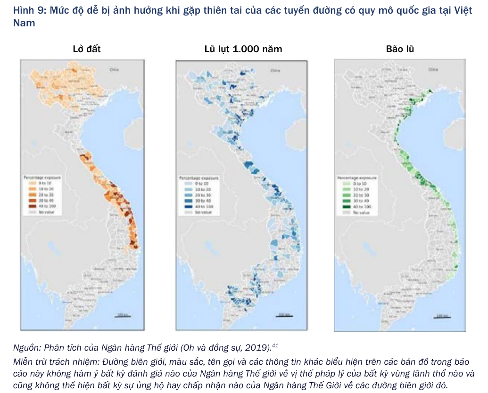

### ad-t12 (Biểu đồ, chú giải)

**Câu hỏi:** Theo Hình 13, phát thải GHG ngành điện năm 2040 của kịch bản CPS và của kịch bản ADS là bao nhiêu triệu tấn CO2e?

**Đáp án:** CPS: 246 triệu tấn CO2e; ADS: 63 triệu tấn CO2e.

**Cách chấm:** Đúng hai giá trị và đơn vị triệu tấn CO2e, đúng gắn với từng kịch bản.

**Lý do thuộc nhóm:** Biểu đồ đường hai chuỗi; phải đọc nhãn cuối của từng chuỗi và gắn đúng kịch bản.

- **Evidence:** Nhãn cuối hai đường của biểu đồ đường bên phải
  - PDF trang 56 (số trang in: 46); vị trí: Hình 13, biểu đồ phải, năm 2040; giá trị: 246; 63
  - chunk: CCDR-p056-H13
  - 

### ad-t13 (Biểu đồ, chú giải)

**Câu hỏi:** Trong Hình 20, mức thay đổi việc làm năm 2040 của ngành Điện ở kịch bản NZP đã cải cách và của ngành Vận tải ở kịch bản NZP là bao nhiêu phần trăm?

**Đáp án:** Điện, NZP đã cải cách: +23,6%; Vận tải, NZP: −6,3%.

**Cách chấm:** Đúng hai giá trị kèm dấu và đúng chuỗi (cột cam cho NZP đã cải cách, cột xanh cho NZP).

**Lý do thuộc nhóm:** Biểu đồ cột nhóm với hai chuỗi và giá trị âm; phải chọn đúng chuỗi cho từng ngành.

- **Evidence:** Cột cam của ngành Điện và cột xanh của ngành Vận tải
  - PDF trang 72 (số trang in: 62); vị trí: Hình 20; giá trị: 23,6; -6,3
  - chunk: CCDR-p072-H20
  - 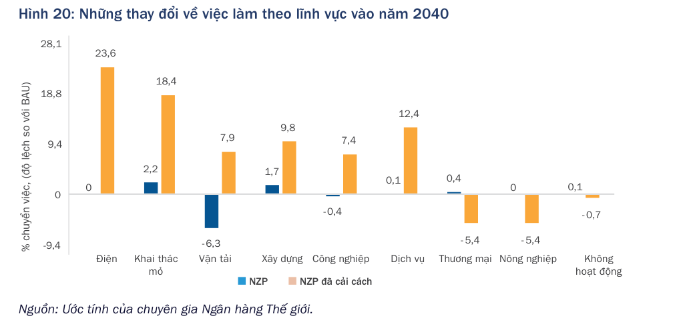

### ad-t14 (Biểu đồ, tính toán)

**Câu hỏi:** Theo Hình 22, dư nợ tín dụng xanh năm 2016 và năm 2019 là bao nhiêu tỷ USD, và tăng thêm bao nhiêu trong giai đoạn đó?

**Đáp án:** 2016: 3,7 tỷ USD; 2019: 13,9 tỷ USD; tăng thêm 10,2 tỷ USD.

**Cách chấm:** Đúng hai giá trị và hiệu 10,2.

**Lý do thuộc nhóm:** Đọc hai cột của biểu đồ cột và tính hiệu; có đơn vị tỷ USD.

- **Evidence:** Cột 2016 và 2019 của biểu đồ trái
  - PDF trang 78 (số trang in: 68); vị trí: Hình 22, biểu đồ trái; giá trị: 3,7; 13,9
  - chunk: CCDR-p078-H22
  - 

### ad-t15 (Biểu đồ, chú giải)

**Câu hỏi:** Trong Hình 7, năm 2018 (sơ bộ), tỷ trọng sản lượng của doanh nghiệp nhà nước trong ngành phân hóa học và trong ngành xi măng là bao nhiêu phần trăm?

**Đáp án:** Phân hóa học: 94%; xi măng: 35%.

**Cách chấm:** Đúng hai giá trị gắn đúng ngành.

**Lý do thuộc nhóm:** Biểu đồ đường nhiều chuỗi, giá trị nằm ở nhãn cuối từng chuỗi (một số nhãn xuống dòng).

- **Evidence:** Nhãn cuối đường Phân hóa học và Xi măng
  - PDF trang 26 (số trang in: 16); vị trí: Hình 7, năm 2018 (sơ bộ); giá trị: 94%; 35%
  - chunk: CCDR-p026-H7
  - 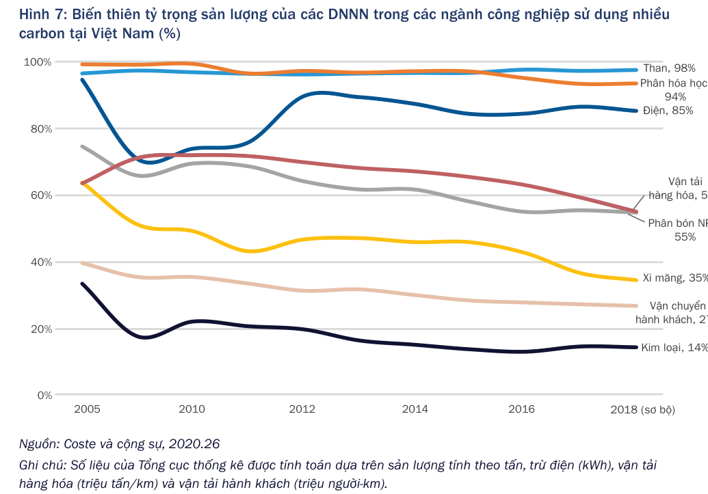

### ad-t16 (Biểu đồ, xu hướng, chú giải)

**Câu hỏi:** Trong Hình 19, đến năm 2040 nhóm hàng nào có chỉ số giá tăng nhiều nhất so với BAU và nhóm nào giảm sâu nhất?

**Đáp án:** Tăng nhiều nhất: Năng lượng (khoảng +15%); giảm sâu nhất: Y tế (khoảng −1,5%).

**Cách chấm:** Đúng hai nhóm (Năng lượng; Y tế); giá trị gần đúng là tùy chọn.

**Lý do thuộc nhóm:** Biểu đồ đường 6 chuỗi không in số: phải nhận xu hướng và gắn đúng chuỗi theo màu chú giải.

- **Evidence:** Điểm cuối năm 2040 của đường cao nhất (Năng lượng) và thấp nhất (Y tế)
  - PDF trang 71 (số trang in: 61); vị trí: Hình 19; giá trị: Năng lượng; Y tế
  - chunk: CCDR-p071-H19; **chỉ kiểm tra được bằng mắt trên hình**
  - 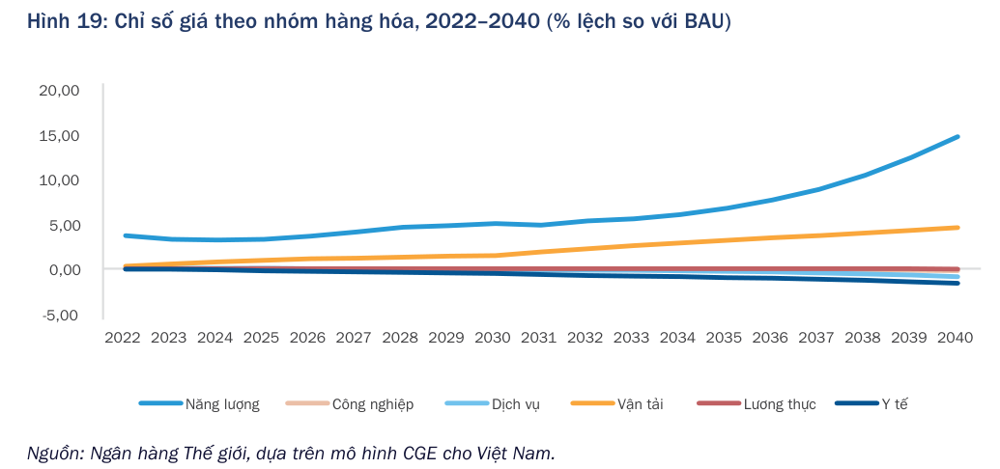

### ad-t17 (Multi-hop, bảng nhiều trang, tính toán)

**Câu hỏi:** Trong Bảng 5, cộng các thay đổi chi phí vốn của từng nguồn (than đá, khí đốt, mặt trời, gió trên bờ, gió ngoài khơi, thủy điện và năng lượng tái tạo khác, lưu trữ) thì có khớp với thay đổi chi phí vốn để lưu trữ và phát điện mới không? Nêu tổng.

**Đáp án:** Có: −19 − 8 + 21 + 8 + 39 + 0 + 3 = +44 tỷ USD, khớp hàng "Chi phí vốn để lưu trữ và phát điện mới" (+44).

**Cách chấm:** Nêu đúng tổng +44 và kết luận khớp; hàng "thủy điện và tái tạo khác" ~0 tính bằng 0.

**Lý do thuộc nhóm:** Bảng 5 nằm trên hai trang; phải gom các hàng ở cả hai trang rồi cộng.

- **Evidence:** Hàng chi phí vốn +44 và các hàng thành phần than đá −19, khí đốt −8
  - PDF trang 56 (số trang in: 46); vị trí: Bảng 5, trang 56; giá trị: +44; -19; -8
  - chunk: CCDR-p056-B5
  - 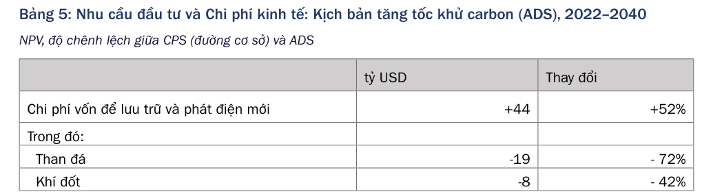
- **Evidence:** Các hàng mặt trời, gió, tái tạo khác, lưu trữ ở trang tiếp theo
  - PDF trang 57 (số trang in: 47); vị trí: Bảng 5 (tiếp), trang 57; giá trị: +21; +8; +39; ~0; +3
  - chunk: CCDR-p057-B5c
  - 

### ad-t18 (Multi-hop, tính toán)

**Câu hỏi:** Tính công suất nhiệt điện than năm 2020 từ Hình 12 rồi đối chiếu với con số trong văn bản: hai nguồn cho kết quả thế nào?

**Đáp án:** Hình 12: 30% × 68 GW ≈ 20,4 GW; văn bản nêu công suất nhiệt điện than tăng từ 5 GW (2010) lên 20 GW (2020), tức hai nguồn khớp ở mức ~20 GW.

**Cách chấm:** Đúng 68 GW, 30%, kết quả ~20 GW và con số 20 GW trong văn bản.

**Lý do thuộc nhóm:** Kết hợp một biểu đồ (trang 54) với một đoạn văn (trang 53) và đối chiếu hai nguồn.

- **Evidence:** Tổng công suất 68 GW và phần than đá 30%
  - PDF trang 54 (số trang in: 44); vị trí: Hình 12, biểu đồ trái; giá trị: 68 GW; 30%
  - chunk: CCDR-p054-H12
  - 
- **Evidence:** Đoạn nêu công suất nhiệt điện than tăng từ 5 GW năm 2010 lên 20 GW năm 2020
  - PDF trang 53 (số trang in: 43); vị trí: Mục 4.3.1; giá trị: 20 GW
  - chunk: CCDR-p053-t02
  - đoạn: "Tuy nhiên, công suất lắp đặt của các nhà máy nhiệt điện than đã tăng gấp 4 lần trong một thập kỷ (từ 5 GW năm 2010 lên 20 GW năm 2020), khiến ngành điện trở thành nguồn phát thải khí nhà kính lớn nhất tại Việt Nam. Năm 2020, nhiệt điện than chiếm kh"

### ad-t19 (Multi-hop, đơn vị)

**Câu hỏi:** Khi thực hiện NZP cùng tất cả các biện pháp hỗ trợ, GDP năm 2040 thay đổi bao nhiêu phần trăm (Bảng 4) và mức sản lượng tăng tích lũy giai đoạn 2022–2040 của kịch bản NZP có cải cách là bao nhiêu tỷ USD (Bảng 3)?

**Đáp án:** GDP 2040: +3,3% (Bảng 4); mức sản lượng tăng 2022–2040: 80,1 tỷ USD NPV (Bảng 3).

**Cách chấm:** Đúng +3,3% và 80,1 tỷ USD, gắn đúng bảng và đúng hàng.

**Lý do thuộc nhóm:** Kết hợp hai bảng ở hai trang khác nhau (50 và 53) với đơn vị khác nhau (% và tỷ USD).

- **Evidence:** Hàng NZP và tất cả các biện pháp hỗ trợ, GDP 2040
  - PDF trang 53 (số trang in: 43); vị trí: Bảng 4; giá trị: 3,3
  - chunk: CCDR-p053-B4
  - 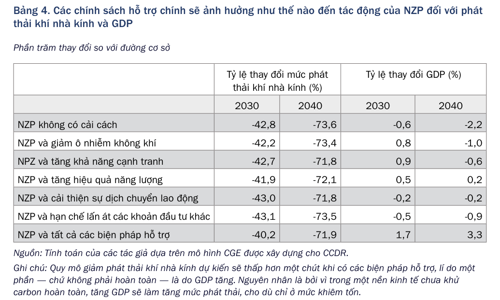
- **Evidence:** Khối NZP với cải cách, hàng Mức sản lượng tăng, cột 2022–2040
  - PDF trang 50 (số trang in: 40); vị trí: Bảng 3; giá trị: 80,1
  - chunk: CCDR-p050-B3
  - 

### ad-t20 (Multi-hop, đơn vị)

**Câu hỏi:** Với NZP không có cải cách, lượng phát thải khí nhà kính năm 2040 giảm bao nhiêu phần trăm so với đường cơ sở (Bảng 4), và chỉ số bất bình đẳng Gini năm 2040 thay đổi bao nhiêu so với BAU (Hình 18)?

**Đáp án:** Phát thải giảm 73,6% (−73,6%, Bảng 4); chỉ số Gini giảm 1,1 điểm so với BAU (−1,1, Hình 18).

**Cách chấm:** Đúng −73,6% và −1,1, gắn đúng hàng "NZP không có cải cách" và đúng cột Bất bình đẳng.

**Lý do thuộc nhóm:** Kết hợp một bảng (trang 53) và một biểu đồ cột (trang 70), hai thước đo khác nhau.

- **Evidence:** Hàng NZP không có cải cách, cột phát thải 2040
  - PDF trang 53 (số trang in: 43); vị trí: Bảng 4; giá trị: -73,6
  - chunk: CCDR-p053-B4
  - 
- **Evidence:** Cột Bất bình đẳng (chỉ số Gini)
  - PDF trang 70 (số trang in: 60); vị trí: Hình 18; giá trị: -1,1
  - chunk: CCDR-p070-H18
  - 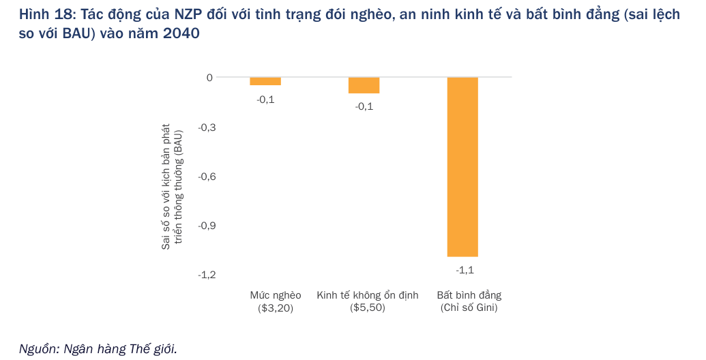

### ad-t21 (Text, điều kiện)

**Câu hỏi:** Theo dữ liệu vệ tinh, nồng độ bụi PM2.5 trung bình năm trên cả nước cao hơn ngưỡng an toàn của WHO bao nhiêu lần, và ngưỡng đó là bao nhiêu?

**Đáp án:** Cao hơn từ 4 đến 5 lần; ngưỡng an toàn WHO là 10 µg/m3.

**Cách chấm:** Đúng 4–5 lần và 10 µg/m3.

**Lý do thuộc nhóm:** Một con số có điều kiện (trung bình cả nước, theo vệ tinh) trong một đoạn văn.

- **Evidence:** Đoạn mở đầu mục ô nhiễm không khí
  - PDF trang 20 (số trang in: 10); vị trí: Đoạn đầu trang 20; giá trị: 4-5 lần; 10 µg/m3
  - chunk: CCDR-p020-t01
  - đoạn: "suất. Theo dữ liệu thu được từ quan sát vệ tinh11 và được tính trung bình cho cả nước, nồng độ bụi trung bình năm luôn cao hơn từ 4-5 lần so với ngưỡng an toàn 10 microgam hạt PM2.5 trên một mét khối thể tích không khí (μg/m3) của Tổ chức Y tế Thế giới (WHO)."

### ad-t22 (Text, điều kiện)

**Câu hỏi:** Thiệt hại nông nghiệp do biến đổi khí hậu ở Việt Nam quanh năm 2050 là bao nhiêu phần trăm theo kịch bản RCP8.5?

**Đáp án:** 10,6% (so với 7,6% theo RCP2.6 và 7,9% theo RCP4.5).

**Cách chấm:** Đúng 10,6% và đúng kịch bản RCP8.5, năm 2050.

**Lý do thuộc nhóm:** Phải chọn đúng năm (2050) và đúng kịch bản trong một đoạn có sáu giá trị.

- **Evidence:** Đoạn nêu tổn thất theo ba kịch bản RCP quanh năm 2030 và 2050
  - PDF trang 34 (số trang in: 24); vị trí: Mục 3.3.1; giá trị: 10,6%
  - chunk: CCDR-p034-t01
  - đoạn: "Thiệt hại nông nghiệp do biến đổi khí hậu ở Việt Nam được dự báo sẽ lên tới 5,6–6,2% vào năm 2030 và 7,6–10,6% vào năm 2050, tùy thuộc vào kịch bản khí hậu. Tổn thất tổng thể về sản lượng của ngành nông nghiệp được ước lượng cho từng n"

### ad-t23 (Text, tổng hợp)

**Câu hỏi:** Ngoài mục tiêu phát thải ròng bằng 0 vào năm 2050, Việt Nam đã đưa ra những cam kết nào tại COP26?

**Đáp án:** Cùng hơn 100 quốc gia cam kết chấm dứt chặt phá rừng; giảm 30% phát thải khí mêtan so với năm 2020 vào năm 2030; chấm dứt đầu tư vào sản xuất nhiệt điện than mới; mở rộng năng lượng tái tạo; dần loại bỏ nhiệt điện than cho tới thập kỷ 2040.

**Cách chấm:** Đạt khi nêu đúng ít nhất bốn trong năm cam kết, gồm khí mêtan −30% vào 2030 và chấm dứt đầu tư nhiệt điện than mới.

**Lý do thuộc nhóm:** Tổng hợp một danh sách cam kết nằm trong một đoạn văn dài.

- **Evidence:** Đoạn nêu các cam kết tại COP26
  - PDF trang 23 (số trang in: 13); vị trí: Mục 2.1; giá trị: rừng; mêtan 30%; chấm dứt nhiệt điện than mới; năng lượng tái tạo; loại bỏ than 2040s
  - chunk: CCDR-p023-t02
  - đoạn: "toàn cầu với biến đổi khí hậu.15 Cũng tại COP26, Việt Nam cùng với hơn 100 quốc gia đã cam kết chấm dứt nạn chặt phá rừng và giảm 30% phát thải khí mêtan so với năm 2020 vào năm 2030.16 Ngoài ra, Việt Nam cũng đã cam kết chấm dứt mọi hoạt động đầu tư vào sản x"

### ad-t24 (Text, điều kiện)

**Câu hỏi:** Việt Nam hiện nhập khoảng bao nhiêu triệu tấn than mỗi năm (ước tính năm 2022) và nguồn cung trong nước là bao nhiêu?

**Đáp án:** Khoảng 55 triệu tấn than nhập khẩu mỗi năm; khoảng 40 triệu tấn do trong nước cung cấp.

**Cách chấm:** Đúng 55 và 40 triệu tấn, gắn đúng nhập khẩu và trong nước.

**Lý do thuộc nhóm:** Hai con số cho hai nguồn, kèm điều kiện năm ước tính.

- **Evidence:** Đoạn nêu lượng than nhập khẩu và trong nước
  - PDF trang 58 (số trang in: 48); vị trí: Mục 4.3.1; giá trị: 55; 40
  - chunk: CCDR-p058-t02
  - đoạn: "Với nguồn lực trong nước hạn chế, Việt Nam ngày càng phụ thuộc vào than nhập khẩu để sản xuất điện. Việt Nam hiện nhập khoảng 55 triệu tấn than hàng năm (ước tính năm 2022) và số còn lại (khoảng 40 triệu tấn) do trong nước cung cấp. Khoảng 72% than tiêu th"

### ad-t25 (Thiếu bằng chứng)

**Câu hỏi:** Tại COP28, Việt Nam đã công bố cam kết mới nào về loại bỏ nhiệt điện than?

**Hành vi mong đợi:** Từ chối: tài liệu không có thông tin này; không thêm khẳng định vô căn cứ.

**Vì sao không trả lời được:** Báo cáo xuất bản 07/2022, trước COP28; chỉ nêu cam kết tại COP26.

**Từ khóa đã tìm trong toàn bộ tài liệu (0 kết quả):** cop28, cop27

**Gần chủ đề ở:** p23, p54: cam kết tại COP26 về than

### ad-t26 (Thiếu bằng chứng)

**Câu hỏi:** Thiệt hại do biến đổi khí hậu năm 2020 của tỉnh Bến Tre là bao nhiêu triệu USD?

**Hành vi mong đợi:** Từ chối: tài liệu không có thông tin này; không thêm khẳng định vô căn cứ.

**Vì sao không trả lời được:** Báo cáo chỉ nêu thiệt hại cấp quốc gia và theo hạng mục (Hình 3), không theo tỉnh.

**Từ khóa đã tìm trong toàn bộ tài liệu (0 kết quả):** bến tre

**Gần chủ đề ở:** p17, Hình 3: thiệt hại 2020 cấp quốc gia

### ad-t27 (Thiếu bằng chứng)

**Câu hỏi:** Chi phí thu giữ và lưu trữ carbon (CCS) trong ngành điện là bao nhiêu USD cho mỗi tấn CO2?

**Hành vi mong đợi:** Từ chối: tài liệu không có thông tin này; không thêm khẳng định vô căn cứ.

**Vì sao không trả lời được:** Báo cáo chỉ nói quy hoạch điện có thể đánh giá tiềm năng thu giữ và lưu trữ carbon và mô hình không tính các công nghệ này; không nêu chi phí.

**Từ khóa đã tìm trong toàn bộ tài liệu (0 kết quả):** ccs, chi phí thu giữ, chi phí lưu trữ các-bon

**Gần chủ đề ở:** p55, p61: nhắc tới thu giữ và lưu trữ carbon, không có chi phí

### ad-t28 (Thiếu bằng chứng)

**Câu hỏi:** Việt Nam hiện có bao nhiêu nhà máy sản xuất hydro xanh đang vận hành?

**Hành vi mong đợi:** Từ chối: tài liệu không có thông tin này; không thêm khẳng định vô căn cứ.

**Vì sao không trả lời được:** Báo cáo không đề cập hydro.

**Từ khóa đã tìm trong toàn bộ tài liệu (0 kết quả):** hydro, hydrogen

**Gần chủ đề ở:** p53-58: chuyển đổi ngành năng lượng

### ad-t29 (Thiếu bằng chứng)

**Câu hỏi:** Tỷ lệ hộ gia đình ở tỉnh An Giang có nguy cơ rơi vào nghèo do thiên tai là bao nhiêu phần trăm?

**Hành vi mong đợi:** Từ chối: tài liệu không có thông tin này; không thêm khẳng định vô căn cứ.

**Vì sao không trả lời được:** Báo cáo chỉ nêu tỷ lệ cấp quốc gia (khoảng 10%) và theo vùng, không có An Giang.

**Từ khóa đã tìm trong toàn bộ tài liệu (0 kết quả):** an giang

**Gần chủ đề ở:** p43: khoảng 10% hộ gia đình dễ rơi vào nghèo do khí hậu

### ad-t30 (Thiếu bằng chứng)

**Câu hỏi:** VinFast đã bán được bao nhiêu xe điện trong năm 2021?

**Hành vi mong đợi:** Từ chối: tài liệu không có thông tin này; không thêm khẳng định vô căn cứ.

**Vì sao không trả lời được:** Báo cáo chỉ nêu doanh số xe điện cả nước (khoảng 1,9 triệu chiếc năm 2020), không nêu hãng nào hay năm 2021.

**Từ khóa đã tìm trong toàn bộ tài liệu (0 kết quả):** vinfast

**Gần chủ đề ở:** p64: doanh số xe điện cả nước 2010-2020

