# Review sheet: dev

Grade each answer against the evidence and the picture; fill in review_labels.csv.

## ad-d01 (bang, answerable)

**Question:** Trong Bảng 1 (so sánh phát thải giữa các nước), nước nào có phát thải carbon trên mỗi triệu USD GDP cao nhất và giá trị đó là bao nhiêu?

**Expected:** Đông Timor, 4.271,0 tCO2e/triệu $GDP (cao hơn Mông Cổ 4.250,9).

**Grading:** Đúng nước và giá trị (4.271,0), đúng cột phát thải carbon tCO2e/triệu $GDP. Chọn Mông Cổ là sai.

- Evidence: Hàng Đông Timor, cột Phát thải Carbon (tCO2e/triệu $GDP) (PDF page 19, Bảng 1, hàng Đông Timor, cột 3): 4.271,0
  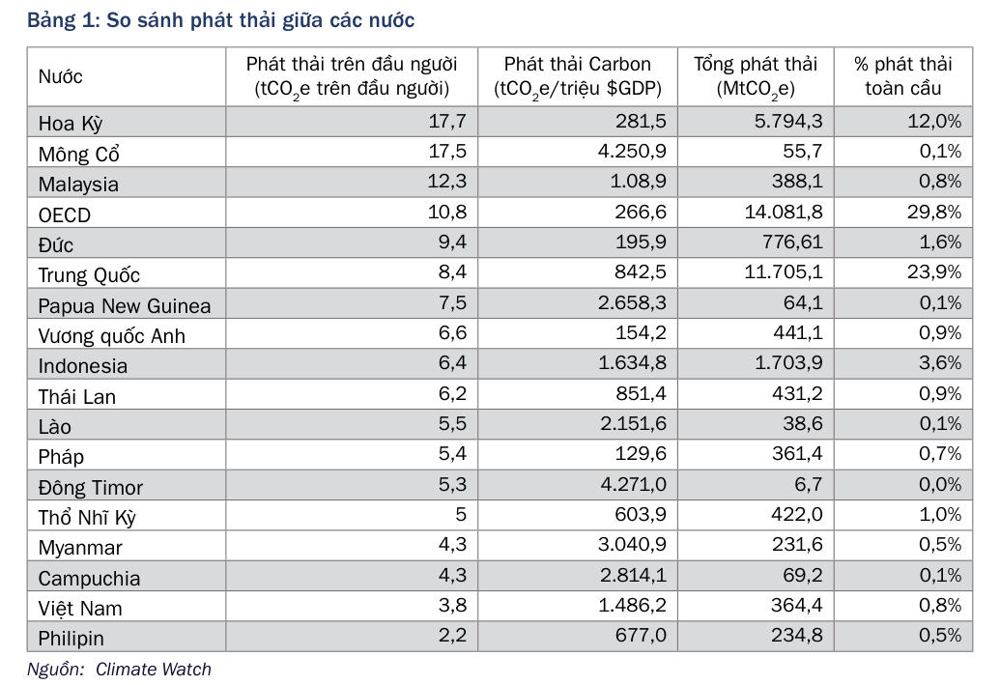

### V0_dense: answered (1 searches, 0 looks)

Theo Bảng 1, Đông Timor có phát thải carbon cao nhất: 4.271,0 tCO2e trên triệu USD GDP [CCDR-p019-B1]. Mông Cổ đứng ngay sau với 4.250,9 [CCDR-p019-B1]. Giá trị được đọc từ bảng như in trong báo cáo, chưa kiểm chứng với nguồn gốc dữ liệu Climate Watch.

- cited CCDR-p019-B1 (PDF page 19, printed 9)
  
- evidence in context: True

### V1_rerank: answered (1 searches, 0 looks)

Đông Timor có phát thải carbon cao nhất trong Bảng 1: 4.271,0 tCO2e trên triệu USD GDP. Mông Cổ đứng ngay sau với 4.250,9 [CCDR-p019-B1]. Lưu ý, bảng ghi "1.08,9" cho Malaysia và "776,61" cho Đức, có thể là lỗi định dạng, nhưng không ảnh hưởng đến kết luận này.

- cited CCDR-p019-B1 (PDF page 19, printed 9)
  
- evidence in context: True

### V2_rerank_look: answered (1 searches, 1 looks)

Đông Timor có phát thải carbon cao nhất trong Bảng 1: 4.271,0 tCO2e trên triệu USD GDP [CCDR-p019-B1]. Mông Cổ đứng ngay sau với 4.250,9 [CCDR-p019-B1]. Lưu ý: giá trị của Malaysia in là "1.08,9" trong bảng, có thể là lỗi định dạng, nhưng không ảnh hưởng đến kết luận về nước cao nhất.

- look CCDR-p019-B1: *Cột "Phát thải Carbon (tCO2e/triệu $GDP)": đọc giá trị của tất cả các nước, đặc biệt là Mông Cổ, Papua New Guinea, Đông Timor, Lào, Campuchia, Myanmar. Nước nào có giá trị cao nhất?* -> **Nước có giá trị cao nhất: Đông Timor, 4.271,0 tCO₂e/triệu $GDP.** Mông Cổ đứng ngay sau với 4.250,9.

Giá trị của các nước trong cột "Phát thải Carbon (tCO₂e/triệu $GDP)":

- Đông Timor: 4.271,0
- Mông Cổ: 4.250,9
- Myanmar: 3.040,9
- Papua New Guinea: 2.658,3
- Campuchia: 2.814,1
- Lào: 2.151,6
- Indonesia: 1.634,8
- Việt Nam: 1.486,2
- Malaysia: "1.08,9" (số in trên hình không rõ ràng, có thể là lỗi in)
- Thái Lan: 851,4
- Trung Quốc: 842,5
- Philipin: 677,0
- Thổ Nhĩ Kỳ: 603,9
- OECD: 266,6
- Hoa Kỳ: 281,5
- Vương quốc Anh: 154,2
- Đức: 195,9
- Pháp: 129,6
- cited CCDR-p019-B1 (PDF page 19, printed 9)
  
- evidence in context: True

## ad-d02 (bang, answerable)

**Question:** Theo Bảng 5, tổng chi phí ròng (sau khi trừ khoản tiết kiệm chi phí nhiên liệu) tăng bao nhiêu tỷ USD và bao nhiêu phần trăm?

**Expected:** Tăng 33 tỷ USD, tương ứng +13%.

**Grading:** Cả hai giá trị (+33 tỷ USD; +13%) và đúng hàng "Tổng chi phí ròng" (không phải "Tổng chi phí" +65 / +56%).

- Evidence: Hàng Tổng chi phí ròng của Bảng 5, ở phần bảng tiếp trang sau (PDF page 57, Bảng 5 (tiếp), hàng 11): +33; +13%
  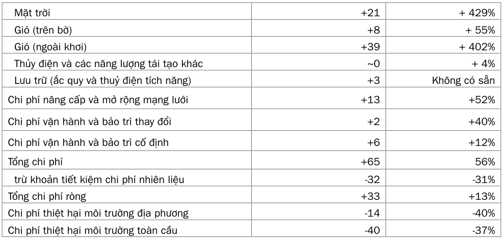

### V0_dense: answered (2 searches, 0 looks)

Theo Bảng 5 (kịch bản tăng tốc khử carbon ADS, 2022–2040, so với CPS), dòng "Tổng chi phí ròng" (sau khi trừ khoản tiết kiệm chi phí nhiên liệu) là +33 tỷ USD, tương ứng +13% [CCDR-p057-B5c]. Cụ thể: tổng chi phí +65 tỷ USD (+56%), trừ tiết kiệm chi phí nhiên liệu -32 tỷ USD (-31%), còn lại +33 tỷ USD [CCDR-p057-B5c]. Văn bản báo cáo cũng nêu nhu cầu đầu tư thuần ước 33 tỷ USD, tương ứng mức biến động 13% [CCDR-p056-t01]. Lưu ý: đoạn trích bảng không ghi rõ đơn vị ở dòng này; đơn vị tỷ USD được suy ra từ tiêu đề bảng và đoạn văn bản liền kề.

- cited CCDR-p057-B5c (PDF page 57, printed 47)
  
- cited CCDR-p056-t01 (PDF page 56, printed 46)
- evidence in context: True

### V1_rerank: answered (1 searches, 0 looks)

Theo Bảng 5 (kịch bản tăng tốc khử carbon ADS, 2022–2040, tính theo NPV so với kịch bản CPS), tổng chi phí ròng sau khi trừ khoản tiết kiệm chi phí nhiên liệu tăng khoảng 33 tỷ USD, tương đương +13% [CCDR-p057-B5c]. Cách tính: tổng chi phí +65 tỷ USD, trừ tiết kiệm nhiên liệu -32 tỷ USD, còn +33 tỷ USD [CCDR-p057-B5c]. Văn bản đi kèm cũng nêu nhu cầu đầu tư thuần khoảng 33 tỷ USD, tức mức biến động 13% [CCDR-p056-t01].

- cited CCDR-p057-B5c (PDF page 57, printed 47)
  
- cited CCDR-p056-t01 (PDF page 56, printed 46)
- evidence in context: True

### V2_rerank_look: answered (1 searches, 1 looks)

Theo Bảng 5 (kịch bản tăng tốc khử carbon ADS, 2022–2040, giá trị NPV so với kịch bản CPS), tổng chi phí ròng sau khi trừ tiết kiệm chi phí nhiên liệu tăng khoảng 33 tỷ USD, tương ứng +13%. Cụ thể: tổng chi phí +65 tỷ USD (56%), trừ tiết kiệm nhiên liệu −32 tỷ USD (−31%) [CCDR-p057-B5c]. Đoạn văn bản cũng nêu nhu cầu đầu tư thuần ước 33 tỷ USD, tương ứng mức biến động 13% [CCDR-p056-t01].

- look CCDR-p057-B5c: *Đọc chính xác giá trị (tỷ USD) và phần trăm ở hàng "Tổng chi phí ròng" và hàng "Tổng chi phí", "trừ khoản tiết kiệm chi phí nhiên liệu".* -> **Tổng chi phí ròng:** +33 tỷ USD, tương ứng +13%.

**Tổng chi phí:** +65 tỷ USD, tương ứng 56%.

**Khoản trừ "tiết kiệm chi phí nhiên liệu":** -32 tỷ USD, tương ứng -31%.

Hình không in đơn vị tỷ USD; đơn vị này theo câu hỏi và tiêu đề bảng.
- cited CCDR-p057-B5c (PDF page 57, printed 47)
  
- cited CCDR-p056-t01 (PDF page 56, printed 46)
- evidence in context: True

## ad-d03 (bang, answerable)

**Question:** Trong bảng so sánh lượng khí thải ước tính của Việt Nam theo từng nguồn thông tin (Phụ lục 3), nguồn nào cho ước tính thấp nhất và thấp hơn con số của Chính phủ (NDC cập nhật 2020) bao nhiêu triệu tấn CO2?

**Expected:** Climate Transparency (2018): 61 triệu tấn CO2; thấp hơn NDC cập nhật (104,5) 43,5 triệu tấn CO2.

**Grading:** Đúng nguồn (61) và đúng hiệu 104,5 − 61 = 43,5.

- Evidence: Bảng ước tính lượng khí thải theo nguồn (PDF page 98, Bảng cuối Phụ lục 3 (không có số hiệu), cột 2): 61; 104,5
  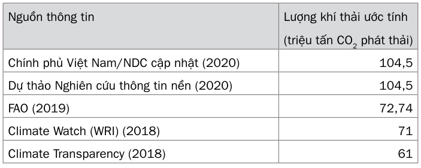

### V0_dense: answered (2 searches, 0 looks)

Nguồn cho ước tính thấp nhất là Climate Transparency (2018), với 61 triệu tấn CO2 [CCDR-p098-bang]. Con số của Chính phủ (NDC cập nhật 2020) là 104,5 triệu tấn CO2 [CCDR-p098-bang]. Chênh lệch là 104,5 − 61 = 43,5 triệu tấn CO2.

Lưu ý: bảng trên trang PDF 98 không có tiêu đề và không ghi rõ là Phụ lục 3, nên việc xác nhận đây là bảng đúng trong Phụ lục 3 chưa được kiểm chứng từ các đoạn tìm được. Đoạn văn cùng trang cho biết 104,5 triệu tấn CO2e trong NDC là số dự báo của kịch bản BAU năm 2020 dùng mức phát thải thực tế năm 2014, và chênh lệch chủ yếu nằm ở phát thải nông nghiệp [CCDR-p098-t04].

- cited CCDR-p098-bang (PDF page 98, printed 88)
  
- cited CCDR-p098-t04 (PDF page 98, printed 88)
- evidence in context: True

### V1_rerank: answered (1 searches, 0 looks)

Nguồn cho ước tính thấp nhất là Climate Transparency (2018), với 61 triệu tấn CO2. Con số của Chính phủ Việt Nam (NDC cập nhật 2020) là 104,5 triệu tấn CO2 [CCDR-p098-bang]. Chênh lệch là 104,5 − 61 = 43,5 triệu tấn CO2 [CCDR-p098-bang]. Bảng này nằm ở trang PDF 98; kết quả tìm kiếm không xác nhận nhãn "Phụ lục 3" nhưng nội dung khớp với câu hỏi.

- cited CCDR-p098-bang (PDF page 98, printed 88)
  
- evidence in context: True

### V2_rerank_look: answered (2 searches, 1 looks)

Nguồn cho ước tính thấp nhất là Climate Transparency (2018): 61 triệu tấn CO2 [CCDR-p098-bang]. Con số của Chính phủ (NDC cập nhật 2020) là 104,5 triệu tấn CO2 [CCDR-p098-bang]. Như vậy, ước tính của Climate Transparency thấp hơn 43,5 triệu tấn CO2 (104,5 − 61 = 43,5) [CCDR-p098-bang]. Lưu ý: bảng này không có tiêu đề ghi "Phụ lục 3" trong phần đã truy xuất; nó nằm ở trang PDF 98, trong phần bàn về chênh lệch giữa số liệu quốc gia báo cáo và cơ sở dữ liệu công khai. Đoạn văn cùng trang giải thích rằng 104,5 triệu tấn CO2e trong NDC là số dự báo của kịch bản BAU 2020 dựa trên mức phát thải nông nghiệp thực tế năm 2014 [CCDR-p098-t04].

- look CCDR-p098-bang: *Đọc chính xác các giá trị cột "Lượng khí thải ước tính (triệu tấn CO2 phát thải)" cho từng nguồn thông tin, đặc biệt là dòng Chính phủ/NDC cập nhật (2020) và dòng có giá trị thấp nhất.* -> Bảng gồm 5 nguồn, cột "Lượng khí thải ước tính (triệu tấn CO2 phát thải)":

- Chính phủ Việt Nam/NDC cập nhật (2020): **104,5 triệu tấn CO2**
- Dự thảo Nghiên cứu thông tin nền (2020): **104,5 triệu tấn CO2**
- FAO (2019): **72,74 triệu tấn CO2**
- Climate Watch (WRI) (2018): **71 triệu tấn CO2**
- Climate Transparency (2018): **61 triệu tấn CO2** (giá trị thấp nhất)
- cited CCDR-p098-bang (PDF page 98, printed 88)
  
- cited CCDR-p098-t04 (PDF page 98, printed 88)
- evidence in context: True

## ad-d04 (anh_so_do, answerable)

**Question:** Mô hình phát triển mới cho Việt Nam trong Hình 1 gồm hai lộ trình nào?

**Expected:** Lộ trình xây dựng khả năng chống chịu và Lộ trình khử carbon.

**Grading:** Nêu đủ hai lộ trình, đúng tên.

- Evidence: Hai mũi tên bên trái và bên phải của sơ đồ Hình 1 (PDF page 13, Hình 1): Lộ trình xây dựng khả năng chống chịu; Lộ trình khử carbon
  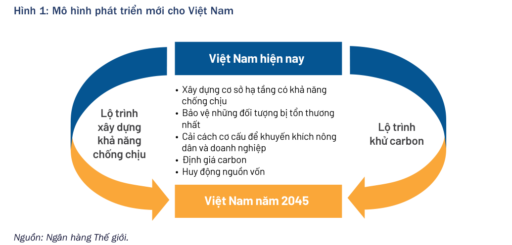

### V0_dense: answered (1 searches, 0 looks)

Hình 1 thể hiện mô hình phát triển mới đi từ "Việt Nam hiện nay" đến "Việt Nam năm 2045" qua hai lộ trình song song: (1) lộ trình xây dựng khả năng chống chịu và (2) lộ trình khử carbon [CCDR-p013-H1]. Năm nhóm giải pháp nằm giữa hai lộ trình gồm: xây dựng cơ sở hạ tầng có khả năng chống chịu, bảo vệ những đối tượng bị tổn thương nhất, cải cách cơ cấu để khuyến khích nông dân và doanh nghiệp, định giá carbon, và huy động nguồn vốn [CCDR-p013-H1].

- cited CCDR-p013-H1 (PDF page 13, printed 3)
  
- evidence in context: True

### V1_rerank: answered (1 searches, 0 looks)

Hình 1 thể hiện mô hình phát triển mới đi từ "Việt Nam hiện nay" đến "Việt Nam năm 2045" qua hai lộ trình song song: (1) lộ trình xây dựng khả năng chống chịu (bên trái) và (2) lộ trình khử carbon (bên phải) [CCDR-p013-H1]. Theo phần dẫn của báo cáo, mô hình này kết hợp hai lộ trình nhằm cân bằng mục tiêu phát triển với rủi ro khí hậu đang gia tăng [CCDR-p012-t02]. Năm nhóm giải pháp ở giữa hình (hạ tầng có khả năng chống chịu, bảo vệ nhóm dễ bị tổn thương, cải cách cơ cấu hỗ trợ nông dân và doanh nghiệp, định giá carbon, huy động nguồn vốn) được ghi chung cho cả hai lộ trình [CCDR-p013-H1].

- cited CCDR-p013-H1 (PDF page 13, printed 3)
  
- cited CCDR-p012-t02 (PDF page 12, printed 2)
- evidence in context: True

### V2_rerank_look: answered (1 searches, 0 looks)

Hình 1 thể hiện mô hình phát triển mới cho Việt Nam, đi từ "Việt Nam hiện nay" đến "Việt Nam năm 2045", kết hợp hai lộ trình: (1) lộ trình xây dựng khả năng chống chịu (khí hậu) và (2) lộ trình khử carbon [CCDR-p013-H1]. Báo cáo nêu mô hình này kết hợp hai lộ trình nhằm cân bằng mục tiêu phát triển với rủi ro khí hậu gia tăng [CCDR-p012-t02]. Năm nhóm giải pháp nằm giữa hai lộ trình gồm: xây dựng cơ sở hạ tầng có khả năng chống chịu, bảo vệ những đối tượng bị tổn thương nhất, cải cách cơ cấu để khuyến khích nông dân và doanh nghiệp, định giá carbon, và huy động nguồn vốn [CCDR-p013-H1].

- cited CCDR-p013-H1 (PDF page 13, printed 3)
  
- cited CCDR-p012-t02 (PDF page 12, printed 2)
- evidence in context: True

## ad-d05 (anh_so_do, answerable)

**Question:** Trong sơ đồ Hình 1, danh sách các hành động ở giữa có mấy mục và mục thứ tư là gì?

**Expected:** Có 5 mục; mục thứ tư là "Định giá carbon".

**Grading:** Đúng số mục (5) và đúng mục thứ tư (Định giá carbon).

- Evidence: Danh sách gạch đầu dòng giữa hai khối "Việt Nam hiện nay" và "Việt Nam năm 2045" (PDF page 13, Hình 1, danh sách giữa): 5 mục; thứ tư: Định giá carbon
  

### V0_dense: answered (4 searches, 0 looks)

Hình 1 (Mô hình phát triển mới cho Việt Nam) có 5 mục ở giữa sơ đồ, và mục thứ tư là "Định giá carbon". Các mục theo thứ tự là: xây dựng cơ sở hạ tầng có khả năng chống chịu; bảo vệ những đối tượng bị tổn thương nhất; cải cách cơ cấu để khuyến khích nông dân và doanh nghiệp; định giá carbon; huy động nguồn vốn [CCDR-p013-H1]. Đây là mô tả từ kết quả tìm kiếm của hình, và hình không thể hiện thứ tự thời gian hay mức độ ưu tiên.

- cited CCDR-p013-H1 (PDF page 13, printed 3)
  
- evidence in context: True

### V1_rerank: answered (1 searches, 0 looks)

Danh sách ở giữa Hình 1 có 5 mục. Mục thứ tư là "Định giá carbon" [CCDR-p013-H1]. Thứ tự đầy đủ: xây dựng cơ sở hạ tầng có khả năng chống chịu; bảo vệ những đối tượng bị tổn thương nhất; cải cách cơ cấu để khuyến khích nông dân và doanh nghiệp; định giá carbon; huy động nguồn vốn [CCDR-p013-H1].

- cited CCDR-p013-H1 (PDF page 13, printed 3)
  
- evidence in context: True

### V2_rerank_look: answered (1 searches, 1 looks)

Danh sách ở giữa Hình 1 có 5 mục: (1) xây dựng cơ sở hạ tầng có khả năng chống chịu; (2) bảo vệ những đối tượng bị tổn thương nhất; (3) cải cách cơ cấu để khuyến khích nông dân và doanh nghiệp; (4) định giá carbon; (5) huy động nguồn vốn. Mục thứ tư là "Định giá carbon" [CCDR-p013-H1].

- look CCDR-p013-H1: *Đếm số gạch đầu dòng ở giữa hai hộp "Việt Nam hiện nay" và "Việt Nam năm 2045". Đọc đúng nội dung từng mục theo thứ tự từ trên xuống.* -> Có 5 gạch đầu dòng giữa hai hộp "Việt Nam hiện nay" và "Việt Nam năm 2045", theo thứ tự từ trên xuống:

1. Xây dựng cơ sở hạ tầng có khả năng chống chịu
2. Bảo vệ những đối tượng bị tổn thương nhất
3. Cải cách cơ cấu để khuyến khích nông dân và doanh nghiệp
4. Định giá carbon
5. Huy động nguồn vốn
- cited CCDR-p013-H1 (PDF page 13, printed 3)
  
- evidence in context: True

## ad-d06 (anh_so_do, answerable)

**Question:** Theo sơ đồ Hình 21, khu vực nào cần nhiều tài chính nhất trong tổng nhu cầu 2022–2040, cần bao nhiêu tỷ USD và tương đương khoảng bao nhiêu phần trăm GDP mỗi năm?

**Expected:** Khu vực tư nhân: 184 tỷ USD, khoảng 3,4% GDP mỗi năm (so với khu vực công 130 tỷ USD, bên ngoài 54 tỷ USD).

**Grading:** Đúng khu vực (tư nhân), 184 tỷ USD và ~3,4% GDP/năm.

- Evidence: Ba ô nguồn tài chính dưới ô nhu cầu tài chính 368 tỷ USD (PDF page 77, Hình 21, ô KHU VỰC TƯ NHÂN): 184 tỷ USD; ~3,4% GDP mỗi năm
  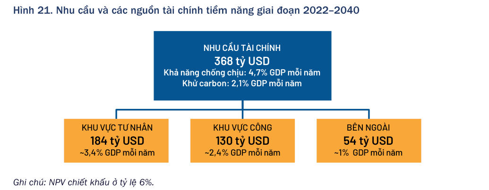

### V0_dense: answered (1 searches, 0 looks)

Theo Hình 21, khu vực tư nhân cần nhiều tài chính nhất: 184 tỷ USD, khoảng 3,4% GDP mỗi năm [CCDR-p077-H21]. So với tổng nhu cầu tài chính 368 tỷ USD giai đoạn 2022–2040 (NPV chiết khấu 6%) [CCDR-p077-H21], khu vực công là 130 tỷ USD (~2,4% GDP mỗi năm) và nguồn bên ngoài là 54 tỷ USD (~1% GDP mỗi năm) [CCDR-p077-H21]. Tổng nhu cầu được chia thành hai mục tiêu: khả năng chống chịu 4,7% GDP mỗi năm và khử carbon 2,1% GDP mỗi năm [CCDR-p077-H21]. Lưu ý: các tỷ lệ % GDP là giá trị in trên hình, không tự tính lại từ dữ liệu GDP.

- cited CCDR-p077-H21 (PDF page 77, printed 67)
  
- evidence in context: True

### V1_rerank: answered (1 searches, 0 looks)

Khu vực tư nhân cần nhiều tài chính nhất: 184 tỷ USD, khoảng 3,4% GDP mỗi năm [CCDR-p077-H21]. Tổng nhu cầu là 368 tỷ USD; khu vực công là 130 tỷ USD (khoảng 2,4% GDP mỗi năm) và bên ngoài là 54 tỷ USD (khoảng 1% GDP mỗi năm) [CCDR-p077-H21]. Các số này là NPV chiết khấu ở tỷ lệ 6% [CCDR-p077-H21].

- cited CCDR-p077-H21 (PDF page 77, printed 67)
  
- evidence in context: True

### V2_rerank_look: answered (1 searches, 1 looks)

Theo Hình 21, khu vực tư nhân là nguồn tài chính lớn nhất: 184 tỷ USD cho cả giai đoạn 2022–2040 (NPV chiết khấu 6%), tương đương khoảng 3,4% GDP mỗi năm [CCDR-p077-H21]. Để so sánh, khu vực công là 130 tỷ USD (~2,4% GDP/năm) và bên ngoài là 54 tỷ USD (~1% GDP/năm). Ba nguồn này cộng lại bằng tổng nhu cầu 368 tỷ USD [CCDR-p077-H21]. Lưu ý: con số 184 tỷ USD là tổng cho cả giai đoạn; tỷ lệ % GDP là mức trung bình mỗi năm.

- look CCDR-p077-H21: *Đọc chính xác các con số: tổng nhu cầu tài chính, và số tỷ USD cùng % GDP mỗi năm của khu vực tư nhân, khu vực công và bên ngoài.* -> **Tổng nhu cầu tài chính:** 368 tỷ USD (giai đoạn 2022–2040, NPV chiết khấu ở tỷ lệ 6%). Ngoài ra, hình ghi khả năng chống chịu 4,7% GDP mỗi năm và khử carbon 2,1% GDP mỗi năm.

**Phân bổ theo nguồn:**

| Nguồn | Số tiền | % GDP mỗi năm |
|---|---|---|
| Khu vực tư nhân | 184 tỷ USD | ~3,4% |
| Khu vực công | 130 tỷ USD | ~2,4% |
| Bên ngoài | 54 tỷ USD | ~1% |

Ba nguồn cộng lại bằng 368 tỷ USD.

Hình không ghi số tỷ USD theo từng năm. Các con số 184, 130 và 54 tỷ USD là tổng cho cả giai đoạn, còn cột % GDP là mức trung bình mỗi năm.
- cited CCDR-p077-H21 (PDF page 77, printed 67)
  
- evidence in context: True

## ad-d07 (bieu_do, answerable)

**Question:** Cộng tất cả các hạng mục trong Hình 3 thì tổng chi phí ước tính do biến đổi khí hậu năm 2020 là bao nhiêu triệu USD, và hạng mục nào lớn nhất?

**Expected:** 10.903 triệu USD (4.219 + 2.807 + 1.474 + 837 + 518 + 447 + 235 + 218 + 148); lớn nhất là Thủy sản (4.219 triệu USD).

**Grading:** Tổng 10.903 (dung sai ±0 vì các số in rõ) và hạng mục lớn nhất là Thủy sản.

- Evidence: Chín ô của biểu đồ treemap, mỗi ô ghi giá trị (PDF page 17, Hình 3): 4219; 2807; 1474; 837; 518; 447; 235; 218; 148
  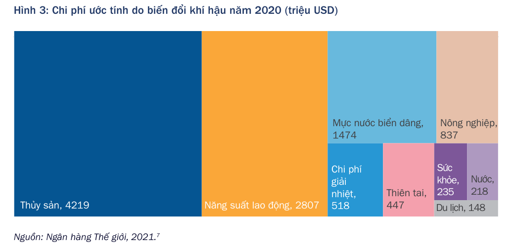

### V0_dense: answered (1 searches, 0 looks)

Tổng cộng khoảng 10.903 triệu USD. Phép cộng từ các giá trị trong Hình 3 (triệu USD): Thủy sản 4.219 + Năng suất lao động 2.807 + Mực nước biển dâng 1.474 + Nông nghiệp 837 + Chi phí giải nhiệt 518 + Thiên tai 447 + Sức khỏe 235 + Nước 218 + Du lịch 148 = 10.903 [CCDR-p017-H3].

Hạng mục lớn nhất là Thủy sản, với 4.219 triệu USD, khoảng 39% tổng [CCDR-p017-H3]. Lưu ý: các giá trị được đọc từ nhãn của biểu đồ treemap; tổng và tỷ lệ được tính từ các nhãn đó.

- cited CCDR-p017-H3 (PDF page 17, printed 7)
  
- evidence in context: True

### V1_rerank: answered (1 searches, 0 looks)

Tổng chi phí ước tính do biến đổi khí hậu năm 2020 trong Hình 3 là khoảng 10.903 triệu USD. Phép cộng: 4219 + 2807 + 1474 + 837 + 518 + 447 + 235 + 218 + 148 = 10.903 (triệu USD) [CCDR-p017-H3]. Con số này khớp với đoạn văn nêu thiệt hại khoảng 10 tỷ USD, tương đương 3,2% GDP [CCDR-p017-t01]. Hạng mục lớn nhất là Thủy sản, 4.219 triệu USD [CCDR-p017-H3]. Lưu ý: các giá trị được đọc từ nhãn của biểu đồ treemap, không có trục số liệu riêng.

- cited CCDR-p017-H3 (PDF page 17, printed 7)
  
- cited CCDR-p017-t01 (PDF page 17, printed 7)
- evidence in context: True

### V2_rerank_look: answered (1 searches, 1 looks)

Tổng các hạng mục trong Hình 3 là 10.903 triệu USD (năm 2020), tức khoảng 10,9 tỷ USD. Các giá trị đọc từ hình: Thủy sản 4.219; Năng suất lao động 2.807; Mực nước biển dâng 1.474; Nông nghiệp 837; Chi phí giải nhiệt 518; Thiên tai 447; Sức khỏe 235; Nước 218; Du lịch 148 (triệu USD). Phép cộng: 4219 + 2807 + 1474 + 837 + 518 + 447 + 235 + 218 + 148 = 10.903 [CCDR-p017-H3]. Hạng mục lớn nhất là Thủy sản, với 4.219 triệu USD [CCDR-p017-H3]. Lưu ý: văn bản ghi thiệt hại năm 2020 khoảng 10 tỷ USD, tương đương 3,2% GDP; con số này làm tròn khác với tổng 10,9 tỷ trong hình [CCDR-p017-t01].

- look CCDR-p017-H3: *Đọc giá trị (triệu USD) của từng ô trong treemap: Thủy sản, Năng suất lao động, Mực nước biển dâng, Nông nghiệp, Chi phí giải nhiệt, Thiên tai, Sức khỏe, Nước, Du lịch. Ghi đúng số trên từng ô.* -> Giá trị in trên từng ô (triệu USD, năm 2020):

- Thủy sản: 4219
- Năng suất lao động: 2807
- Mực nước biển dâng: 1474
- Nông nghiệp: 837
- Chi phí giải nhiệt: 518
- Thiên tai: 447
- Sức khỏe: 235
- Nước: 218
- Du lịch: 148
- cited CCDR-p017-H3 (PDF page 17, printed 7)
  
- cited CCDR-p017-t01 (PDF page 17, printed 7)
- evidence in context: True

## ad-d08 (bieu_do, answerable)

**Question:** Trong Hình 6, bao nhiêu phần trăm doanh nghiệp cho biết tác động "Thiếu nguồn cung nguyên liệu đầu vào" ở mức "Hầu như không"?

**Expected:** 33%.

**Grading:** Đúng 33% và đúng hàng "Thiếu nguồn cung nguyên liệu đầu vào", mức "Hầu như không" (đoạn xanh đậm).

- Evidence: Hàng cuối của biểu đồ cột chồng, đoạn đầu (Hầu như không) (PDF page 25, Hình 6, hàng Thiếu nguồn cung nguyên liệu đầu vào): 33
  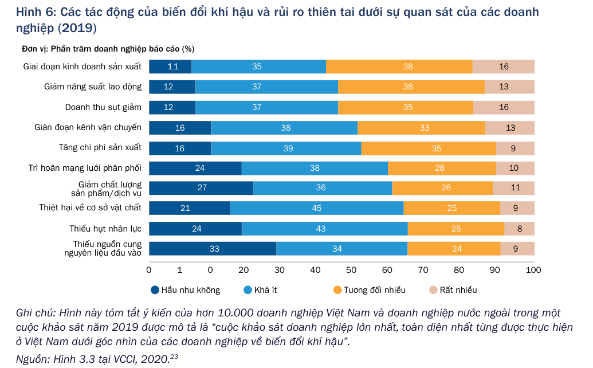

### V0_dense: answered (1 searches, 0 looks)

Khoảng 33% doanh nghiệp cho biết tác động "Thiếu nguồn cung nguyên liệu đầu vào" ở mức "Hầu như không" (đơn vị: % doanh nghiệp báo cáo, năm 2019) [CCDR-p025-H6]. Lưu ý: con số này được suy ra từ thứ tự nhãn số trong chữ trích của hình (hàng cuối: 33/34/24/9, tổng 100%), nên nên đối chiếu với hình gốc để xác nhận.

- cited CCDR-p025-H6 (PDF page 25, printed 15)
  
- evidence in context: True

### V1_rerank: answered (1 searches, 0 looks)

Khoảng 33% doanh nghiệp cho biết tác động "Thiếu nguồn cung nguyên liệu đầu vào" ở mức "Hầu như không" (năm 2019, đơn vị: phần trăm doanh nghiệp báo cáo) [CCDR-p025-H6]. Lưu ý: chữ trích từ hình không ghi rõ từng số thuộc hàng nào. Tôi suy ra số này là hàng cuối cùng dựa trên thứ tự các nhóm số và tổng 4 mức của mỗi hàng đều bằng 100%, nên cần đối chiếu với hình gốc để chắc chắn.

- cited CCDR-p025-H6 (PDF page 25, printed 15)
  
- evidence in context: True

### V2_rerank_look: answered (1 searches, 1 looks)

Khoảng 33% doanh nghiệp cho biết tác động "Thiếu nguồn cung nguyên liệu đầu vào" ở mức "Hầu như không" (khảo sát năm 2019, đơn vị: % doanh nghiệp báo cáo). Các mức còn lại của hàng này là 34% (Khá ít), 24% (Tương đối nhiều) và 9% (Rất nhiều) [CCDR-p025-H6].

- look CCDR-p025-H6: *Với hàng "Thiếu nguồn cung nguyên liệu đầu vào" (hàng cuối cùng), cột "Hầu như không" (màu xanh đậm) hiển thị giá trị phần trăm bao nhiêu? Đọc chính xác trên thanh.* -> Hàng "Thiếu nguồn cung nguyên liệu đầu vào", cột "Hầu như không" (màu xanh đậm) có giá trị **33%** doanh nghiệp báo cáo.
- cited CCDR-p025-H6 (PDF page 25, printed 15)
  
- evidence in context: True

## ad-d09 (bieu_do, answerable)

**Question:** Trong Hình 8, đến năm 2050 thiệt hại GDP theo kịch bản RCP 4.5 và theo kịch bản RCP 2.6 khoảng bao nhiêu phần trăm?

**Expected:** RCP 4.5: khoảng 12,3%; RCP 2.6: khoảng 9,9% (RCP 4.5 cao hơn).

**Grading:** Biểu đồ không in số: chấp nhận RCP 4.5 trong 11,8–12,8% và RCP 2.6 trong 9,4–10,4%, đúng kịch bản nào cao hơn.

- Evidence: Điểm cuối năm 2050 của hai đường RCP 2.6 (xanh đậm) và RCP 4.5 (cam) (PDF page 30, Hình 8): RCP 4.5 ≈ 12,3; RCP 2.6 ≈ 9,9 (đọc từ trục)
  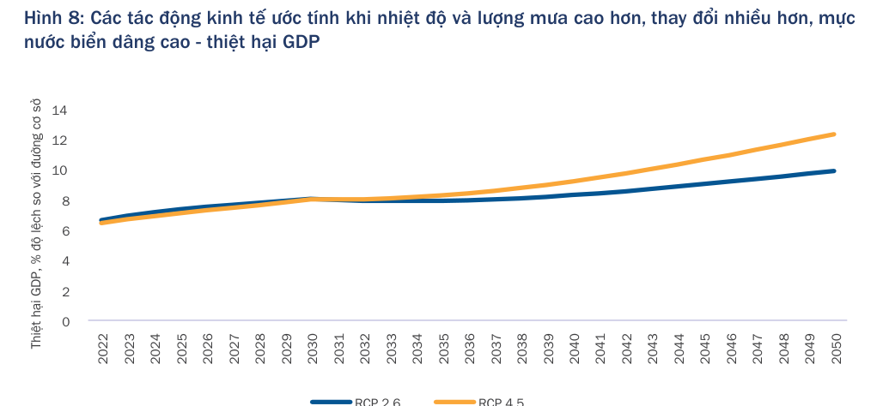

### V0_dense: answered (1 searches, 0 looks)

Theo Hình 8, đến năm 2050 thiệt hại GDP khoảng 10% theo RCP 2.6 và khoảng 12,4% theo RCP 4.5 (đơn vị: % độ lệch so với đường cơ sở). Các con số này là ước lượng từ trục tung của hình, vì hình không ghi giá trị số [CCDR-p030-H8]. Văn bản báo cáo ghi số làm tròn khác nhau: 9,8% (RCP 2.6) và 12,3% (RCP 4.5) ở một đoạn [CCDR-p030-t03], còn đoạn khác ghi 9,9% và 12,4% [CCDR-p029-t02]. Mức chênh lệch này nhỏ và không ảnh hưởng đến kết luận: RCP 4.5 cao hơn RCP 2.6 khoảng 2–2,5 điểm phần trăm vào năm 2050.

- cited CCDR-p030-H8 (PDF page 30, printed 20)
  
- cited CCDR-p030-t03 (PDF page 30, printed 20)
- cited CCDR-p029-t02 (PDF page 29, printed 19)
- evidence in context: True

### V1_rerank: answered (1 searches, 0 looks)

Theo văn bản, đến năm 2050 thiệt hại GDP (so với đường cơ sở) khoảng 9,8% theo kịch bản RCP 2.6 và khoảng 12,3% theo kịch bản RCP 4.5 [CCDR-p030-t03]. Một đoạn khác ghi con số tối đa là 9,9% (RCP 2.6) và 12,4% (RCP 4.5) [CCDR-p029-t02]. Hình 8 không in giá trị số; ước lượng từ trục tung cho khoảng 10% và 12,4% [CCDR-p030-H8], nên chỉ coi đây là ước tính.

- cited CCDR-p030-t03 (PDF page 30, printed 20)
- cited CCDR-p029-t02 (PDF page 29, printed 19)
- cited CCDR-p030-H8 (PDF page 30, printed 20)
  
- evidence in context: True

### V2_rerank_look: answered (1 searches, 1 looks)

Đến năm 2050, theo báo cáo, thiệt hại GDP khoảng 9,8% theo kịch bản RCP 2.6 và khoảng 12,3% theo kịch bản RCP 4.5 so với đường cơ sở [CCDR-p030-t03]. Hình 8 không in số liệu; khi ước lượng từ trục tung, RCP 2.6 khoảng 10% và RCP 4.5 khoảng 12,4% [CCDR-p030-H8]. Phần văn bản cũng nêu mức tối đa 9,9% (RCP 2.6) và 12,4% (RCP 4.5) [CCDR-p029-t02].

- look CCDR-p030-H8: *Đọc giá trị thiệt hại GDP (% độ lệch so với đường cơ sở) của RCP 2.6 (xanh đậm) và RCP 4.5 (cam) tại năm 2050. Ước lượng từ trục tung.* -> Năm 2050, ước lượng từ trục tung:

- **RCP 2.6 (xanh đậm):** khoảng 10% độ lệch so với đường cơ sở.
- **RCP 4.5 (cam):** khoảng 12,4% độ lệch so với đường cơ sở.

Hình không in số liệu cụ thể, nên đây chỉ là giá trị ước lượng.
- cited CCDR-p030-t03 (PDF page 30, printed 20)
- cited CCDR-p030-H8 (PDF page 30, printed 20)
  
- cited CCDR-p029-t02 (PDF page 29, printed 19)
- evidence in context: True

## ad-d10 (bieu_do, answerable)

**Question:** Trong Hình 16, biện pháp giảm phát thải từ sản xuất lúa gạo nào có chi phí (USD/tCO2e) cao nhất và mức đó khoảng bao nhiêu?

**Expected:** Chuyển từ trồng lúa sang ngô, khoảng 390 USD/tCO2e.

**Grading:** Đúng biện pháp; giá trị chấp nhận trong khoảng 350–420 USD/tCO2e (không in nhãn số, đọc từ trục).

- Evidence: Cột cao nhất của biểu đồ cột (cột cuối) (PDF page 65, Hình 16, cột Chuyển từ trồng lúa sang ngô): ~390 $/tCO2e (đọc từ trục)
  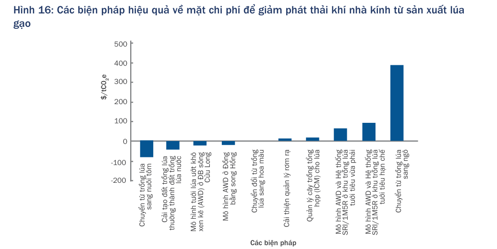

### V0_dense: answered (1 searches, 0 looks)

Biện pháp có chi phí cao nhất trong Hình 16 là "Chuyển từ trồng lúa sang ngô", khoảng 390 USD/tCO2e. Đây là ước lượng đọc từ trục tung (thang -200 đến 500), vì hình không in số liệu trên cột [CCDR-p065-H16]. Biện pháp cao thứ hai là AWD và hệ thống SRI/1M5R ở khu tưới tiêu hạn chế, khoảng 90 USD/tCO2e (cũng là ước lượng) [CCDR-p065-H16]. Lưu ý: việc ghép nhãn với từng cột dựa trên mô tả tự động của hình, nên nên đối chiếu trực tiếp với hình gốc.

- cited CCDR-p065-H16 (PDF page 65, printed 55)
  
- evidence in context: True

### V1_rerank: answered (1 searches, 0 looks)

Theo Hình 16, biện pháp có chi phí cao nhất là "Chuyển từ trồng lúa sang ngô", khoảng 390 USD/tCO2e. Đây là giá trị ước lượng từ trục tung (thang -200 đến 500), vì biểu đồ không in số liệu trên cột [CCDR-p065-H16]. Các biện pháp còn lại thấp hơn nhiều, cao nhất trong nhóm còn lại là AWD và SRI/1M5R ở khu tưới tiêu hạn chế, khoảng 90 USD/tCO2e [CCDR-p065-H16].

- cited CCDR-p065-H16 (PDF page 65, printed 55)
  
- evidence in context: True

### V2_rerank_look: answered (1 searches, 1 looks)

Biện pháp có chi phí cao nhất trong Hình 16 là "Chuyển từ trồng lúa sang ngô", với chi phí khoảng 390 USD/tCO2e (giá trị ước lượng từ trục tung, vì hình không in số trên cột) [CCDR-p065-H16]. Biện pháp cao thứ hai là AWD và SRI/1M5R ở khu tưới tiêu hạn chế, khoảng 90 USD/tCO2e [CCDR-p065-H16].

- look CCDR-p065-H16: *Đọc giá trị chi phí ($/tCO2e) của cột cao nhất (nhãn 'Chuyển từ trồng lúa sang ngô' hoặc biện pháp nào khác) và ước lượng mức trên trục tung. Liệt kê các cột có giá trị dương lớn nhất.* -> **Cột cao nhất:** "Chuyển từ trồng lúa sang ngô" có chi phí khoảng **390 $/tCO₂e**. Giá trị này là ước lượng từ trục tung, vì hình không in nhãn số.

**Các cột có giá trị dương lớn nhất (ước lượng, theo thứ tự giảm dần):**
1. Chuyển từ trồng lúa sang ngô: khoảng 390 $/tCO₂e
2. Mô hình AWD và SRI/1M5R ở khu trồng lúa tưới tiêu hạn chế: khoảng 90 $/tCO₂e
3. Mô hình AWD và SRI/1M5R ở khu trồng lúa tưới tiêu vừa phải: khoảng 65 $/tCO₂e

Các cột dương nhỏ hơn là Quản lý cây trồng tổng hợp (ICM) cho lúa (khoảng 18) và Cải thiện quản lý rơm rạ (khoảng 12).
- cited CCDR-p065-H16 (PDF page 65, printed 55)
  
- evidence in context: True

## ad-d11 (multi_hop, answerable)

**Question:** Nhu cầu tài chính của khu vực tư nhân giai đoạn 2022–2040 (Hình 21) gấp khoảng bao nhiêu lần dư nợ tín dụng xanh đầu năm 2021 (Hình 22)?

**Expected:** 184 tỷ USD / 14,5 tỷ USD ≈ 12,7 lần.

**Grading:** Đúng hai số (184 và 14,5) và tỷ số 12,6–12,8.

- Evidence: Khu vực tư nhân: 184 tỷ USD (PDF page 77, Hình 21): 184
  
- Evidence: Dư nợ tín dụng xanh 2021:Q1: 14,5 tỷ USD (PDF page 78, Hình 22, biểu đồ trái, cột 2021:Q1): 14,5
  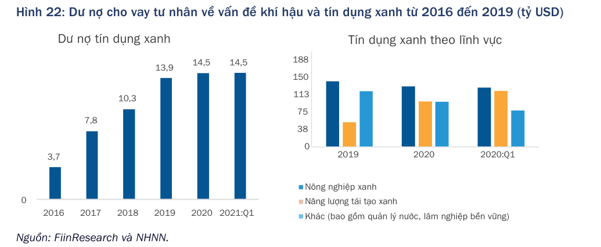

### V0_dense: answered (3 searches, 0 looks)

Khoảng 12,7 lần, nhưng đây chỉ là phép so sánh thô vì hai con số không cùng bản chất.

- Hình 21 ghi tổng nhu cầu tài chính 2022–2040 là 368 tỷ USD (NPV, chiết khấu 6%). Con số 184 tỷ USD (khoảng 3,4% GDP mỗi năm) là phần đóng góp dự kiến của khu vực tư nhân, một trong ba nguồn tài chính tiềm năng cùng với khu vực công (130 tỷ USD) và bên ngoài (54 tỷ USD). Đây không phải là nhu cầu riêng của khu vực tư nhân [CCDR-p077-H21]. Văn bản cũng xác nhận đây là các con đường tiềm năng để đáp ứng nhu cầu tài chính [CCDR-p077-t02].
- Hình 22 cho thấy dư nợ tín dụng xanh đạt 14,5 tỷ USD vào 2020 và giữ nguyên ở 2021:Q1 [CCDR-p078-H22].

Phép tính: 184 / 14,5 ≈ 12,7.

Con số 184 tỷ USD là tổng quy về NPV cho cả giai đoạn 19 năm, còn 14,5 tỷ USD là dư nợ tại một thời điểm. Báo cáo không nêu tỷ lệ so sánh trực tiếp giữa hai con số này.

- cited CCDR-p077-H21 (PDF page 77, printed 67)
  
- cited CCDR-p077-t02 (PDF page 77, printed 67)
- cited CCDR-p078-H22 (PDF page 78, printed 68)
  
- evidence in context: True

### V1_rerank: answered (2 searches, 0 looks)

Khoảng 12,7 lần.

- Hình 21: nhu cầu tài chính của khu vực tư nhân giai đoạn 2022–2040 là 184 tỷ USD (khoảng 3,4% GDP mỗi năm); đây là giá trị NPV chiết khấu ở 6% [CCDR-p077-H21].
- Hình 22: dư nợ tín dụng xanh ở mốc 2021:Q1 là 14,5 tỷ USD, nhãn số in trên cột biểu đồ bên trái [CCDR-p078-H22].
- Phép tính: 184 / 14,5 ≈ 12,7.

Lưu ý: hai số không cùng gốc thời gian và cách tính. Hình 21 là NPV tích lũy cho cả giai đoạn 2022–2040, còn Hình 22 là dư nợ tại một thời điểm (2021:Q1, không phải "đầu năm 2021" đúng nghĩa). Tỷ số trên chỉ mang tính minh họa về quy mô.

- cited CCDR-p077-H21 (PDF page 77, printed 67)
  
- cited CCDR-p078-H22 (PDF page 78, printed 68)
  
- evidence in context: True

### V2_rerank_look: answered (2 searches, 1 looks)

Khoảng 12,7 lần. Nhu cầu tài chính từ khu vực tư nhân giai đoạn 2022–2040 là 184 tỷ USD (NPV chiết khấu 6%, tương đương ~3,4% GDP mỗi năm) [CCDR-p077-H21]. Dư nợ tín dụng xanh đầu năm 2021 là 14,5 tỷ USD (giá trị 2020 và 2021:Q1 đều là 14,5 tỷ USD) [CCDR-p078-H22]. Phép tính: 184 / 14,5 ≈ 12,7. Lưu ý: đây là phép so sánh gần đúng, vì con số 184 tỷ USD là giá trị hiện tại thuần của dòng nhu cầu nhiều năm, còn dư nợ là số dư tại một thời điểm.

- look CCDR-p078-H22: *Đọc giá trị dư nợ tín dụng xanh (tỷ USD) của biểu đồ cột bên trái cho các năm 2020 và 2021:Q1. Cho biết giá trị nào tương ứng với mốc nào.* -> Biểu đồ cột bên trái (Dư nợ tín dụng xanh):

- Năm 2020: 14,5 tỷ USD
- Năm 2021:Q1: 14,5 tỷ USD
- cited CCDR-p077-H21 (PDF page 77, printed 67)
  
- cited CCDR-p078-H22 (PDF page 78, printed 68)
  
- evidence in context: True

## ad-d12 (multi_hop, answerable)

**Question:** Điện từ than năm 2040 trong kịch bản BAU (Hình 13) gấp khoảng bao nhiêu lần điện từ than năm 2020, tính từ Hình 12?

**Expected:** Hình 12: 59% × 200 TWh = 118 TWh năm 2020; Hình 13: 550 TWh (BAU 2040); 550 / 118 ≈ 4,7 lần.

**Grading:** Hai giá trị đúng (118 và 550 TWh) và tỷ số 4,6–4,7.

- Evidence: Than 59% của 200 TWh năm 2020 (PDF page 54, Hình 12, biểu đồ phải): 59%; 200 TWh
  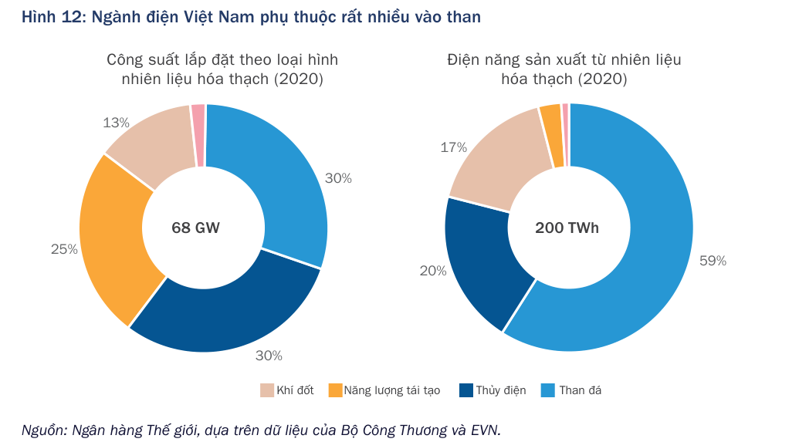
- Evidence: BAU 2040, đoạn Than: 550 TWh (PDF page 56, Hình 13, cột BAU, đoạn xanh đậm): 550
  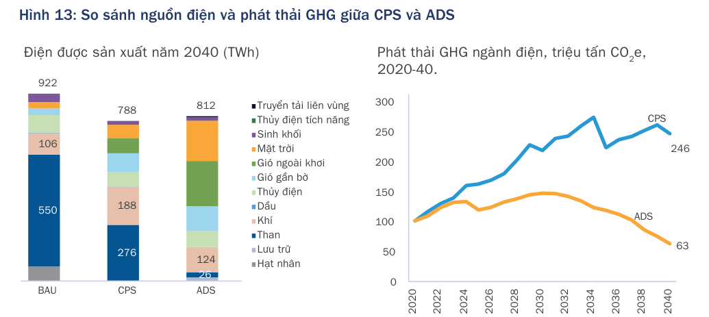

### V0_dense: answered (2 searches, 0 looks)

Điện than năm 2040 trong BAU gấp khoảng 4,7 lần điện than năm 2020 (ước lượng). Năm 2020, điện từ nhiên liệu hóa thạch là 200 TWh và than chiếm 59%, tức khoảng 118 TWh [CCDR-p054-H12]. Năm 2040, BAU có tổng 922 TWh, trong đó than 550 TWh [CCDR-p056-H13]. Tỷ lệ: 550 / 118 ≈ 4,7. Lưu ý: chữ trích của hình không gắn rõ từng số với cột/nhãn nên cần đối chiếu hình gốc; 118 TWh là ước tính từ tỷ trọng 59% trên tổng điện hóa thạch, không phải số liệu trực tiếp.

- cited CCDR-p054-H12 (PDF page 54, printed 44)
  
- cited CCDR-p056-H13 (PDF page 56, printed 46)
  
- evidence in context: True

### V1_rerank: answered (2 searches, 0 looks)

Điện từ than năm 2040 trong kịch bản BAU gấp khoảng 4,7 lần so với năm 2020 (ước tính).

Cách tính:
- Năm 2020: điện từ nhiên liệu hóa thạch là 200 TWh, than đá chiếm 59%, tức khoảng 0,59 × 200 ≈ 118 TWh [CCDR-p054-H12].
- Năm 2040 (BAU): điện từ than khoảng 550 TWh [CCDR-p056-H13].
- Tỷ lệ: 550 / 118 ≈ 4,66.

Lưu ý: mốc 2020 là ước tính, vì tỷ lệ 59% áp dụng cho tổng điện từ nhiên liệu hóa thạch (200 TWh), không phải tổng sản lượng điện. Số 550 nằm ở cột BAU trong Hình 13, nhưng bản trích không ghi rõ thứ tự từng lớp chồng nên việc gán này chưa được xác nhận chắc chắn từ chữ trích [CCDR-p056-H13].

- cited CCDR-p054-H12 (PDF page 54, printed 44)
  
- cited CCDR-p056-H13 (PDF page 56, printed 46)
  
- evidence in context: True

### V2_rerank_look: answered (2 searches, 2 looks)

Khoảng 4,7 lần (ước tính).

- Điện than năm 2040 trong kịch bản BAU (Hình 13): 550 TWh, đọc trực tiếp từ nhãn trên phần Than của cột BAU [CCDR-p056-H13].
- Điện than năm 2020 (Hình 12): Than đá chiếm 59% trong tổng 200 TWh điện từ nhiên liệu hóa thạch, tức khoảng 0,59 × 200 ≈ 118 TWh [CCDR-p054-H12]. Báo cáo cũng nêu nhiệt điện than chiếm 59% sản lượng điện năm 2020 [CCDR-p053-t02].
- Phép tính: 550 / 118 ≈ 4,7.

Lưu ý: con số 118 TWh là suy ra từ tỷ trọng 59% nhân với 200 TWh, không phải nhãn trực tiếp trong hình.

- look CCDR-p056-H13: *Cột BAU (sản lượng điện năm 2040, TWh): giá trị của phần Than (màu/chú giải Than) là bao nhiêu? Đọc chính xác số nhãn trên phần than của cột BAU.* -> Phần Than (màu xanh đậm) của cột BAU có nhãn **550 TWh**.
- look CCDR-p054-H12: *Biểu đồ tròn bên phải (điện năng sản xuất từ nhiên liệu hóa thạch 2020, 200 TWh): tỷ trọng phần Than đá là bao nhiêu phần trăm? Và tổng 200 TWh nằm ở đâu?* -> **Than đá chiếm 59%** trong biểu đồ tròn bên phải (điện năng sản xuất từ nhiên liệu hóa thạch, 2020).

**Tổng 200 TWh** được ghi ở chính giữa vòng tròn bên phải, tức là tổng của cả biểu đồ.
- cited CCDR-p056-H13 (PDF page 56, printed 46)
  
- cited CCDR-p054-H12 (PDF page 54, printed 44)
  
- cited CCDR-p053-t02 (PDF page 53, printed 43)
- evidence in context: True

## ad-d13 (text, answerable)

**Question:** Năm 2020, ngành năng lượng chiếm khoảng bao nhiêu phần trăm lượng phát thải GHG của cả nước và ngành nào là ngành phát thải lớn thứ hai?

**Expected:** Năng lượng khoảng 65%; nông nghiệp là ngành lớn thứ hai, khoảng 19%.

**Grading:** Đúng 65%, nông nghiệp và 19%.

- Evidence: Đoạn nêu cơ cấu phát thải năm 2020 (PDF page 18, Đoạn đầu trang 8 in (PDF 18)): 65%; nông nghiệp 19%

### V0_dense: answered (2 searches, 0 looks)

Năm 2020, ngành năng lượng chiếm khoảng 65% lượng phát thải GHG của cả nước [CCDR-p018-t01]. Ngành phát thải lớn thứ hai là nông nghiệp, chiếm khoảng 19% tổng lượng phát thải năm 2020 [CCDR-p064-t04].

- cited CCDR-p018-t01 (PDF page 18, printed 8)
- cited CCDR-p064-t04 (PDF page 64, printed 54)
- evidence in context: True

### V1_rerank: answered (2 searches, 0 looks)

Năm 2020, ngành năng lượng chiếm khoảng 65% lượng phát thải GHG của cả nước [CCDR-p018-t01]. Ngành phát thải lớn thứ hai là nông nghiệp, chiếm khoảng 19% tổng lượng phát thải năm 2020 [CCDR-p018-t01][CCDR-p064-t04].</answer>
<parameter name="citations">["CCDR-p018-t01", "CCDR-p064-t04"]

- cited CCDR-p018-t01 (PDF page 18, printed 8)
- cited CCDR-p064-t04 (PDF page 64, printed 54)
- evidence in context: True

### V2_rerank_look: answered (2 searches, 0 looks)

Năm 2020, ngành năng lượng chiếm khoảng 65% lượng phát thải GHG của cả nước [CCDR-p018-t01]. Ngành phát thải lớn thứ hai là nông nghiệp, chiếm khoảng 19% tổng phát thải năm 2020 [CCDR-p018-t01][CCDR-p064-t04].

- cited CCDR-p018-t01 (PDF page 18, printed 8)
- cited CCDR-p064-t04 (PDF page 64, printed 54)
- evidence in context: True

## ad-d14 (text, answerable)

**Question:** Thuế Bảo vệ Môi trường hiện hành tương đương bao nhiêu USD/tCO2e đối với than, xăng và dầu diesel?

**Expected:** Khoảng 0,5 USD/tCO2e đối với than, 77,60 USD/tCO2e đối với xăng và 32,90 USD/tấn CO2e đối với dầu diesel.

**Grading:** Đủ ba giá trị đúng nhiên liệu.

- Evidence: Đoạn về thuế carbon hiện tại (EPT) (PDF page 24, Đoạn thứ hai của mục 2.1): 0,5; 77,60; 32,90

### V0_dense: answered (1 searches, 0 looks)

Theo báo cáo, thuế carbon hiện tại là Thuế Bảo vệ Môi trường (EPT), vào khoảng: than ~0,5 USD/tCO2e; xăng 77,60 USD/tCO2e; dầu diesel 32,90 USD/tCO2e. Báo cáo nhận định mức này thấp hơn hầu hết các quốc gia và quá thấp để khuyến khích khử carbon quy mô lớn [CCDR-p024-t02].

- cited CCDR-p024-t02 (PDF page 24, printed 14)
- evidence in context: True

### V1_rerank: answered (1 searches, 0 looks)

Theo báo cáo, thuế carbon hiện hành là Thuế Bảo vệ Môi trường (EPT) vào khoảng: 0,5 USD/tCO2e đối với than; 77,60 USD/tCO2e đối với xăng; 32,90 USD/tCO2e đối với dầu diesel. Báo cáo nhận xét mức này thấp hơn hầu hết các quốc gia và quá thấp để khuyến khích khử carbon quy mô lớn [CCDR-p024-t02]. Đoạn tìm được không giải thích thêm về cách tính, nên mức 0,5 USD/tCO2e đối với than chỉ được nêu nguyên văn theo báo cáo.

- cited CCDR-p024-t02 (PDF page 24, printed 14)
- evidence in context: True

### V2_rerank_look: answered (1 searches, 0 looks)

Theo báo cáo, thuế carbon hiện hành ở Việt Nam là Thuế Bảo vệ Môi trường (EPT), với mức tương đương khoảng: than ~0,5 USD/tCO2e; xăng 77,60 USD/tCO2e; dầu diesel 32,90 USD/tCO2e. Báo cáo nhận định các mức này thấp hơn hầu hết các quốc gia và quá thấp để khuyến khích khử carbon quy mô lớn [CCDR-p024-t02].

- cited CCDR-p024-t02 (PDF page 24, printed 14)
- evidence in context: True

## ad-d15 (text, answerable)

**Question:** Việt Nam xếp hạng bao nhiêu theo Sáng kiến Thích ứng Biến đổi Khí hậu Toàn cầu Notre Dame (ND-GAIN) và theo Chỉ số Rủi ro Khí hậu Toàn cầu Germanwatch giai đoạn 2000–2019?

**Expected:** Hạng 127 trong 182 quốc gia (ND-GAIN) và hạng 13 trong 180 quốc gia (Germanwatch).

**Grading:** Đúng hai hạng và hai tổng số quốc gia.

- Evidence: Đoạn nêu xếp hạng dễ bị tổn thương (PDF page 16, Mục 1.2): 127/182; 13/180

### V0_dense: answered (2 searches, 0 looks)

Theo báo cáo, Việt Nam xếp hạng 127 trên tổng số 182 quốc gia theo Sáng kiến Thích ứng Biến đổi Khí hậu Toàn cầu Notre Dame (ND-GAIN), và đứng thứ 13 trên tổng số 180 quốc gia theo Chỉ số Rủi ro Khí hậu Toàn cầu Germanwatch giai đoạn 2000–2019 [CCDR-p016-t04]. Lưu ý: thứ hạng 13 theo Germanwatch là thứ tự rủi ro (càng nhỏ càng dễ bị tổn thương), nhưng đoạn văn không nêu rõ chiều của thang này.

- cited CCDR-p016-t04 (PDF page 16, printed 6)
- evidence in context: True

### V1_rerank: answered (2 searches, 0 looks)

Theo báo cáo, Việt Nam xếp hạng 127 trong số 182 quốc gia theo Sáng kiến Thích ứng Biến đổi Khí hậu Toàn cầu Notre Dame (ND-GAIN), tức là thuộc nhóm dễ bị tổn thương cao. Theo Chỉ số Rủi ro Khí hậu Toàn cầu Germanwatch giai đoạn 2000–2019, Việt Nam đứng thứ 13 trong số 180 quốc gia [CCDR-p016-t04]. Lưu ý: trong cùng đoạn, Việt Nam xếp thứ 91 trong số 192 quốc gia theo Chỉ số Sẵn sàng ND-GAIN, nhưng đây là chỉ số khác [CCDR-p016-t04].

- cited CCDR-p016-t04 (PDF page 16, printed 6)
- evidence in context: True

### V2_rerank_look: answered (2 searches, 0 looks)

Việt Nam xếp hạng 127 trong số 182 quốc gia theo Sáng kiến Thích ứng Biến đổi Khí hậu Toàn cầu Notre Dame (ND-GAIN), và đứng thứ 13 trong số 180 quốc gia theo Chỉ số Rủi ro Khí hậu Toàn cầu Germanwatch giai đoạn 2000–2019 [CCDR-p016-t04]. Lưu ý: thứ hạng 13 theo Germanwatch là vị trí cao, tức mức rủi ro khí hậu cao (nằm trong nhóm bị ảnh hưởng nhiều), theo cách báo cáo mô tả Việt Nam là một trong những nước dễ bị tổn thương nhất.

- cited CCDR-p016-t04 (PDF page 16, printed 6)
- evidence in context: True

## ad-d16 (thieu_bang_chung, no evidence)

**Question:** Bão Yagi năm 2024 đã gây thiệt hại bao nhiêu phần trăm GDP của Việt Nam?

**Expected:** Từ chối: tài liệu không có thông tin này; không thêm khẳng định vô căn cứ.

**Why:** Báo cáo xuất bản 07/2022, trước cơn bão.

### V0_dense: abstain (2 searches, 0 looks)

Báo cáo "Việt Nam: Báo cáo về Khí hậu và Phát triển" (07/2022) không nêu thông tin về bão Yagi năm 2024 hay thiệt hại của cơn bão này đối với GDP, vì nó được xuất bản trước sự kiện đó. Các đoạn tìm được chỉ cho thấy số liệu chung về thiệt hại do khí hậu cực đoan và bão nhiệt đới: trung bình Việt Nam chịu thiệt hại trực tiếp khoảng 2,4 tỷ USD mỗi năm, tương đương 0,8% GDP [CCDR-p030-t02]; năm 2020 thiệt hại do biến đổi khí hậu là 10 tỷ USD, tương đương 3,2% GDP [CCDR-p017-t01]. Những con số này không phải là số liệu về bão Yagi 2024.

- cited CCDR-p030-t02 (PDF page 30, printed 20)
- cited CCDR-p017-t01 (PDF page 17, printed 7)
- evidence in context: n/a

### V1_rerank: abstain (2 searches, 0 looks)

Không đủ bằng chứng trong báo cáo để trả lời. Báo cáo "Việt Nam: Báo cáo về Khí hậu và Phát triển" được công bố năm 2022, nên không đề cập đến cơn bão Yagi năm 2024, và hai lần tìm kiếm không cho thấy số liệu thiệt hại của Yagi. Báo cáo chỉ nêu ước tính chung: Việt Nam trung bình chịu thiệt hại trực tiếp về tài sản công và tư khoảng 2,4 tỷ USD mỗi năm, tương đương 0,8% GDP do các hiện tượng khí hậu cực đoan (bão nhiệt đới được đưa vào mô hình xác suất thảm họa) [CCDR-p030-t02]. Báo cáo cũng ước tính tổng thiệt hại do biến đổi khí hậu theo kịch bản RCP 2.6 và RCP 4.5 ở mức 6,26–9,36% GDP tùy năm và kịch bản, nhưng đây là dự báo mô hình CGE, không phải số liệu thiệt hại thực tế của một cơn bão cụ thể [CCDR-p095-bang-r3].

- cited CCDR-p030-t02 (PDF page 30, printed 20)
- cited CCDR-p095-bang-r3 (PDF page 95, printed 85)
  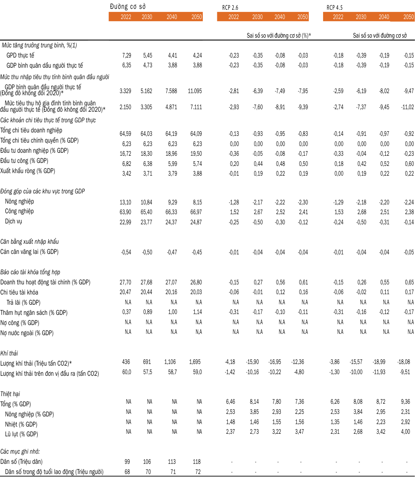
- evidence in context: n/a

### V2_rerank_look: abstain (2 searches, 0 looks)

Không đủ bằng chứng để trả lời. Báo cáo được công bố vào tháng 7/2022, nên không đề cập đến bão Yagi năm 2024 và không có số liệu thiệt hại GDP của cơn bão này. Hai lần tìm kiếm không thấy nội dung nào về Yagi.

Chỉ có các số liệu tổng quát về thiệt hại do khí hậu cực đoan (bao gồm bão nhiệt đới) do báo cáo ước tính: trung bình Việt Nam chịu thiệt hại trực tiếp khoảng 2,4 tỷ USD mỗi năm, tương đương 0,8% GDP [CCDR-p030-t02]. Đây là mức trung bình dài hạn, không phải thiệt hại của riêng bão Yagi.

- cited CCDR-p030-t02 (PDF page 30, printed 20)
- evidence in context: n/a

## ad-d17 (thieu_bang_chung, no evidence)

**Question:** Giá điện bán lẻ bình quân hiện nay ở Việt Nam là bao nhiêu đồng mỗi kWh?

**Expected:** Từ chối: tài liệu không có thông tin này; không thêm khẳng định vô căn cứ.

**Why:** Báo cáo chỉ nêu thay đổi tương đối của giá điện (ADS cao hơn CPS 26% năm 2040), không nêu giá tuyệt đối.

### V0_dense: abstain (3 searches, 0 looks)

Các đoạn đã tìm không nêu giá điện bán lẻ bình quân hiện nay (đồng/kWh) ở Việt Nam. Chúng chỉ đề cập chung về cải cách giá điện và việc giá điện bình quân trong kịch bản ADS cao hơn 26% so với CPS vào năm 2040 (cao hơn 16% giai đoạn 2020–2040), không có mức giá tuyệt đối [CCDR-p056-t03]. Báo cáo cũng nêu EVN là đơn vị thu tiền cấp 1 và cần tính đủ chi phí cung ứng, nhưng không có con số giá [CCDR-p060-t05]. Vì vậy tôi không thể xác định giá điện bán lẻ bình quân bằng đồng mỗi kWh từ báo cáo này.

- cited CCDR-p056-t03 (PDF page 56, printed 46)
- cited CCDR-p060-t05 (PDF page 60, printed 50)
- evidence in context: n/a

### V1_rerank: abstain (2 searches, 0 looks)

Các đoạn đã tìm không nêu giá điện bán lẻ bình quân (đồng/kWh) ở Việt Nam hiện nay. Chỉ có một số thông tin liên quan: tiêu thụ điện bình quân đầu người là 2.745 kWh năm 2020, tổng điện tiêu thụ 267,18 TWh năm 2020 (bảng Phụ lục 1, trang 92) [CCDR-p092-bangc-r1]. Báo cáo cũng nhắc đến cải cách giá điện và vai trò của EVN trong thu tiền điện nhưng không đưa con số giá bán lẻ [CCDR-p060-t05]. Vì vậy không thể xác nhận mức giá bình quân từ báo cáo này.

- cited CCDR-p092-bangc-r1 (PDF page 92, printed 82)
  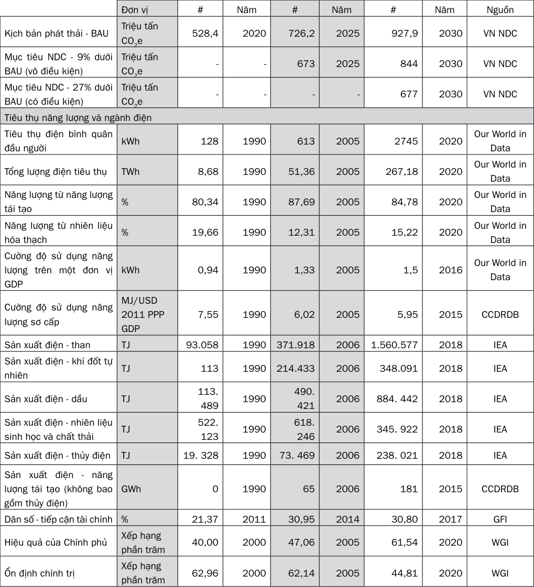
- cited CCDR-p060-t05 (PDF page 60, printed 50)
- evidence in context: n/a

### V2_rerank_look: abstain (4 searches, 0 looks)

Sau bốn lần tìm kiếm, các đoạn tìm được không nêu giá điện bán lẻ bình quân hiện nay (đồng/kWh) ở Việt Nam, nên không thể trả lời con số cụ thể. Các đoạn liên quan chỉ cho thấy: kịch bản ADS (khử carbon tăng cường) làm giá điện bình quân cao hơn 26% so với CPS vào năm 2040 và cao hơn 16% trong giai đoạn 2020–2040 [CCDR-p056-t03]; báo cáo nhấn mạnh cần cải cách giá điện để phản ánh chi phí cung ứng [CCDR-p060-t05]. Đoạn về tiêu thụ điện bình quân đầu người năm 2020 là 2.745 kWh (không phải giá) [CCDR-p092-bangc-r2]. Để có giá bán lẻ bình quân, cần tra cứu nguồn khác (ví dụ biểu giá điện của EVN/Bộ Công Thương).

- cited CCDR-p056-t03 (PDF page 56, printed 46)
- cited CCDR-p060-t05 (PDF page 60, printed 50)
- cited CCDR-p092-bangc-r2 (PDF page 92, printed 82)
  
- evidence in context: n/a

## ad-d18 (thieu_bang_chung, no evidence)

**Question:** Chi phí đầu tư điện gió ngoài khơi ở Việt Nam là bao nhiêu USD cho mỗi MW?

**Expected:** Từ chối: tài liệu không có thông tin này; không thêm khẳng định vô căn cứ.

**Why:** Bảng 5 chỉ nêu thay đổi tổng chi phí vốn (tỷ USD), không có đơn giá theo MW.

### V0_dense: abstain (3 searches, 0 looks)

Các đoạn đã tìm không nêu chi phí đầu tư điện gió ngoài khơi tính bằng USD trên mỗi MW, nên không thể trả lời con số này.

Phần liên quan mà các đoạn có nêu:
- Bảng 5 (kịch bản tăng tốc khử carbon ADS, 2022–2040) cho thấy mức thay đổi của gió ngoài khơi là +39 (đơn vị không ghi rõ trong chữ trích, phần trăm +402%), nhưng đây là thay đổi trong nhu cầu đầu tư/chi phí, không phải đơn giá theo MW [CCDR-p057-B5c].
- Bảng 5 (phần đầu) cho thấy chi phí vốn để lưu trữ và phát điện mới tăng +44 tỷ USD (+52%) trong giai đoạn 2022–2040 theo NPV; không có số riêng cho gió ngoài khơi [CCDR-p056-B5].
- Báo cáo khuyến nghị thúc đẩy nhanh điện gió ngoài khơi, thay FIT bằng cơ chế đấu giá [CCDR-p059-t01], [CCDR-p059-t03].

Để có đơn giá USD/MW cần tra thêm phần giả định chi phí của mô hình (ví dụ phụ lục về mô hình năng lượng), vốn không xuất hiện trong các đoạn đã tìm.

- cited CCDR-p057-B5c (PDF page 57, printed 47)
  
- cited CCDR-p056-B5 (PDF page 56, printed 46)
  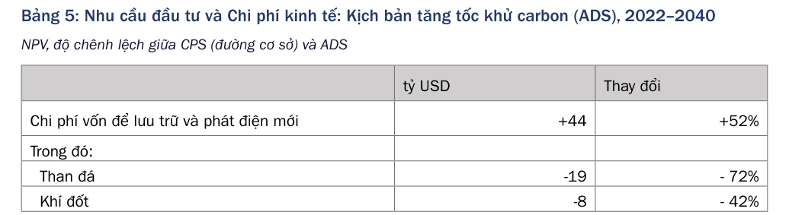
- cited CCDR-p059-t01 (PDF page 59, printed 49)
- cited CCDR-p059-t03 (PDF page 59, printed 49)
- evidence in context: n/a

### V1_rerank: abstain (4 searches, 0 looks)

Các đoạn đã tìm không nêu chi phí đầu tư điện gió ngoài khơi tính theo USD/MW. Điều tìm được là tổng nhu cầu đầu tư theo kịch bản tăng tốc khử carbon (ADS) giai đoạn 2022–2040: gió ngoài khơi tăng +39 tỷ USD (+402%) so với kịch bản CPS, theo NPV; đây là mức thay đổi tổng, không phải đơn giá trên mỗi MW [CCDR-p057-B5c]. Bảng 5 cho thấy tổng chi phí vốn cho lưu trữ và phát điện mới tăng +44 tỷ USD (+52%) [CCDR-p056-B5]. Không tìm thấy giả định đơn giá vốn (USD/MW hoặc USD/kW) cho điện gió ngoài khơi trong các đoạn đã truy xuất, nên không thể trả lời con số USD cho mỗi MW.

- cited CCDR-p057-B5c (PDF page 57, printed 47)
  
- cited CCDR-p056-B5 (PDF page 56, printed 46)
  
- evidence in context: n/a

### V2_rerank_look: abstain (4 searches, 0 looks)

Các đoạn đã tìm không nêu chi phí đầu tư điện gió ngoài khơi tính bằng USD/MW (hoặc USD/kW). Không tìm thấy bảng hay giả định nào về đơn giá này.

Thông tin liên quan có trong báo cáo: 
- Trong kịch bản tăng tốc khử carbon (ADS), 2022–2040, chi phí tổng tăng thêm cho điện gió ngoài khơi là +39 tỷ USD (+402%) so với kịch bản cơ sở; đây là tổng chi phí theo giai đoạn, không phải đơn giá theo MW [CCDR-p057-B5c]. 
- Tổng chi phí toàn hệ thống ước 65 tỷ USD, chi phí ròng sau tiết kiệm nhiên liệu 33 tỷ USD [CCDR-p056-t01].
- Điện gió ngoài khơi được nêu là một nguồn tái tạo chủ đạo trong quy hoạch đến 2040 [CCDR-p055-t02].

Để có đơn giá USD/MW cần tra phụ lục hoặc bảng giả định công nghệ của báo cáo, mà chưa có trong kết quả tìm kiếm.

- cited CCDR-p057-B5c (PDF page 57, printed 47)
  
- cited CCDR-p056-t01 (PDF page 56, printed 46)
- cited CCDR-p055-t02 (PDF page 55, printed 45)
- evidence in context: n/a

