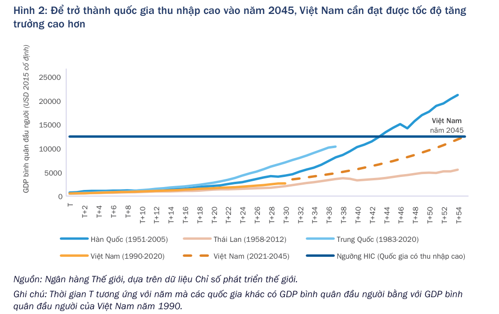
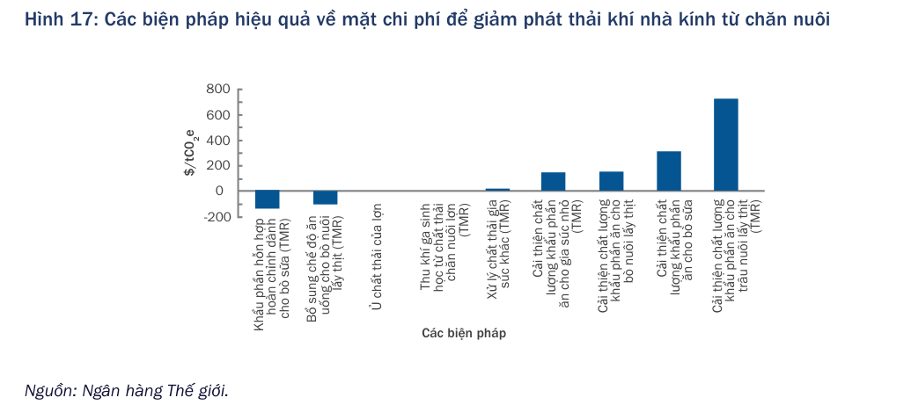
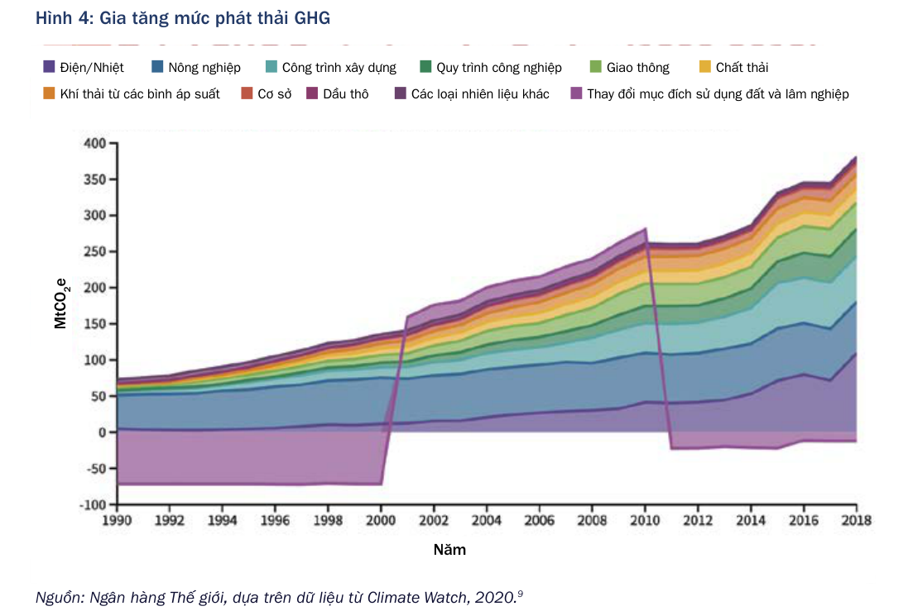
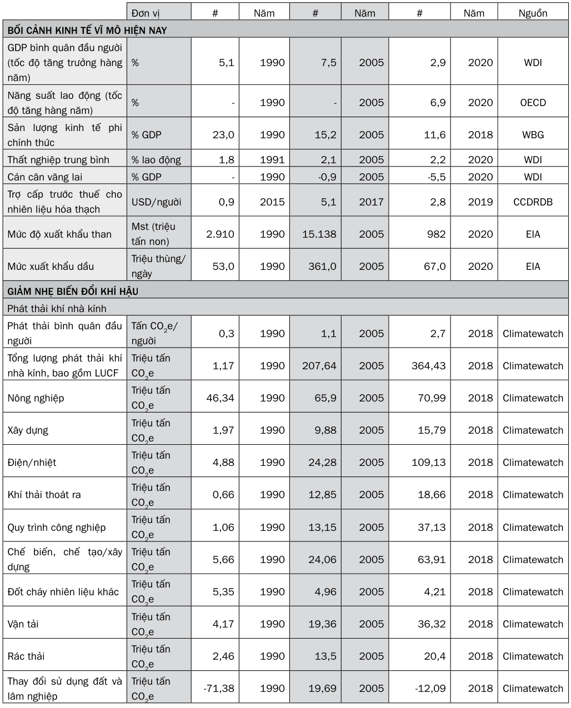
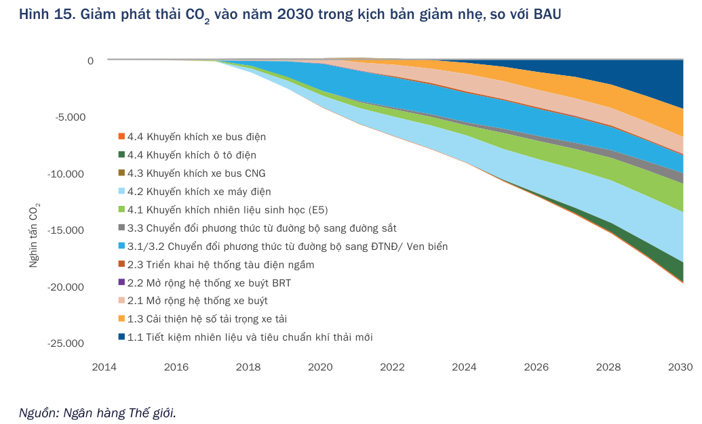

# Review sheet: dev

Grade each answer against the evidence and the picture; fill in review_labels.csv.

## ad-d19 (bieu_do, answerable)

**Question:** Trong Hình 2, đến cuối giai đoạn (khoảng T+54) đường của Thái Lan đạt GDP bình quân đầu người khoảng bao nhiêu USD (USD 2015 cố định)?

**Expected:** Khoảng 5.500 USD (đường Thái Lan 1958-2012 kết thúc ở cuối trục thời gian).

**Grading:** Chấp nhận 4.800-6.200 USD; hình không in số, đọc từ trục tung.

- Evidence: Điểm cuối của đường Thái Lan (1958-2012) (PDF page 15, Hình 2): ~5.500 (đọc từ trục)
  

### V0_dense_ext: abstain (2 searches, 0 looks)

Không đủ bằng chứng để nêu con số chính xác. Hình 2 (trang 15) có đường "Thái Lan (1958-2012)" và trục GDP bình quân đầu người (USD 2015 cố định) từ 0 đến 25.000, nên đường này kết thúc ở khoảng T+54. Tuy nhiên, phần chữ trích từ hình chỉ có nhãn và trục, không có giá trị số tại T+54. Mô tả do model tạo (không phải bằng chứng) ước lượng khoảng 5.700 USD, nhưng con số này chỉ là ước lượng từ trục và chưa được đối chiếu với hình. Các đoạn khác tìm được (bảng CGE, bảng tài chính) không nêu GDP bình quân đầu người của Thái Lan. Muốn có số chính xác, cần xem trực tiếp hình 2 trong báo cáo gốc hoặc dữ liệu nguồn của Chỉ số phát triển thế giới.

- cited CCDR-p015-H2 (PDF page 15, printed 5)
  
- evidence in context: True

### V1_rerank_ext: answered (2 searches, 0 looks)

Theo Hình 2, đường Thái Lan (1958-2012) kết thúc ở khoảng T+54 với GDP bình quân đầu người khoảng 5.700 USD (USD 2015 cố định). Đây là giá trị ước lượng từ trục tung, vì hình không ghi nhãn số liệu cho điểm này; mô tả hình chỉ ghi "khoảng 5.700 (T+54)" và không có bảng số liệu gốc để đối chiếu [CCDR-p015-H2]. Hình cũng ghi chú T là năm GDP bình quân đầu người của quốc gia đó bằng mức Việt Nam năm 1990 [CCDR-p015-H2].

- cited CCDR-p015-H2 (PDF page 15, printed 5)
  
- evidence in context: True

### V2_rerank_look_ext: answered (1 searches, 1 looks)

Theo Hình 2, đường Thái Lan (1958–2012) kết thúc ở khoảng 5.700 USD (USD 2015 cố định) gần mốc T+54. Đây là giá trị ước lượng từ trục tung, hình không ghi số cụ thể [CCDR-p015-H2].

- look CCDR-p015-H2: *Đọc giá trị GDP bình quân đầu người (USD 2015) của đường Thái Lan (1958-2012) tại điểm cuối, gần T+54. Ước lượng theo trục tung, nêu số cụ thể.* -> Đường Thái Lan (1958–2012) kết thúc ở khoảng **5.700 USD (2015 cố định)** tại điểm gần T+54. Đây là giá trị ước lượng từ trục tung, không phải số in trên hình.
- cited CCDR-p015-H2 (PDF page 15, printed 5)
  
- evidence in context: True

## ad-d20 (bieu_do, answerable)

**Question:** Trong Hình 17, biện pháp giảm phát thải từ chăn nuôi nào có chi phí cao nhất và mức đó khoảng bao nhiêu USD/tCO2e?

**Expected:** Cải thiện chất lượng khẩu phần ăn cho trâu nuôi lấy thịt (TMR), khoảng 725 USD/tCO2e.

**Grading:** Đúng biện pháp; giá trị chấp nhận 650-800 USD/tCO2e (không in nhãn số).

- Evidence: Cột cao nhất (cột cuối) của biểu đồ cột (PDF page 65, Hình 17, cột ngoài cùng bên phải): ~725 $/tCO2e (đọc từ trục)
  

### V0_dense_ext: answered (1 searches, 0 looks)

Trong Hình 17, biện pháp có chi phí cao nhất là cải thiện chất lượng khẩu phần ăn cho trâu nuôi lấy thịt (TMR), khoảng 725 USD/tCO2e. [CCDR-p065-H17] Đây là giá trị ước lượng từ trục tung (trục từ -200 đến 800 USD/tCO2e), vì hình không in số liệu trên cột. [CCDR-p065-H17]

- cited CCDR-p065-H17 (PDF page 65, printed 55)
  
- evidence in context: True

### V1_rerank_ext: answered (1 searches, 0 looks)

Trong Hình 17, biện pháp có chi phí cao nhất là "Cải thiện chất lượng khẩu phần ăn cho trâu nuôi lấy thịt (TMR)", ước lượng khoảng 725 USD/tCO2e [CCDR-p065-H17]. Lưu ý: hình không in số trên cột, con số này chỉ là ước lượng từ trục tung (thang -200 đến 800), nên chỉ mang tính tham khảo. Mô tả hình cũng cho thấy các biện pháp cải thiện khẩu phần ăn có chi phí tăng dần từ gia súc nhỏ, bò thịt, bò sữa đến trâu thịt [CCDR-p065-H17].

- cited CCDR-p065-H17 (PDF page 65, printed 55)
  
- evidence in context: True

### V2_rerank_look_ext: answered (1 searches, 1 looks)

Biện pháp có chi phí cao nhất trong Hình 17 là "Cải thiện chất lượng khẩu phần ăn cho trâu nuôi lấy thịt (TMR)", khoảng 720–725 USD/tCO2e (giá trị ước lượng từ trục tung, hình không in số liệu trên cột) [CCDR-p065-H17]. Để tham chiếu, biện pháp thấp nhất là khẩu phần hỗn hợp hoàn chỉnh cho bò sữa, khoảng -140 USD/tCO2e (chi phí âm) [CCDR-p065-H17].

- look CCDR-p065-H17: *Cột nào cao nhất trên trục $/tCO2e? Tên biện pháp ở chân cột đó là gì và giá trị ước lượng trên trục tung khoảng bao nhiêu? Cũng cho biết cột của bò sữa (khẩu phần hỗn hợp) và cột thấp nhất nằm ở đâu.* -> **Cột cao nhất:** cột ngoài cùng bên phải, ứng với biện pháp **"Cải thiện chất lượng khẩu phần ăn cho trâu nuôi lấy thịt (TMR)"**. Giá trị ước lượng khoảng **720 $/tCO₂e**.

**Bò sữa (khẩu phần hỗn hợp):** cột đầu tiên bên trái, "Khẩu phần hỗn hợp hoàn chỉnh dành cho bò sữa (TMR)". Cột này nằm dưới mức 0, khoảng **-140 $/tCO₂e**.

**Cột thấp nhất:** cũng là cột bò sữa ở đầu bên trái, vì đáy cột này sâu nhất trong biểu đồ (khoảng -140 $/tCO₂e).
- cited CCDR-p065-H17 (PDF page 65, printed 55)
  
- evidence in context: True

## ad-d21 (bieu_do, answerable)

**Question:** Trong Hình 17, những biện pháp nào có chi phí âm (tiết kiệm chi phí)?

**Expected:** Khẩu phần hỗn hợp hoàn chỉnh dành cho bò sữa (TMR) và bổ sung chế độ ăn uống cho bò nuôi lấy thịt (TMR).

**Grading:** Nêu đủ hai biện pháp; thêm biện pháp khác là sai.

- Evidence: Hai cột đầu nằm dưới trục 0 (PDF page 65, Hình 17, hai cột bên trái): khẩu phần hỗn hợp bò sữa; bổ sung chế độ ăn bò thịt
  

### V0_dense_ext: answered (1 searches, 0 looks)

Theo Hình 17 (các biện pháp giảm phát thải khí nhà kính từ chăn nuôi, đơn vị $/tCO2e), có hai biện pháp có chi phí âm, tức tiết kiệm chi phí:
1. Khẩu phần hỗn hợp hoàn chỉnh dành cho bò sữa (TMR), ước lượng khoảng -140 $/tCO2e [CCDR-p065-H17].
2. Bổ sung chế độ ăn uống cho bò nuôi lấy thịt (TMR), ước lượng khoảng -100 $/tCO2e [CCDR-p065-H17].

Lưu ý: hình không in giá trị trên cột; các con số trên là ước lượng từ trục tung, chỉ mang tính tương đối. Việc ghép nhãn với từng cột cũng dựa trên thứ tự nhãn trích từ hình nên cần đối chiếu lại với hình gốc. Các biện pháp còn lại (ủ chất thải lợn, thu khí sinh học từ chất thải lợn) gần bằng 0, và các biện pháp cải thiện khẩu phần ăn đều có chi phí dương [CCDR-p065-H17].

- cited CCDR-p065-H17 (PDF page 65, printed 55)
  
- evidence in context: True

### V1_rerank_ext: answered (1 searches, 0 looks)

Theo Hình 17 (chi phí giảm phát thải khí nhà kính từ chăn nuôi, đơn vị $/tCO2e), hai biện pháp có chi phí âm, tức tiết kiệm chi phí, là:
1. Khẩu phần hỗn hợp hoàn chỉnh cho bò sữa (TMR), ước lượng khoảng -140 $/tCO2e [CCDR-p065-H17].
2. Bổ sung chế độ ăn uống cho bò nuôi lấy thịt (TMR), ước lượng khoảng -100 $/tCO2e [CCDR-p065-H17].

Lưu ý: hình không in giá trị trên cột; các số trên là ước lượng từ trục tung. Các cột ủ chất thải lợn và thu khí sinh học từ chất thải chăn nuôi lợn (TMR) có giá trị gần 0 và không thấy rõ là âm hay dương, nên không đưa vào danh sách. Các biện pháp còn lại đều có chi phí dương [CCDR-p065-H17].

- cited CCDR-p065-H17 (PDF page 65, printed 55)
  
- evidence in context: True

### V2_rerank_look_ext: answered (1 searches, 1 looks)

Trong Hình 17 (chi phí giảm phát thải khí nhà kính từ chăn nuôi, đơn vị $/tCO2e), có hai biện pháp có chi phí âm, tức tiết kiệm chi phí:
1. Khẩu phần hỗn hợp hoàn chỉnh cho bò sữa (TMR): khoảng -140 $/tCO2e.
2. Bổ sung chế độ ăn uống cho bò nuôi lấy thịt (TMR): khoảng -90 đến -100 $/tCO2e.
Giá trị là ước lượng từ trục vì hình không in số liệu. Hai biện pháp "ủ chất thải của lợn" và "thu khí ga sinh học từ chất thải chăn nuôi lợn (TMR)" nằm gần mức 0, không thấy rõ là âm hay dương. [CCDR-p065-H17]

- look CCDR-p065-H17: *Với mỗi cột trong Hình 17, nhãn biện pháp là gì và cột nằm trên hay dưới mốc 0 $/tCO2e? Cột nào nằm dưới 0 (chi phí âm)? Ước lượng giá trị từng cột.* -> Hình 17 có 9 cột. Không có giá trị nào được in trên hình, nên tất cả số dưới đây là ước lượng từ trục (đơn vị $/tCO₂e).

| Cột | Nhãn biện pháp | Vị trí so với 0 | Ước lượng |
|---|---|---|---|
| 1 | Khẩu phần hỗn hợp hoàn chỉnh cảnh cho bò sữa (TMR) | Dưới 0 | khoảng −140 |
| 2 | Bổ sung chế độ ăn uống cho bò nuôi lấy thịt (TMR) | Dưới 0 | khoảng −90 |
| 3 | Ủ chất thải của lợn | Gần 0 (không thấy cột rõ) | khoảng 0 |
| 4 | Thu khí ga sinh học từ chất thải chăn nuôi lợn (TMR) | Gần 0 (không thấy cột rõ) | khoảng 0 |
| 5 | Xử lý chất thải gia súc khác (TMR) | Trên 0 | khoảng 20 |
| 6 | Cải thiện chất lượng khẩu phần ăn cho gia súc nhỏ (TMR) | Trên 0 | khoảng 145 |
| 7 | Cải thiện chất lượng khẩu phần ăn cho bò nuôi lấy thịt | Trên 0 | khoảng 150 |
| 8 | Cải thiện chất lượng khẩu phần ăn cho bò sữa | Trên 0 | khoảng 315 |
| 9 | Cải thiện chất lượng khẩu phần ăn cho trâu nuôi lấy thịt (TMR) | Trên 0 | khoảng 730 |

Các cột có chi phí âm (nằm dưới 0) là: khẩu phần hỗn hợp hoàn chỉnh cho bò sữa (TMR) và bổ sung chế độ ăn uống cho bò nuôi lấy thịt (TMR).
- cited CCDR-p065-H17 (PDF page 65, printed 55)
  
- evidence in context: True

## ad-d22 (anh_so_do, answerable)

**Question:** Trong Hình 4, phần diện tích nằm dưới trục 0 trong giai đoạn 1990-2000 thuộc ngành nào theo chú giải?

**Expected:** Thay đổi mục đích sử dụng đất và lâm nghiệp (LULUCF).

**Grading:** Đúng ngành; nhầm với Điện/Nhiệt hoặc một ngành phát thải khác là sai.

- Evidence: Vùng màu tím nhạt dưới trục 0, khớp màu chú giải cuối (PDF page 18, Hình 4): Thay đổi mục đích sử dụng đất và lâm nghiệp
  

### V0_dense_ext: answered (2 searches, 0 looks)

Theo chú giải của Hình 4 (Gia tăng mức phát thải GHG, trang 18), nhóm duy nhất có khả năng nằm dưới trục 0 là "Thay đổi mục đích sử dụng đất và lâm nghiệp" (LULUCF). Chú giải liệt kê nhóm này cùng 10 nhóm khác, và trục tung có đơn vị MtCO2e từ -100 đến 400 [CCDR-p018-H4]. Bảng Phụ lục 1 cho thấy LULUCF năm 1990 là -71,38 triệu tấn CO2e, tức là giá trị âm (hấp thụ) [CCDR-p091-bang-r2]. Lưu ý: văn bản trích từ hình không gắn rõ màu từng dải với nhãn, nên việc xác định dải dưới trục 0 là LULUCF là suy luận từ chú giải và số liệu bảng, chưa được xác nhận trực tiếp từ màu sắc trong hình. Tôi cũng không tìm thấy số liệu riêng cho năm 2000 của nhóm này.

- cited CCDR-p018-H4 (PDF page 18, printed 8)
  
- cited CCDR-p091-bang-r2 (PDF page 91, printed 81)
  
- evidence in context: True

### V1_rerank_ext: answered (1 searches, 0 looks)

Theo chú giải của Hình 4, phần nằm dưới trục 0 thuộc nhóm "Thay đổi mục đích sử dụng đất và lâm nghiệp" (LULUCF) [CCDR-p018-H4]. Chú giải nêu LULUCF là nhóm có giá trị âm (hấp thụ), và phần mô tả hình ước lượng LULUCF khoảng -70 MtCO2e trong giai đoạn 1990–2000 [CCDR-p018-H4]. Lưu ý: các giá trị này là ước lượng từ trục, vì hình không in số liệu. Ngoài ra, việc xác định nhóm này bằng màu hồng tím là từ phần mô tả do model tạo, chưa được kiểm chứng trực tiếp từ chữ trích của hình; nguồn hình là Ngân hàng Thế giới dựa trên Climate Watch, 2020 [CCDR-p018-H4].

- cited CCDR-p018-H4 (PDF page 18, printed 8)
  
- evidence in context: True

### V2_rerank_look_ext: answered (1 searches, 1 looks)

Phần diện tích nằm dưới trục 0 trong giai đoạn 1990-2000 (khoảng -70 đến -75 MtCO₂e, ước lượng từ trục) có màu hồng tím, và theo chú giải tương ứng với ngành "Thay đổi mục đích sử dụng đất và lâm nghiệp" (LULUCF). Đây là nhóm hấp thụ khí nhà kính. Giá trị là ước lượng từ trục vì hình không in số liệu [CCDR-p018-H4].

- look CCDR-p018-H4: *Trong giai đoạn 1990-2000, phần diện tích nằm dưới trục 0 (giá trị âm) có màu gì? Đối chiếu với chú giải (legend) để cho biết tên ngành tương ứng với màu đó. Đọc từng nhãn chú giải và màu tương ứng.* -> Trong giai đoạn 1990-2000, phần diện tích dưới trục 0 có **màu tím hồng (hồng tím nhạt)**. Theo chú giải, màu này tương ứng với ngành **"Thay đổi mục đích sử dụng đất và lâm nghiệp"**.

Giá trị của vùng này khoảng **-70 đến -75 MtCO₂e** trong suốt giai đoạn. Đây là giá trị ước lượng từ trục, không có số in trên hình.
- cited CCDR-p018-H4 (PDF page 18, printed 8)
  
- evidence in context: True

## ad-d23 (anh_so_do, answerable)

**Question:** Trong Hình 15, lớp màu xanh dương đậm nằm trên cùng, sát trục 0 vào năm 2030, là biện pháp nào theo chú giải?

**Expected:** 1.1 Tiết kiệm nhiên liệu và tiêu chuẩn khí thải mới.

**Grading:** Đúng biện pháp 1.1; nhầm với 3.1/3.2 (xanh dương sáng hơn) là sai.

- Evidence: Lớp xanh dương đậm trên cùng, khớp ô vuông cuối chú giải (PDF page 62, Hình 15): 1.1 Tiết kiệm nhiên liệu và tiêu chuẩn khí thải mới
  

### V0_dense_ext: abstain (2 searches, 0 looks)

Không đủ bằng chứng để xác định lớp màu xanh dương đậm trên cùng sát trục 0 năm 2030 là biện pháp nào. Hình 15 (Giảm phát thải CO2 vào năm 2030 trong kịch bản giảm nhẹ, so với BAU) có chú giải gồm 12 biện pháp: 1.1 Tiết kiệm nhiên liệu và tiêu chuẩn khí thải mới; 1.3 Cải thiện hệ số tải trọng xe tải; 2.1 Mở rộng hệ thống xe buýt; 2.2 Mở rộng xe buýt BRT; 2.3 Triển khai hệ thống tàu điện ngầm; 3.1/3.2 Chuyển đổi phương thức từ đường bộ sang ĐTNĐ/ven biển; 3.3 Chuyển đổi sang đường sắt; 4.1 Khuyến khích nhiên liệu sinh học (E5); 4.2 Khuyến khích xe máy điện; 4.3 Khuyến khích xe buýt CNG; 4.4 Khuyến khích ô tô điện và xe buýt điện [CCDR-p062-H15]. Tuy nhiên, văn bản trích từ hình không cho biết màu của từng lớp cũng như thứ tự xếp chồng tương ứng với chú giải, nên không xác định được lớp nào là lớp xanh dương đậm trên cùng. Phần mô tả do model tạo của hình có nêu lớp trên cùng là 1.1, nhưng đây không phải chữ trích từ hình và chưa được kiểm chứng, nên không dùng làm căn cứ. Cần xem trực tiếp hình để đối chiếu màu sắc và thứ tự lớp.

- cited CCDR-p062-H15 (PDF page 62, printed 52)
  
- evidence in context: True

### V1_rerank_ext: abstain (1 searches, 0 looks)

Không đủ bằng chứng để xác định chắc chắn lớp xanh dương đậm trên cùng, sát trục 0 năm 2030 là biện pháp nào. Chú giải trích được trong Hình 15 chỉ liệt kê 12 biện pháp theo tên (1.1 Tiết kiệm nhiên liệu và tiêu chuẩn khí thải mới; 1.3 Cải thiện hệ số tải trọng xe tải; 2.1 Mở rộng xe buýt; 2.2 Xe buýt BRT; 2.3 Tàu điện ngầm; 3.1/3.2 Chuyển sang ĐTNĐ/ven biển; 3.3 Chuyển sang đường sắt; 4.1 Nhiên liệu sinh học E5; 4.2 Xe máy điện; 4.3 Xe buýt CNG; 4.4 Ô tô điện và xe buýt điện) nhưng không cho biết màu nào tương ứng với biện pháp nào, cũng không cho biết thứ tự các lớp trong hình [CCDR-p062-H15]. Mô tả do model tạo (không phải bằng chứng) ước lượng lớp trên cùng là 1.1 với khoảng -4.300 nghìn tấn CO2 năm 2030, nhưng điều này chưa được chữ trích từ hình xác nhận. Đề nghị đối chiếu trực tiếp với hình gốc ở trang PDF 62. Văn bản trang 62 chỉ nêu kịch bản giảm 20% phát thải giao thông vào 2030 so với BAU qua các biện pháp này [CCDR-p062-t01].

- cited CCDR-p062-H15 (PDF page 62, printed 52)
  
- cited CCDR-p062-t01 (PDF page 62, printed 52)
- evidence in context: True

### V2_rerank_look_ext: answered (2 searches, 1 looks)

Theo chú giải của Hình 15, lớp xanh dương đậm nằm sát trục 0 vào năm 2030 là biện pháp 1.1 "Tiết kiệm nhiên liệu và tiêu chuẩn khí thải mới" [CCDR-p062-H15]. Giá trị ước lượng từ trục của lớp này vào 2030 khoảng -4.200 nghìn tấn CO2 (so với BAU). Đây là ước lượng đọc từ biểu đồ, không phải số in trên hình [CCDR-p062-H15].

- look CCDR-p062-H15: *Trong biểu đồ diện tích xếp chồng, lớp nằm sát trục 0 (trên cùng) vào năm 2030 có màu xanh dương đậm là lớp nào? Đọc chú giải để xác định mã biện pháp tương ứng (ví dụ 1.1, 4.2...) và giá trị ước lượng của lớp đó vào 2030.* -> Lớp sát trục 0 ở năm 2030 có màu xanh dương đậm là **1.1 Tiết kiệm nhiên liệu và tiêu chuẩn khí thải mới**.

Giá trị ước lượng của lớp này vào 2030 là **khoảng -4.200 nghìn tấn CO₂** (tức khoảng 4,2 triệu tấn). Đây là ước lượng từ trục, không phải số in trên hình.
- cited CCDR-p062-H15 (PDF page 62, printed 52)
  
- evidence in context: True

