# Review sheet: test

Grade each answer against the evidence and the picture; fill in review_labels.csv.

## ad-t01 (bang, answerable)

**Question:** Theo Bảng 2, lấy tổng nhu cầu tài chính trừ đi nguồn tài chính hiện có thì chênh lệch là bao nhiêu tỷ USD (giá trị tích lũy NPV)?

**Expected:** 479,2–547,6 trừ 136,9 = 342,3–410,7 tỷ USD (bằng hàng "Nhu cầu tài chính tăng thêm").

**Grading:** Đúng khoảng 342,3–410,7 tỷ USD; đơn vị tỷ USD theo NPV.

- Evidence: Hàng Tổng nhu cầu tài chính và hàng Nguồn tài chính hiện có, cột giá trị tích lũy (PDF page 32, Bảng 2, cột 2): 479,2–547,6; 136,9
  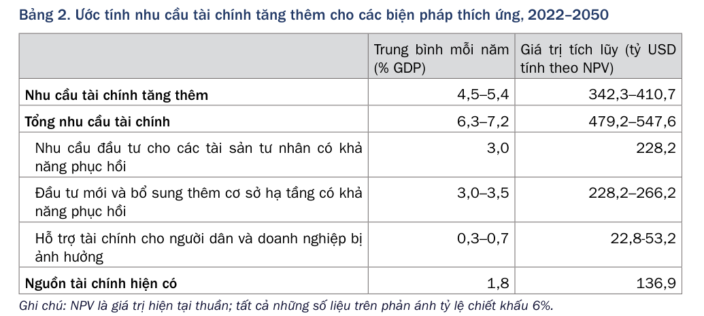

### V1_rerank: answered (1 searches, 0 looks)

Chênh lệch là khoảng 342,3–410,7 tỷ USD (NPV, chiết khấu 6%, giai đoạn 2022–2050). Phép tính: tổng nhu cầu tài chính 479,2–547,6 tỷ USD trừ nguồn tài chính hiện có 136,9 tỷ USD, tức 479,2 − 136,9 = 342,3 và 547,6 − 136,9 = 410,7 [CCDR-p032-B2]. Kết quả này khớp với dòng "Nhu cầu tài chính tăng thêm" trong cùng bảng và với đoạn văn nêu khoảng 342–411 tỷ USD [CCDR-p031-t03].

- cited CCDR-p032-B2 (PDF page 32, printed 22)
  
- cited CCDR-p031-t03 (PDF page 31, printed 21)
- evidence in context: True

### V0_dense: answered (1 searches, 0 looks)

Theo Bảng 2, chênh lệch tích lũy (NPV, chiết khấu 6%, giai đoạn 2022–2050) là khoảng 342,3–410,7 tỷ USD.

Phép tính: tổng nhu cầu tài chính 479,2–547,6 tỷ USD trừ nguồn tài chính hiện có 136,9 tỷ USD: 479,2 − 136,9 = 342,3 và 547,6 − 136,9 = 410,7. Kết quả khớp với dòng "Nhu cầu tài chính tăng thêm" trong cùng bảng [CCDR-p032-B2]. Đoạn văn bản cũng nêu cùng khoảng 342–411 tỷ USD theo NPV [CCDR-p031-t03].

- cited CCDR-p032-B2 (PDF page 32, printed 22)
  
- cited CCDR-p031-t03 (PDF page 31, printed 21)
- evidence in context: True

## ad-t02 (bang, answerable)

**Question:** Trong Bảng 3, với kịch bản NZP có những cải cách hỗ trợ, tác động kinh tế ròng giai đoạn 2031–2040 là bao nhiêu tỷ USD?

**Expected:** +19,3 tỷ USD (NPV, chiết khấu 6%).

**Grading:** Đúng 19,3 và dấu dương; đúng khối "NZP với những cải cách hỗ trợ" (không phải khối NZP, −95,5).

- Evidence: Khối NZP với những cải cách hỗ trợ, hàng Tác động kinh tế ròng, cột 2031–2040 (PDF page 50, Bảng 3): 19,3
  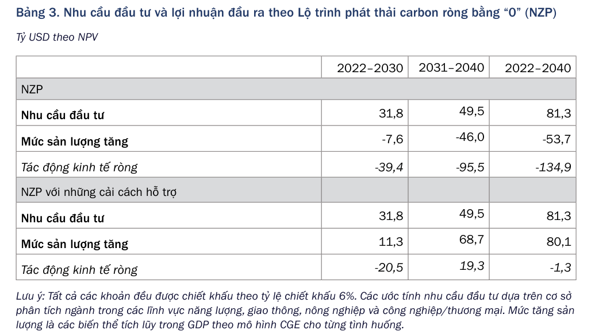

### V1_rerank: answered (1 searches, 0 looks)

Theo Bảng 3, với kịch bản "NZP với những cải cách hỗ trợ", tác động kinh tế ròng giai đoạn 2031–2040 là 19,3 tỷ USD (theo NPV, chiết khấu 6%) [CCDR-p050-B3]. Con số này là kết quả của mức sản lượng tăng 68,7 tỷ USD trừ nhu cầu đầu tư 49,5 tỷ USD (khoảng 19,2, chênh lệch do làm tròn) [CCDR-p050-B3].

- cited CCDR-p050-B3 (PDF page 50, printed 40)
  
- evidence in context: True

### V0_dense: answered (2 searches, 0 looks)

Theo Bảng 3, với kịch bản "NZP với những cải cách hỗ trợ", tác động kinh tế ròng giai đoạn 2031–2040 là +19,3 tỷ USD (theo NPV, chiết khấu 6%) [CCDR-p050-B3]. Giá trị này được tính từ mức tăng sản lượng 68,7 tỷ USD trừ nhu cầu đầu tư 49,5 tỷ USD [CCDR-p050-B3]. Để so sánh, kịch bản NZP thuần có tác động ròng -95,5 tỷ USD trong cùng giai đoạn [CCDR-p050-B3].

- cited CCDR-p050-B3 (PDF page 50, printed 40)
  
- evidence in context: True

## ad-t03 (bang, answerable)

**Question:** Theo Bảng 3, các cải cách hỗ trợ làm tác động kinh tế ròng của NZP giai đoạn 2022–2040 tốt hơn bao nhiêu tỷ USD?

**Expected:** −1,3 − (−134,9) = 133,6 tỷ USD.

**Grading:** Đúng 133,6 tỷ USD (dung sai ±0,1).

- Evidence: Tác động kinh tế ròng 2022–2040 của hai khối (PDF page 50, Bảng 3, cột 2022–2040): -134,9; -1,3
  

### V1_rerank: answered (1 searches, 0 looks)

Theo Bảng 3, tác động kinh tế ròng giai đoạn 2022–2040 (NPV, chiết khấu 6%) của NZP thuần là -134,9 tỷ USD, còn NZP với những cải cách hỗ trợ là -1,3 tỷ USD [CCDR-p050-B3]. Như vậy, các cải cách hỗ trợ giúp tác động ròng tốt hơn khoảng 133,6 tỷ USD (-1,3 − (-134,9) = 133,6). Phép tính này dựa trên hai giá trị đã đọc trong bảng. Văn bản cũng nêu NZP có cải cách gần như không ảnh hưởng đến GDP giai đoạn này, thiệt hại khoảng 1,3 tỷ USD [CCDR-p050-t01].

- cited CCDR-p050-B3 (PDF page 50, printed 40)
  
- cited CCDR-p050-t01 (PDF page 50, printed 40)
- evidence in context: True

### V0_dense: answered (3 searches, 0 looks)

Theo Bảng 3 (đơn vị: tỷ USD theo NPV, chiết khấu 6%), tác động kinh tế ròng giai đoạn 2022–2040 của NZP là -134,9 tỷ USD, còn NZP với các cải cách hỗ trợ là -1,3 tỷ USD [CCDR-p050-B3]. Vì vậy, các cải cách hỗ trợ làm tác động ròng tốt hơn khoảng 133,6 tỷ USD (-1,3 − (-134,9) = 133,6). Bản văn cũng nêu NZP có cải cách gần như không ảnh hưởng đến GDP giai đoạn 2022–2040, thiệt hại nhỏ khoảng 1,3 tỷ USD [CCDR-p050-t01]. Lưu ý: phép tính 133,6 là do tôi suy ra từ hai con số trong bảng.

- cited CCDR-p050-B3 (PDF page 50, printed 40)
  
- cited CCDR-p050-t01 (PDF page 50, printed 40)
- evidence in context: True

## ad-t04 (bang, answerable)

**Question:** Trong bảng kết quả mô hình CGE ở Phụ lục 3 ("Những thiệt hại chính và kết quả kinh tế vĩ mô"), GDP bình quân đầu người thực tế đường cơ sở năm 2050 là bao nhiêu và dưới kịch bản RCP 4.5 năm 2050 thấp hơn đường cơ sở bao nhiêu phần trăm?

**Expected:** 11.095 (đồng đô không đổi 2020); thấp hơn 9,47% dưới RCP 4.5.

**Grading:** Đúng 11.095 và −9,47% (cột RCP 4.5, năm 2050, không phải RCP 2.6 −7,95%).

- Evidence: Hàng GDP bình quân đầu người thực tế: cột Đường cơ sở 2050 và RCP 4.5 2050 (PDF page 95, Bảng Phụ lục 3 trang 85, nhóm Mức thu nhập): 11.095; -9,47
  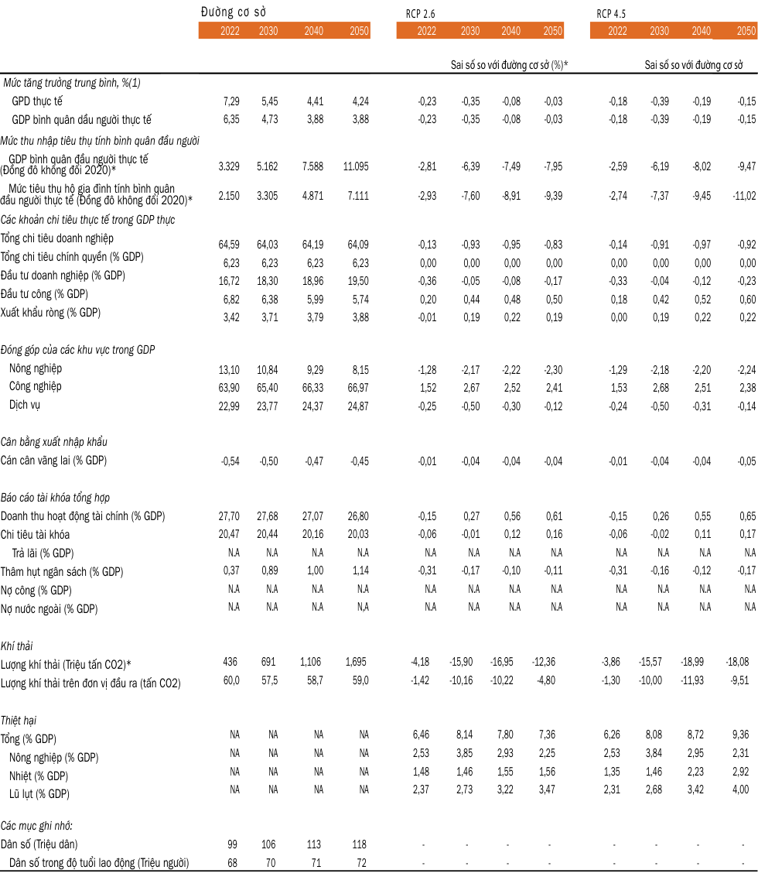

### V1_rerank: answered (1 searches, 0 looks)

Theo bảng "Những thiệt hại chính và kết quả kinh tế vĩ mô từ mô hình CGE" (phần 1/3, Phụ lục 3):

- GDP bình quân đầu người thực tế đường cơ sở năm 2050 là khoảng 11.095 đồng (đồng đô la không đổi 2020) [CCDR-p095-bang-r1].
- Dưới kịch bản RCP 4.5, mức sai số so với đường cơ sở năm 2050 là -9,47%, nghĩa là thấp hơn đường cơ sở khoảng 9,47% [CCDR-p095-bang-r1]. Theo cách tính từ hai con số trên, mức này tương đương khoảng 10.044 đồng (11.095 × (1 − 0,0947)).

Lưu ý: nhãn hàng trong bảng trích xuất bị lẫn lộn ở dòng "GDP bình quân đầu người thực tế" và dòng "Mức thu nhập tiêu thụ…"; con số 11.095 và -9,47% được đối chiếu từ mô tả bảng nên nên kiểm tra lại với bảng gốc trước khi trích dẫn chính thức.

- cited CCDR-p095-bang-r1 (PDF page 95, printed 85)
  
- evidence in context: True

### V0_dense: answered (1 searches, 0 looks)

Theo bảng "Những thiệt hại chính và kết quả kinh tế vĩ mô từ mô hình CGE" (phần 1/3), GDP bình quân đầu người thực tế đường cơ sở năm 2050 là 11.095 (đơn vị ghi trong bảng: đồng đô la không đổi 2020) [CCDR-p095-bang-r1]. Dưới kịch bản RCP 4.5, mức này thấp hơn đường cơ sở 9,47% vào năm 2050 [CCDR-p095-bang-r1].

Lưu ý: nhãn dòng trong bảng bị lộn xộn khi trích xuất, nhưng các số 3.329 / 5.162 / 7.588 / 11.095 và sai số -2,59 / -6,19 / -8,02 / -9,47 (RCP 4.5) nằm cùng dòng GDP bình quân đầu người thực tế theo đồng 2020, nên tôi dùng các số này. Dòng tăng trưởng phần trăm ngay phía trên (3,88% năm 2050) là một chỉ tiêu khác, không phải mức GDP.

- cited CCDR-p095-bang-r1 (PDF page 95, printed 85)
  
- evidence in context: True

## ad-t05 (bang, answerable)

**Question:** Theo Bảng 1, Việt Nam phát thải bao nhiêu tCO2e bình quân đầu người và chiếm bao nhiêu phần trăm phát thải toàn cầu?

**Expected:** 3,8 tCO2e bình quân đầu người; 0,8% phát thải toàn cầu.

**Grading:** Đúng 3,8 và 0,8%.

- Evidence: Hàng Việt Nam của Bảng 1 (PDF page 19, Bảng 1, hàng Việt Nam): 3,8; 0,8%
  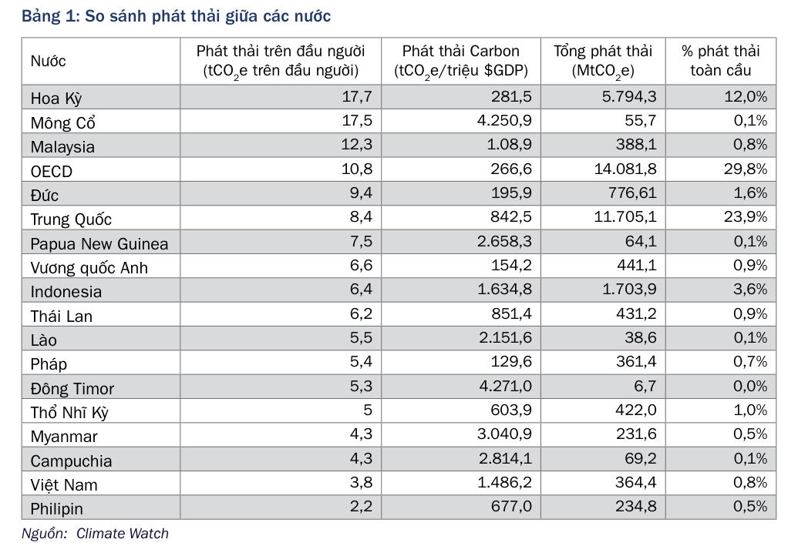

### V1_rerank: answered (1 searches, 0 looks)

Theo Bảng 1, Việt Nam phát thải khoảng 3,8 tCO2e bình quân đầu người và chiếm 0,8% phát thải toàn cầu, với tổng phát thải 364,4 MtCO2e [CCDR-p019-B1]. Văn bản đi kèm nêu cụ thể hơn: lượng phát thải GHG bình quân đầu người năm 2018 là 3,81 tấn CO2e và tổng lượng phát thải chiếm "chưa đến 0,8%" phát thải toàn cầu [CCDR-p018-t02]. Số liệu thuộc năm 2018 theo văn bản.

- cited CCDR-p019-B1 (PDF page 19, printed 9)
  
- cited CCDR-p018-t02 (PDF page 18, printed 8)
- evidence in context: True

### V0_dense: answered (1 searches, 0 looks)

Theo Bảng 1, Việt Nam phát thải khoảng 3,8 tCO2e trên đầu người và chiếm 0,8% phát thải toàn cầu, với tổng phát thải 364,4 MtCO2e [CCDR-p019-B1]. Văn bản cho biết con số bình quân đầu người năm 2018 là 3,81 tấn CO2e, và Việt Nam chiếm chưa đến 0,8% tổng phát thải toàn cầu năm 2018 [CCDR-p018-t02].

- cited CCDR-p019-B1 (PDF page 19, printed 9)
  
- cited CCDR-p018-t02 (PDF page 18, printed 8)
- evidence in context: True

## ad-t06 (bang, answerable)

**Question:** Trong Bảng 6 (tiêu chí ưu tiên), hành động có mức khẩn cấp Trung bình nhưng tác động Cao được mô tả thế nào?

**Expected:** "Các hành động cần thời gian để hình thành và thực hiện nhưng có thể mang lại tác động lớn".

**Grading:** Đúng ô (hàng Khẩn cấp Trung bình, cột Tác động Cao); nhầm hàng hoặc cột là sai.

- Evidence: Ô giao của hàng Khẩn cấp Trung bình và cột Tác động Cao (PDF page 84, Bảng 6): Các hành động cần thời gian để hình thành và thực hiện nhưng có thể mang lại tác động lớn
  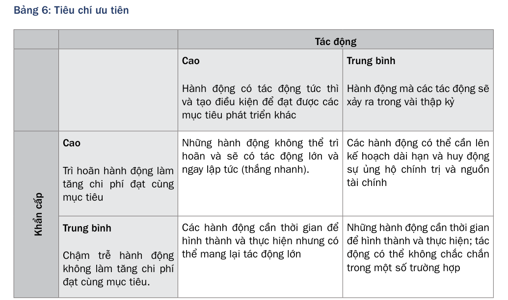

### V1_rerank: answered (1 searches, 0 looks)

Ở ô Khẩn cấp Trung bình × Tác động Cao, Bảng 6 mô tả các hành động "cần thời gian để hình thành và thực hiện nhưng có thể mang lại tác động lớn" [CCDR-p084-B6]. Theo phần giải thích của bảng, mức Tác động Cao là hành động có tác động tức thì và tạo điều kiện đạt các mục tiêu phát triển khác, còn mức Khẩn cấp Trung bình nghĩa là can thiệp có thể bị trì hoãn do thiếu ý chí chính trị hoặc nguồn lực tài chính, hoặc có thể khả thi hơn trong tương lai [CCDR-p084-B6][CCDR-p084-t03]. Bảng ghi chú thêm rằng chậm trễ hành động ở nhóm này không làm tăng chi phí đạt cùng mục tiêu [CCDR-p084-B6]. Lưu ý: văn bản trích từ bảng không nêu rõ ô nào thuộc hàng nào, nên cách gán nội dung này cho ô Khẩn cấp Trung bình × Tác động Cao dựa trên thứ tự các ô trong bảng và mô tả tóm tắt, chưa được xác nhận chắc chắn từ hình.

- cited CCDR-p084-B6 (PDF page 84, printed 74)
  
- cited CCDR-p084-t03 (PDF page 84, printed 74)
- evidence in context: True

### V0_dense: answered (1 searches, 0 looks)

Theo Bảng 6 (tiêu chí ưu tiên), ô có Khẩn cấp Trung bình và Tác động Cao mô tả là: "các hành động cần thời gian để hình thành và thực hiện nhưng có thể mang lại tác động lớn" [CCDR-p084-B6].

Lưu ý: văn bản trích từ bảng không ghi rõ nhãn hàng và cột theo thứ tự, nên việc ghép ô này dựa trên vị trí và logic nội dung, chưa được đối chiếu trực tiếp với hình bảng. Khung tổng thể của ma trận khẩn cấp–tác động được mô tả trong văn bản ngay trước bảng [CCDR-p084-t03].

- cited CCDR-p084-B6 (PDF page 84, printed 74)
  
- cited CCDR-p084-t03 (PDF page 84, printed 74)
- evidence in context: True

## ad-t07 (anh_so_do, answerable)

**Question:** Trên bản đồ Hình 14, tỉnh nào được ghi chú là tỉnh sản xuất than chính?

**Expected:** Quảng Ninh.

**Grading:** Đúng Quảng Ninh.

- Evidence: Ô ghi "Quảng Ninh" cạnh chú thích "Tỉnh sản xuất than chính" (PDF page 59, Hình 14, bên phải bản đồ): Quảng Ninh
  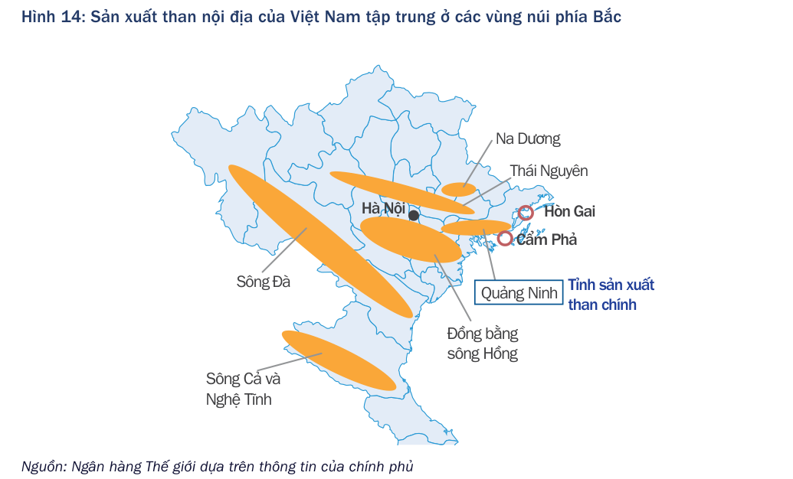

### V1_rerank: answered (1 searches, 0 looks)

Tỉnh được ghi chú là "Tỉnh sản xuất than chính" trên Hình 14 là Quảng Ninh. Chữ trích từ hình có nhãn "Quảng Ninh" và "Tỉnh sản xuất than chính" [CCDR-p059-H14]. Văn bản cũng nêu hầu hết (trên 90%) than sản xuất trong nước khai thác ở miền Bắc, đặc biệt ở tỉnh Quảng Ninh [CCDR-p058-t04]. Lưu ý: chữ trích từ hình bị lộn thứ tự, nên việc gán nhãn chú giải cho Quảng Ninh là suy ra từ mô tả hình, chưa phải đọc trực tiếp từ bản gốc.

- cited CCDR-p059-H14 (PDF page 59, printed 49)
  
- cited CCDR-p058-t04 (PDF page 58, printed 48)
- evidence in context: True

### V0_dense: answered (1 searches, 0 looks)

Theo Hình 14, tỉnh được ghi chú "Tỉnh sản xuất than chính" là Quảng Ninh, với hộp nhãn "Quảng Ninh" nằm ở phía đông bắc, ven biển [CCDR-p059-H14]. Trên bản đồ, Hòn Gai và Cẩm Phả (đánh dấu bằng hình tròn đỏ) nằm trong vùng này [CCDR-p059-H14]. Lưu ý: phần chữ trích từ hình không cho biết chắc chắn nhãn nào gắn với đường chỉ nào, nên việc gán chú thích cho Quảng Ninh dựa vào phần mô tả hình, chưa được xác nhận trực tiếp từ hình gốc.

- cited CCDR-p059-H14 (PDF page 59, printed 49)
  
- evidence in context: True

## ad-t08 (anh_so_do, answerable)

**Question:** Trên bản đồ Hình 14, vùng than nào được vẽ ở xa nhất về phía nam, ở dưới cùng bản đồ?

**Expected:** Sông Cả và Nghệ Tĩnh.

**Grading:** Đúng "Sông Cả và Nghệ Tĩnh" (không phải Sông Đà).

- Evidence: Hình elip cam thấp nhất, nhãn Sông Cả và Nghệ Tĩnh (PDF page 59, Hình 14, góc dưới bên trái): Sông Cả và Nghệ Tĩnh
  

### V1_rerank: answered (1 searches, 0 looks)

Theo Hình 14, vùng được vẽ ở xa nhất về phía nam là "Sông Cả và Nghệ Tĩnh", thuộc Bắc Trung Bộ, tách biệt với các vùng khác và nằm xa về phía nam [CCDR-p059-H14]. Lưu ý: phần mô tả vị trí này là do công cụ tạo khi đọc hình, chưa được đối chiếu trực tiếp với ảnh gốc. Văn bản báo cáo cũng nêu than nội địa khai thác ở khu vực quanh đồng bằng sông Hồng, sông Đà và sông Cả, đặc biệt ở Quảng Ninh [CCDR-p058-t04].

- cited CCDR-p059-H14 (PDF page 59, printed 49)
  
- cited CCDR-p058-t04 (PDF page 58, printed 48)
- evidence in context: True

### V0_dense: answered (2 searches, 0 looks)

Vùng được vẽ ở xa nhất về phía nam trên Hình 14 là "Sông Cả và Nghệ Tĩnh", thuộc Bắc Trung Bộ [CCDR-p059-H14]. Vị trí "phía nam" này lấy từ mô tả do model tạo của hình, chưa được đối chiếu trực tiếp với ảnh bản đồ, nên cần kiểm tra lại trên hình gốc. Văn bản báo cáo cũng nêu rằng trên 90% than sản xuất trong nước khai thác ở miền Bắc, quanh đồng bằng sông Hồng, sông Đà và sông Cả, đặc biệt ở Quảng Ninh [CCDR-p058-t04]; đoạn này không nói rõ vùng nào nằm xa nhất về phía nam.

- cited CCDR-p059-H14 (PDF page 59, printed 49)
  
- cited CCDR-p058-t04 (PDF page 58, printed 48)
- evidence in context: True

## ad-t09 (anh_so_do, answerable)

**Question:** Trong Hình 11 (rủi ro ngập lụt tại các vùng ven biển), dải lãnh thổ nào có màu đậm nhất, tức rủi ro ngập lụt tương đối cao nhất?

**Expected:** Dải ven biển miền Trung (Trung Bộ, khoảng từ phía bắc Đà Nẵng đến Nam Trung Bộ).

**Grading:** Chấp nhận "miền Trung / Trung Bộ"; sai nếu nêu miền Bắc hay Đồng bằng sông Cửu Long.

- Evidence: Các tỉnh màu xanh lục đậm nhất trên bản đồ (PDF page 42, Hình 11): miền Trung
  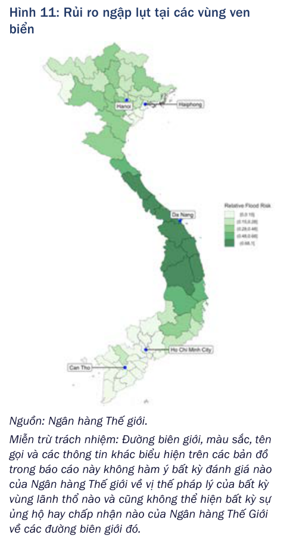

### V1_rerank: abstain (2 searches, 0 looks)

Không đủ bằng chứng để xác định dải lãnh thổ có màu đậm nhất trong Hình 11. Hình 11 "Rủi ro ngập lụt tại các vùng ven biển" nằm ở trang PDF 42 [CCDR-p042-H11], nhưng phần chữ trích được từ hình chỉ có tiêu đề, chú thích nguồn và miễn trừ trách nhiệm; không ghi giá trị hay chú giải màu gắn với khu vực nào. Phần mô tả do model tạo cho thấy dải màu đậm nhất ở duyên hải miền Trung, phía Nam Đà Nẵng, nhưng đây chỉ là mô tả định hướng, chưa được đối chiếu với chữ trong hình, nên không dùng làm kết luận. Các đoạn khác chỉ nêu chung rằng các vùng thấp ven biển có nguy cơ tổn thương rất cao [CCDR-p016-t05] và một nửa khu công nghiệp đối mặt nguy cơ ngập lụt nghiêm trọng (Hình 11) [CCDR-p042-t01], không xác định khu vực màu đậm nhất. Để trả lời chắc chắn cần xem trực tiếp thang màu và chú giải của Hình 11 trong báo cáo.

- cited CCDR-p042-H11 (PDF page 42, printed 32)
  
- cited CCDR-p016-t05 (PDF page 16, printed 6)
- cited CCDR-p042-t01 (PDF page 42, printed 32)
- evidence in context: True

### V0_dense: abstain (2 searches, 0 looks)

Các đoạn đã tìm không đủ để xác định dải lãnh thổ nào có màu đậm nhất trong Hình 11. Hình 11 (trang PDF 42) là bản đồ tô màu rủi ro ngập lụt tương đối tại các vùng ven biển, thang màu 5 nhóm, nhưng phần văn bản trích không ghi chú giải màu đọc được, không có giá trị số theo tỉnh, và không có đoạn văn nào nêu vùng nào có rủi ro tương đối cao nhất. Phần mô tả tự động của hình có nêu nhóm màu đậm nhất ở dải duyên hải miền Trung, phía nam Đà Nẵng, nhưng đây chỉ là mô tả do model tạo, không phải nội dung đã được xác minh từ báo cáo, nên tôi không dùng làm kết luận. Các đoạn liên quan khác chỉ nói chung rằng các vùng thấp ven biển và đồng bằng lưu vực sông có nguy cơ tổn thương rất cao với nước biển dâng [CCDR-p016-t05], và duyên hải miền Trung thường gặp thời tiết cực đoan [CCDR-p085-t03]. Để trả lời chắc chắn, cần xem trực tiếp chú giải và màu sắc của Hình 11.

- cited CCDR-p042-H11 (PDF page 42, printed 32)
  
- cited CCDR-p016-t05 (PDF page 16, printed 6)
- cited CCDR-p085-t03 (PDF page 85, printed 75)
- evidence in context: True

## ad-t10 (anh_so_do, answerable)

**Question:** Trên bản đồ Hình 10, biển ở phía đông được ghi tên là gì và nước nào được ghi tên ở phía tây bắc?

**Expected:** "BIỂN ĐÔNG" và "CAM PU CHIA".

**Grading:** Đúng cả hai nhãn (viết hoa trên bản đồ).

- Evidence: Hai nhãn chữ trong ảnh bản đồ (PDF page 40, Hình 10): BIỂN ĐÔNG; CAM PU CHIA
  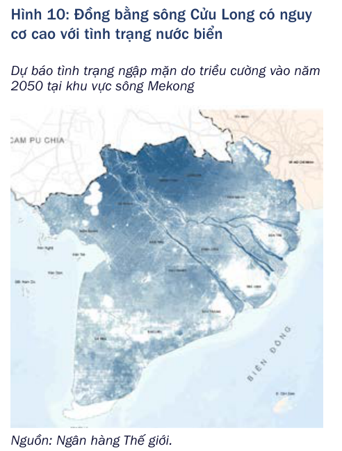

### V1_rerank: answered (1 searches, 0 looks)

Theo phần chữ trích trên Hình 10 (Đồng bằng sông Cửu Long có nguy cơ cao với tình trạng nước biển, dự báo ngập mặn do triều cường năm 2050), biển ở phía đông được ghi tên là "BIỂN ĐÔNG" (ở phía đông nam, dọc bờ biển) [CCDR-p040-H10]. Nước ở góc trên bên trái, tức phía tây bắc/phía bắc của bản đồ, được ghi tên là "CAM PU CHIA" (Campuchia) [CCDR-p040-H10]. Lưu ý: vị trí tương đối của nhãn được suy ra từ mô tả hình do công cụ tạo, không phải từ chú thích gốc; hình cũng không có trục hay chú giải, nên chỉ nên xem đây là cách đọc gần đúng.

- cited CCDR-p040-H10 (PDF page 40, printed 30)
  
- evidence in context: True

### V0_dense: answered (2 searches, 0 looks)

Theo phần mô tả hình 10 (bản đồ dự báo ngập mặn do triều cường năm 2050 ở khu vực sông Mekong), biển ở phía đông được ghi là "BIỂN ĐÔNG", nằm ở phía đông nam, dọc bờ biển [CCDR-p040-H10]. Nước được ghi tên ở góc trên bên trái, tức phía bắc/tây bắc, là "CAM PU CHIA" [CCDR-p040-H10].

Lưu ý: thông tin này lấy từ mô tả do model tạo, không phải chữ đọc trực tiếp từ hình. Mô tả cũng ghi rằng một số nhãn nhỏ ở phía tây và phía đông không đọc rõ, nên có thể còn nhãn khác mà tôi không xác định được.

- cited CCDR-p040-H10 (PDF page 40, printed 30)
  
- evidence in context: True

## ad-t11 (anh_so_do, answerable)

**Question:** Hình 9 gồm ba bản đồ về ba loại thiên tai. Bản đồ nào dùng thang màu xanh lục?

**Expected:** Bản đồ "Bão lũ" (bản đồ bên phải).

**Grading:** Đúng "Bão lũ"; "Lũ lụt 1.000 năm" dùng thang xanh dương và "Lở đất" thang cam.

- Evidence: Ba bản đồ có ba thang màu: cam (Lở đất), xanh dương (Lũ lụt 1.000 năm), xanh lục (Bão lũ) (PDF page 37, Hình 9): Bão lũ
  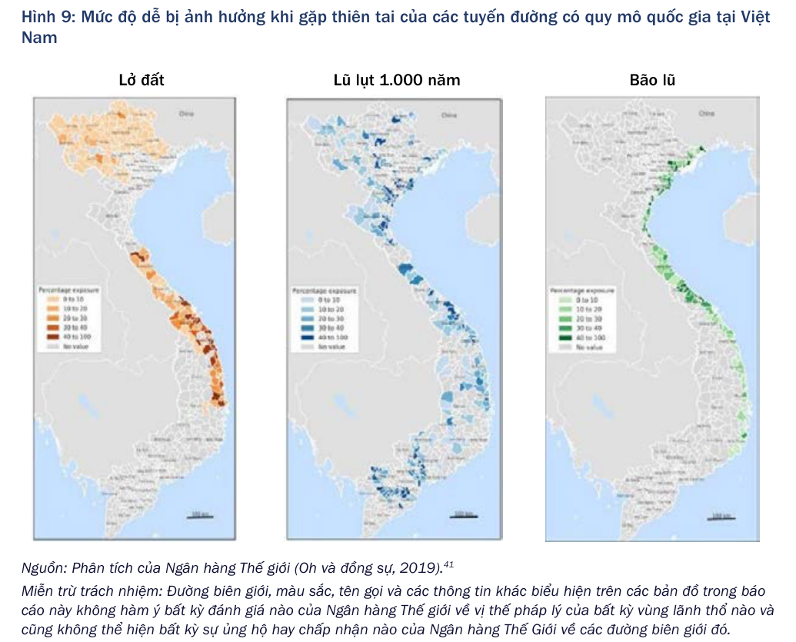

### V1_rerank: abstain (2 searches, 0 looks)

Các đoạn tìm được xác nhận Hình 9 (trang 37) gồm ba bản đồ: lở đất, lũ lụt 1.000 năm và bão lũ, thể hiện "tỷ lệ phơi nhiễm" (%) của các tuyến đường quốc gia, nguồn Oh và đồng sự (2019) [CCDR-p037-H9]. Tuy nhiên, phần chữ trích từ hình không ghi màu sắc của từng bản đồ, và tôi không tìm thấy đoạn văn bản nào nêu chú giải màu. Chỉ có phần mô tả do model tạo (không phải nguồn gốc của báo cáo) ghi bản đồ bão lũ dùng màu xanh lá, nhưng thông tin này chưa được đối chiếu với hình gốc nên không thể xem là bằng chứng. Để trả lời chắc chắn, cần xem chú giải của Hình 9 trên trang 37.

- cited CCDR-p037-H9 (PDF page 37, printed 27)
  
- evidence in context: True

### V0_dense: abstain (2 searches, 0 looks)

Không đủ bằng chứng để xác định bản đồ nào dùng thang màu xanh lục. Hình 9 (trang PDF 37) có ba bản đồ với tiêu đề lở đất, lũ lụt 1.000 năm và bão lũ, thể hiện "Percentage exposure" (tỷ lệ phơi nhiễm, %) của các tuyến đường quốc gia, nguồn Oh và đồng sự (2019) [CCDR-p037-H9]. Tuy nhiên, các đoạn tìm được không ghi rõ màu của chú giải từng bản đồ. Phần mô tả do model tạo cho rằng bão lũ là màu xanh lá, nhưng đó chỉ là thông tin định hướng, chưa được đối chiếu với hình, nên tôi không khẳng định. Để trả lời chắc chắn, cần xem trực tiếp chú giải của Hình 9 trong báo cáo.

- cited CCDR-p037-H9 (PDF page 37, printed 27)
  
- evidence in context: True

## ad-t12 (bieu_do, answerable)

**Question:** Theo Hình 13, phát thải GHG ngành điện năm 2040 của kịch bản CPS và của kịch bản ADS là bao nhiêu triệu tấn CO2e?

**Expected:** CPS: 246 triệu tấn CO2e; ADS: 63 triệu tấn CO2e.

**Grading:** Đúng hai giá trị và đơn vị triệu tấn CO2e, đúng gắn với từng kịch bản.

- Evidence: Nhãn cuối hai đường của biểu đồ đường bên phải (PDF page 56, Hình 13, biểu đồ phải, năm 2040): 246; 63
  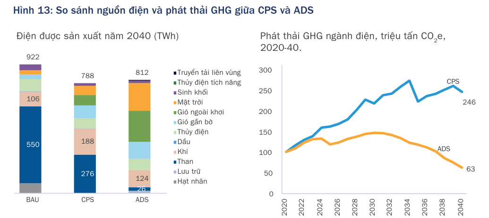

### V1_rerank: answered (2 searches, 0 looks)

Theo Hình 13, phát thải GHG ngành điện năm 2040 là khoảng 246 triệu tấn CO2e ở kịch bản CPS và khoảng 63 triệu tấn CO2e ở kịch bản ADS [CCDR-p056-H13]. Lưu ý: các số này lấy từ phần mô tả hình do công cụ tạo, còn chữ trích từ hình chỉ ghi các số 246 và 63 mà không nêu rõ cột nào, nên cần đối chiếu lại với hình gốc. Văn bản nêu ADS giúp giảm khoảng 80% phát thải ngành điện năm 2040 so với CPS [CCDR-p054-t03]; con số 63/246 tương ứng mức giảm khoảng 74%, không khớp hoàn toàn với 80%.

- cited CCDR-p056-H13 (PDF page 56, printed 46)
  
- cited CCDR-p054-t03 (PDF page 54, printed 44)
- evidence in context: True

### V0_dense: answered (1 searches, 0 looks)

Theo Hình 13, phát thải GHG ngành điện năm 2040 là khoảng 246 triệu tấn CO2e ở kịch bản CPS và khoảng 63 triệu tấn CO2e ở kịch bản ADS [CCDR-p056-H13]. Lưu ý: phần chữ trích từ hình chỉ ghi các số 246 và 63 mà không gắn rõ nhãn, nên việc gán 246 cho CPS và 63 cho ADS dựa trên mô tả của hình và chưa được xác nhận trực tiếp từ nhãn. Văn bản cũng nêu ADS giúp giảm khoảng 80% phát thải ngành điện vào năm 2040 so với CPS [CCDR-p054-t03]; tỷ lệ 63/246 tương ứng giảm khoảng 74%, hơi khác con số "khoảng 80%" này.

- cited CCDR-p056-H13 (PDF page 56, printed 46)
  
- cited CCDR-p054-t03 (PDF page 54, printed 44)
- evidence in context: True

## ad-t13 (bieu_do, answerable)

**Question:** Trong Hình 20, mức thay đổi việc làm năm 2040 của ngành Điện ở kịch bản NZP đã cải cách và của ngành Vận tải ở kịch bản NZP là bao nhiêu phần trăm?

**Expected:** Điện, NZP đã cải cách: +23,6%; Vận tải, NZP: −6,3%.

**Grading:** Đúng hai giá trị kèm dấu và đúng chuỗi (cột cam cho NZP đã cải cách, cột xanh cho NZP).

- Evidence: Cột cam của ngành Điện và cột xanh của ngành Vận tải (PDF page 72, Hình 20): 23,6; -6,3
  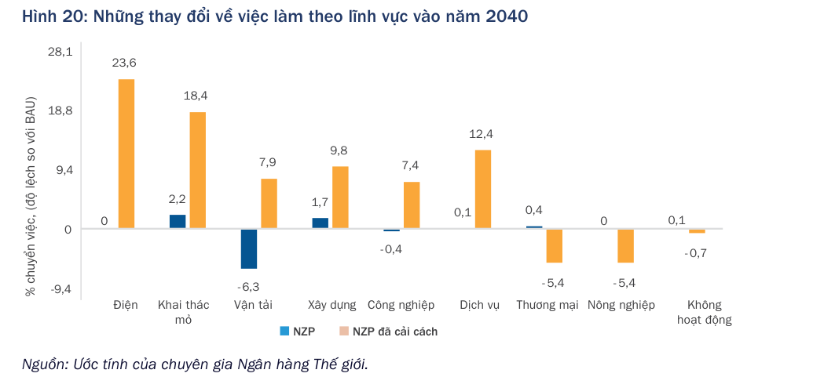

### V1_rerank: answered (1 searches, 0 looks)

Theo Hình 20 (đơn vị: % chuyển việc, độ lệch so với BAU, năm 2040):
- Ngành Điện, kịch bản NZP đã cải cách: khoảng +23,6% [CCDR-p072-H20].
- Ngành Vận tải, kịch bản NZP: khoảng -6,3% (tức giảm 6,3%) [CCDR-p072-H20].

Lưu ý: văn bản trích từ hình không ghi rõ số nào thuộc cột nào. Cách ghép giá trị trên dựa vào mô tả do model tạo, nên nên đối chiếu lại với hình gốc trước khi trích dẫn chính thức.

- cited CCDR-p072-H20 (PDF page 72, printed 62)
  
- evidence in context: True

### V0_dense: answered (1 searches, 0 looks)

Theo Hình 20 (năm 2040, % chuyển việc so với BAU):
- Ngành Điện ở kịch bản NZP đã cải cách: tăng 23,6% [CCDR-p072-H20].
- Ngành Vận tải ở kịch bản NZP: giảm 6,3% (-6,3%) [CCDR-p072-H20].

Lưu ý: chữ trích từ hình bị lộn thứ tự, nên việc gán từng số cho từng cột/lĩnh vực dựa trên phần mô tả hình, chưa được đối chiếu trực tiếp với hình gốc.

- cited CCDR-p072-H20 (PDF page 72, printed 62)
  
- evidence in context: True

## ad-t14 (bieu_do, answerable)

**Question:** Theo Hình 22, dư nợ tín dụng xanh năm 2016 và năm 2019 là bao nhiêu tỷ USD, và tăng thêm bao nhiêu trong giai đoạn đó?

**Expected:** 2016: 3,7 tỷ USD; 2019: 13,9 tỷ USD; tăng thêm 10,2 tỷ USD.

**Grading:** Đúng hai giá trị và hiệu 10,2.

- Evidence: Cột 2016 và 2019 của biểu đồ trái (PDF page 78, Hình 22, biểu đồ trái): 3,7; 13,9
  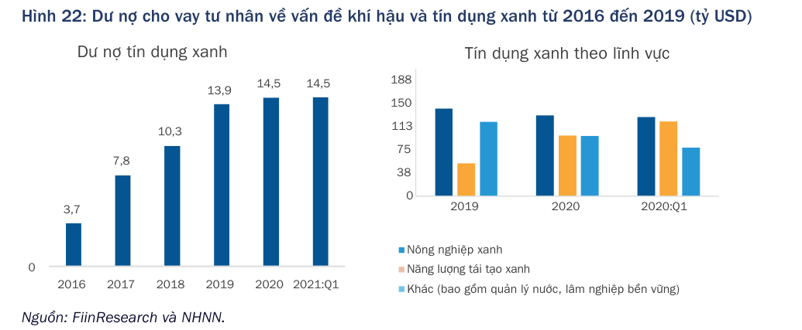

### V1_rerank: answered (1 searches, 0 looks)

Theo Hình 22, dư nợ tín dụng xanh khoảng 3,7 tỷ USD năm 2016 và 13,9 tỷ USD năm 2019 [CCDR-p078-H22]. Mức tăng trong giai đoạn này khoảng 10,2 tỷ USD (13,9 − 3,7) [CCDR-p078-H22]. Lưu ý: chữ trích từ hình không ghi rõ giá trị nào ứng với năm nào; việc gán năm dựa trên thứ tự các giá trị, nên cần đối chiếu với hình gốc.

- cited CCDR-p078-H22 (PDF page 78, printed 68)
  
- evidence in context: True

### V0_dense: answered (1 searches, 0 looks)

Theo Hình 22, dư nợ cho vay tư nhân về khí hậu và tín dụng xanh ước đạt khoảng 3,7 tỷ USD vào năm 2016 và 13,9 tỷ USD vào năm 2019 [CCDR-p078-H22]. Mức tăng trong giai đoạn 2016–2019 là khoảng 13,9 − 3,7 = 10,2 tỷ USD.

Lưu ý: Dữ liệu trích từ hình chỉ có sáu giá trị (3,7; 7,8; 10,3; 13,9; 14,5; 14,5) và nhãn năm bị thiếu trong phần trích chữ. Việc gán 3,7 cho 2016 và 13,9 cho 2019 dựa trên thứ tự cột và tiêu đề hình (2016–2019), chưa được xác nhận trực tiếp từ nhãn trên hình. Nguồn: FiinResearch và NHNN.

- cited CCDR-p078-H22 (PDF page 78, printed 68)
  
- evidence in context: True

## ad-t15 (bieu_do, answerable)

**Question:** Trong Hình 7, năm 2018 (sơ bộ), tỷ trọng sản lượng của doanh nghiệp nhà nước trong ngành phân hóa học và trong ngành xi măng là bao nhiêu phần trăm?

**Expected:** Phân hóa học: 94%; xi măng: 35%.

**Grading:** Đúng hai giá trị gắn đúng ngành.

- Evidence: Nhãn cuối đường Phân hóa học và Xi măng (PDF page 26, Hình 7, năm 2018 (sơ bộ)): 94%; 35%
  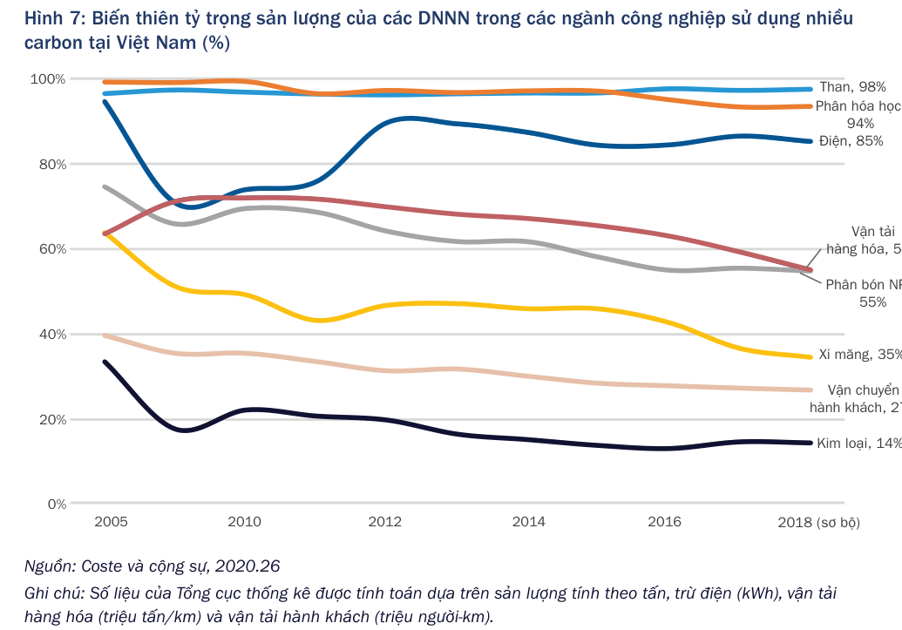

### V1_rerank: answered (1 searches, 0 looks)

Theo Hình 7 (năm 2018, sơ bộ), tỷ trọng sản lượng của doanh nghiệp nhà nước là khoảng 94% trong ngành phân hóa học và 35% trong ngành xi măng. Các con số này là nhãn ghi trên hình, và đoạn trích không cho biết rõ nhãn nào gắn với đường nào, nên tôi đọc theo tên ngành ghi cạnh giá trị [CCDR-p026-H7].

- cited CCDR-p026-H7 (PDF page 26, printed 16)
  
- evidence in context: True

### V0_dense: answered (1 searches, 0 looks)

Theo Hình 7, tỷ trọng sản lượng của doanh nghiệp nhà nước năm 2018 (sơ bộ) là: ngành phân hóa học 94% [CCDR-p026-H7]; ngành xi măng 35% [CCDR-p026-H7]. Các con số này lấy từ nhãn ghi trên hình.

- cited CCDR-p026-H7 (PDF page 26, printed 16)
  
- evidence in context: True

## ad-t16 (bieu_do, answerable)

**Question:** Trong Hình 19, đến năm 2040 nhóm hàng nào có chỉ số giá tăng nhiều nhất so với BAU và nhóm nào giảm sâu nhất?

**Expected:** Tăng nhiều nhất: Năng lượng (khoảng +15%); giảm sâu nhất: Y tế (khoảng −1,5%).

**Grading:** Đúng hai nhóm (Năng lượng; Y tế); giá trị gần đúng là tùy chọn.

- Evidence: Điểm cuối năm 2040 của đường cao nhất (Năng lượng) và thấp nhất (Y tế) (PDF page 71, Hình 19): Năng lượng; Y tế
  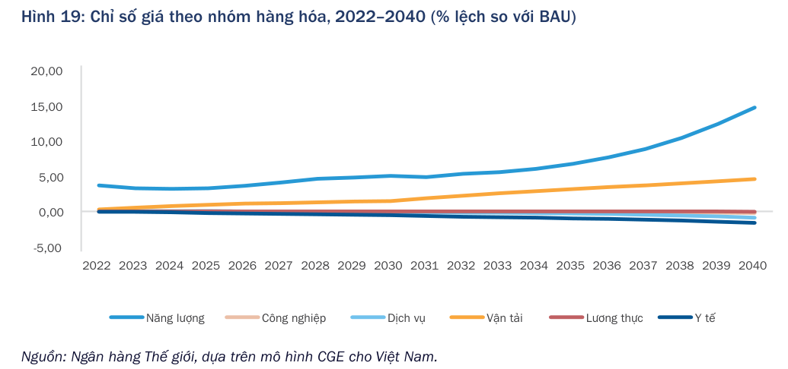

### V1_rerank: answered (2 searches, 0 looks)

Theo Hình 19, năm 2040: nhóm Năng lượng có chỉ số giá tăng nhiều nhất so với BAU, khoảng +14,9% (ước lượng từ trục, vì biểu đồ không in giá trị) [CCDR-p071-H19]. Vận tải đứng thứ hai, khoảng +4,8% [CCDR-p071-H19]. Nhóm giảm sâu nhất là Dịch vụ, khoảng -2,5% (ước lượng), sâu hơn Y tế khoảng -1,5% [CCDR-p071-H19]. Lương thực và Công nghiệp gần như không đổi so với BAU [CCDR-p071-H19]. Lưu ý: các con số trên là ước lượng từ đồ thị do mô tả tự động, chưa được xác nhận bằng số liệu in trong báo cáo, và một số đường bị che khuất phần lớn.

- cited CCDR-p071-H19 (PDF page 71, printed 61)
  
- evidence in context: True

### V0_dense: answered (2 searches, 0 looks)

Hình 19 (trang 71) là biểu đồ đường chỉ số giá theo sáu nhóm hàng, 2022–2040, đo bằng % lệch so với BAU [CCDR-p071-H19]. Hình không in giá trị nên các con số dưới đây chỉ là ước lượng từ trục, chưa được xác nhận bằng văn bản:

- Tăng nhiều nhất: Năng lượng, khoảng +14,9% vào năm 2040, và tăng mạnh nhất từ 2035 trở đi [CCDR-p071-H19]. Vận tải đứng thứ hai, khoảng +4,8% [CCDR-p071-H19].
- Giảm sâu nhất: Dịch vụ, khoảng -2,5% vào năm 2040; Y tế khoảng -1,5% [CCDR-p071-H19]. Lương thực và Công nghiệp gần như không đổi so với BAU [CCDR-p071-H19].

Nếu cần con số chính xác, cần tra bộ số liệu gốc của mô hình CGE, vì báo cáo không ghi giá trị trên hình.

- cited CCDR-p071-H19 (PDF page 71, printed 61)
  
- evidence in context: True

## ad-t17 (multi_hop, answerable)

**Question:** Trong Bảng 5, cộng các thay đổi chi phí vốn của từng nguồn (than đá, khí đốt, mặt trời, gió trên bờ, gió ngoài khơi, thủy điện và năng lượng tái tạo khác, lưu trữ) thì có khớp với thay đổi chi phí vốn để lưu trữ và phát điện mới không? Nêu tổng.

**Expected:** Có: −19 − 8 + 21 + 8 + 39 + 0 + 3 = +44 tỷ USD, khớp hàng "Chi phí vốn để lưu trữ và phát điện mới" (+44).

**Grading:** Nêu đúng tổng +44 và kết luận khớp; hàng "thủy điện và tái tạo khác" ~0 tính bằng 0.

- Evidence: Hàng chi phí vốn +44 và các hàng thành phần than đá −19, khí đốt −8 (PDF page 56, Bảng 5, trang 56): +44; -19; -8
  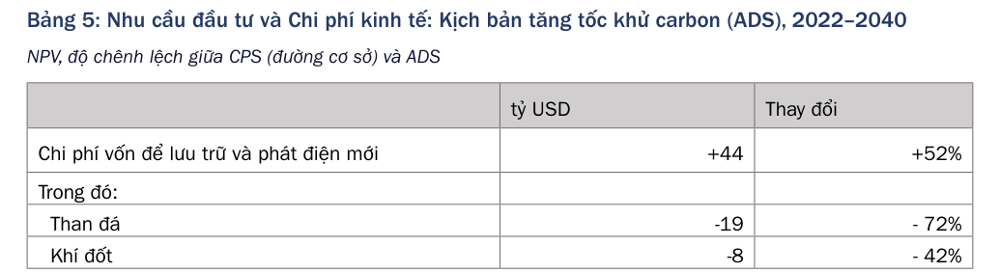
- Evidence: Các hàng mặt trời, gió, tái tạo khác, lưu trữ ở trang tiếp theo (PDF page 57, Bảng 5 (tiếp), trang 57): +21; +8; +39; ~0; +3
  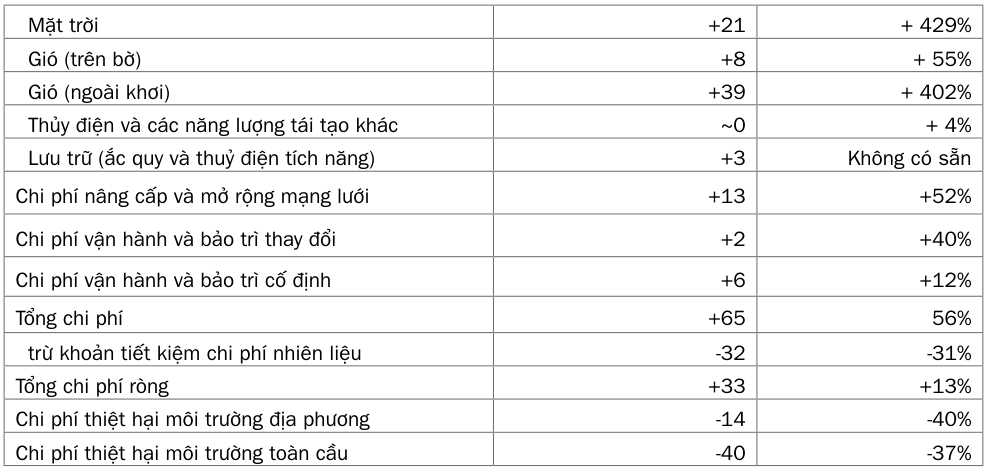

### V1_rerank: answered (1 searches, 0 looks)

Có khớp. Tổng các nguồn: than đá −19, khí đốt −8, mặt trời +21, gió trên bờ +8, gió ngoài khơi +39, thủy điện và năng lượng tái tạo khác ~0, lưu trữ +3. Phép tính: −19 − 8 + 21 + 8 + 39 + 0 + 3 = +44 tỷ USD (NPV, 2022–2040, ADS so với CPS), trùng với dòng "Chi phí vốn để lưu trữ và phát điện mới" +44 tỷ USD (+52%) [CCDR-p056-B5], [CCDR-p057-B5c]. Mục thủy điện ghi "~0" nên khớp ở mức làm tròn.

- cited CCDR-p056-B5 (PDF page 56, printed 46)
  
- cited CCDR-p057-B5c (PDF page 57, printed 47)
  
- evidence in context: True

### V0_dense: answered (1 searches, 0 looks)

Có khớp. Bảng 5 (kịch bản ADS, 2022–2040, NPV, tỷ USD) ghi chi phí vốn để lưu trữ và phát điện mới là +44 [CCDR-p056-B5]. Các thành phần đọc được: than đá -19 và khí đốt -8 [CCDR-p056-B5]; mặt trời +21, gió trên bờ +8, gió ngoài khơi +39, thủy điện và năng lượng tái tạo khác ~0, lưu trữ +3 [CCDR-p057-B5c].

Tổng: -19 - 8 + 21 + 8 + 39 + 0 + 3 = +44 tỷ USD, trùng với mức +44 của chi phí vốn tổng. Lưu ý: thủy điện và các nguồn tái tạo khác ghi là "~0" nên được coi là không đáng kể trong phép cộng.

- cited CCDR-p056-B5 (PDF page 56, printed 46)
  
- cited CCDR-p057-B5c (PDF page 57, printed 47)
  
- evidence in context: True

## ad-t18 (multi_hop, answerable)

**Question:** Tính công suất nhiệt điện than năm 2020 từ Hình 12 rồi đối chiếu với con số trong văn bản: hai nguồn cho kết quả thế nào?

**Expected:** Hình 12: 30% × 68 GW ≈ 20,4 GW; văn bản nêu công suất nhiệt điện than tăng từ 5 GW (2010) lên 20 GW (2020), tức hai nguồn khớp ở mức ~20 GW.

**Grading:** Đúng 68 GW, 30%, kết quả ~20 GW và con số 20 GW trong văn bản.

- Evidence: Tổng công suất 68 GW và phần than đá 30% (PDF page 54, Hình 12, biểu đồ trái): 68 GW; 30%
  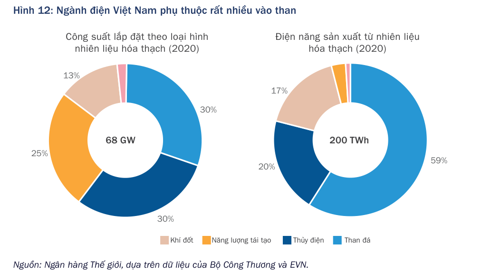
- Evidence: Đoạn nêu công suất nhiệt điện than tăng từ 5 GW năm 2010 lên 20 GW năm 2020 (PDF page 53, Mục 4.3.1): 20 GW

### V1_rerank: answered (2 searches, 0 looks)

Hai nguồn khớp nhau ở mức làm tròn. Từ Hình 12: tổng công suất lắp đặt 2020 là 68 GW, than đá chiếm 30%, nên công suất than ≈ 0,30 × 68 ≈ 20,4 GW [CCDR-p054-H12]. Hình chỉ cho tỷ trọng đã làm tròn, nên khoảng thực tế khoảng 20,1–20,7 GW nếu tỷ trọng là 29,5–30,5%. Văn bản nêu công suất nhiệt điện than tăng từ 5 GW (2010) lên 20 GW (2020) và chiếm khoảng 30% công suất lắp đặt năm 2020 [CCDR-p053-t02]. Đối chiếu: 20,4 GW so với 20 GW chênh khoảng 2%, trong sai số làm tròn; tỷ trọng 30% khớp ở cả hai nguồn. Lưu ý: tiêu đề phụ của Hình 12 ghi "theo loại hình nhiên liệu hóa thạch" nhưng chú giải có cả tái tạo và thủy điện trong tổng 68 GW, nên tôi giả định 68 GW là tổng công suất toàn hệ thống.

- cited CCDR-p054-H12 (PDF page 54, printed 44)
  
- cited CCDR-p053-t02 (PDF page 53, printed 43)
- evidence in context: True

### V0_dense: answered (2 searches, 0 looks)

Hai nguồn khớp nhau.

- Từ Hình 12: tổng công suất lắp đặt nhóm nhiên liệu hóa thạch năm 2020 là 68 GW, và than đá chiếm 30% [CCDR-p054-H12]. Tính: 68 GW × 30% ≈ 20,4 GW.
- Văn bản: công suất nhiệt điện than tăng từ 5 GW (2010) lên 20 GW (2020), và năm 2020 nhiệt điện than chiếm khoảng 30% công suất lắp đặt [CCDR-p053-t02].

Kết quả: khoảng 20,4 GW từ phép tính so với 20 GW trong văn bản, chênh lệch rất nhỏ, do làm tròn. Lưu ý: tỷ lệ 30% được đọc từ nhãn của hình, và hình không ghi số GW riêng cho than.

- cited CCDR-p054-H12 (PDF page 54, printed 44)
  
- cited CCDR-p053-t02 (PDF page 53, printed 43)
- evidence in context: True

## ad-t19 (multi_hop, answerable)

**Question:** Khi thực hiện NZP cùng tất cả các biện pháp hỗ trợ, GDP năm 2040 thay đổi bao nhiêu phần trăm (Bảng 4) và mức sản lượng tăng tích lũy giai đoạn 2022–2040 của kịch bản NZP có cải cách là bao nhiêu tỷ USD (Bảng 3)?

**Expected:** GDP 2040: +3,3% (Bảng 4); mức sản lượng tăng 2022–2040: 80,1 tỷ USD NPV (Bảng 3).

**Grading:** Đúng +3,3% và 80,1 tỷ USD, gắn đúng bảng và đúng hàng.

- Evidence: Hàng NZP và tất cả các biện pháp hỗ trợ, GDP 2040 (PDF page 53, Bảng 4): 3,3
  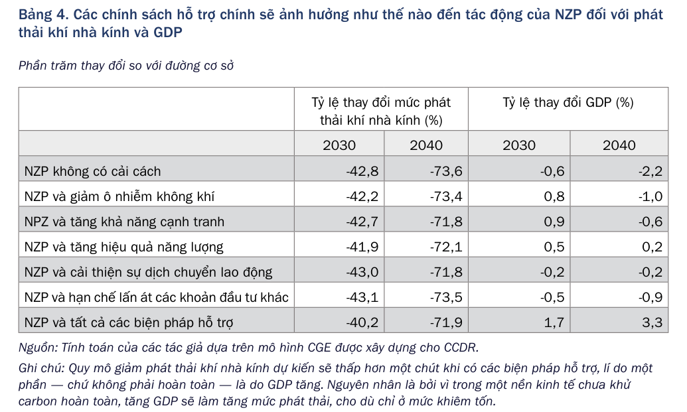
- Evidence: Khối NZP với cải cách, hàng Mức sản lượng tăng, cột 2022–2040 (PDF page 50, Bảng 3): 80,1
  

### V1_rerank: answered (2 searches, 0 looks)

- GDP năm 2040 của kịch bản "NZP và tất cả các biện pháp hỗ trợ" tăng 3,3% so với BAU (năm 2030 tăng 1,7%) [CCDR-p053-B4][CCDR-p052-t04].
- Mức sản lượng tăng tích lũy giai đoạn 2022–2040 của kịch bản "NZP với những cải cách hỗ trợ" là 80,1 tỷ USD, theo NPV với tỷ lệ chiết khấu 6% [CCDR-p050-B3]. Đoạn văn bản làm tròn thành 80 tỷ USD [CCDR-p052-t04].

- cited CCDR-p053-B4 (PDF page 53, printed 43)
  
- cited CCDR-p052-t04 (PDF page 52, printed 42)
- cited CCDR-p050-B3 (PDF page 50, printed 40)
  
- evidence in context: True

### V0_dense: answered (2 searches, 0 looks)

- GDP năm 2040 (Bảng 4): khi thực hiện NZP cùng tất cả các biện pháp hỗ trợ, GDP tăng 3,3% so với BAU vào năm 2040 (và 1,7% vào năm 2030) [CCDR-p053-B4][CCDR-p052-t04]. Lưu ý, cùng hàng này, phát thải năm 2040 giảm 71,9%.
- Mức sản lượng tăng tích lũy 2022–2040 của NZP có cải cách (Bảng 3): 80,1 tỷ USD, tính theo NPV với tỷ lệ chiết khấu 6% [CCDR-p050-B3]. Đoạn văn cũng nêu tổng mức tăng sản lượng khoảng 80 tỷ USD so với BAU [CCDR-p052-t04].

- cited CCDR-p053-B4 (PDF page 53, printed 43)
  
- cited CCDR-p052-t04 (PDF page 52, printed 42)
- cited CCDR-p050-B3 (PDF page 50, printed 40)
  
- evidence in context: True

## ad-t20 (multi_hop, answerable)

**Question:** Với NZP không có cải cách, lượng phát thải khí nhà kính năm 2040 giảm bao nhiêu phần trăm so với đường cơ sở (Bảng 4), và chỉ số bất bình đẳng Gini năm 2040 thay đổi bao nhiêu so với BAU (Hình 18)?

**Expected:** Phát thải giảm 73,6% (−73,6%, Bảng 4); chỉ số Gini giảm 1,1 điểm so với BAU (−1,1, Hình 18).

**Grading:** Đúng −73,6% và −1,1, gắn đúng hàng "NZP không có cải cách" và đúng cột Bất bình đẳng.

- Evidence: Hàng NZP không có cải cách, cột phát thải 2040 (PDF page 53, Bảng 4): -73,6
  
- Evidence: Cột Bất bình đẳng (chỉ số Gini) (PDF page 70, Hình 18): -1,1
  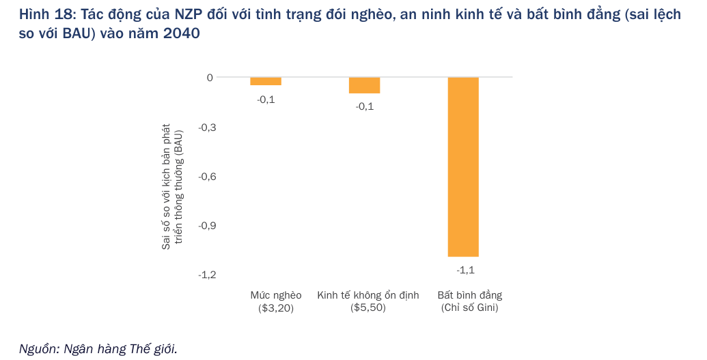

### V1_rerank: answered (2 searches, 0 looks)

1) Phát thải khí nhà kính: Bảng 4 ghi NZP không có cải cách làm mức phát thải năm 2040 thay đổi -73,6% so với đường cơ sở (năm 2030 là -42,8%) [CCDR-p053-B4]. Bảng không ghi rõ đơn vị khác ngoài phần trăm thay đổi.

2) Chỉ số Gini năm 2040: Hình 18 cho thấy sai lệch của chỉ số Gini so với BAU vào khoảng -1,1 (cột có giá trị âm, lớn nhất trong ba chỉ số) [CCDR-p070-H18]. Tuy nhiên, có hai điểm cần lưu ý: (a) trục tung không ghi đơn vị, và hình ghi nhãn chung là "NZP", không nói rõ là NZP không có cải cách; (b) đoạn văn lại viết rằng bất bình đẳng (Gini) "sẽ tăng nhẹ so với BAU vào năm 2040" [CCDR-p070-t01], mâu thuẫn với dấu âm trong hình. Vì vậy, không thể khẳng định chắc chắn chiều và mức thay đổi của Gini từ các đoạn đã tìm được.

- cited CCDR-p053-B4 (PDF page 53, printed 43)
  
- cited CCDR-p070-H18 (PDF page 70, printed 60)
  
- cited CCDR-p070-t01 (PDF page 70, printed 60)
- evidence in context: True

### V0_dense: answered (3 searches, 0 looks)

1) Phát thải: Với kịch bản "NZP không có cải cách", mức phát thải khí nhà kính năm 2040 thay đổi -73,6% so với đường cơ sở (BAU) [CCDR-p053-B4]. Đây là mức giảm lớn nhất trong các kịch bản ở Bảng 4.

2) Gini: Hình 18 thể hiện sai lệch so với BAU năm 2040; cột "Bất bình đẳng (Chỉ số Gini)" được ghi là khoảng -1,1 trên thang không có đơn vị [CCDR-p070-H18]. Tuy nhiên, phần văn bản lại nói bất bình đẳng (Gini) "sẽ tăng nhẹ so với BAU vào năm 2040" [CCDR-p070-t01]. Hai nguồn này mâu thuẫn về chiều thay đổi. Dữ liệu trích từ hình chưa xác nhận chắc chắn giá trị -1,1 gắn với cột Gini, nên cần kiểm tra lại hình gốc trước khi kết luận. Vì vậy, tôi không thể khẳng định chắc chắn mức thay đổi của Gini.

- cited CCDR-p053-B4 (PDF page 53, printed 43)
  
- cited CCDR-p070-H18 (PDF page 70, printed 60)
  
- cited CCDR-p070-t01 (PDF page 70, printed 60)
- evidence in context: True

## ad-t21 (text, answerable)

**Question:** Theo dữ liệu vệ tinh, nồng độ bụi PM2.5 trung bình năm trên cả nước cao hơn ngưỡng an toàn của WHO bao nhiêu lần, và ngưỡng đó là bao nhiêu?

**Expected:** Cao hơn từ 4 đến 5 lần; ngưỡng an toàn WHO là 10 µg/m3.

**Grading:** Đúng 4–5 lần và 10 µg/m3.

- Evidence: Đoạn mở đầu mục ô nhiễm không khí (PDF page 20, Đoạn đầu trang 20): 4-5 lần; 10 µg/m3

### V1_rerank: answered (1 searches, 0 looks)

Theo dữ liệu quan sát vệ tinh, được tính trung bình cho cả nước, nồng độ bụi PM2.5 trung bình năm luôn cao hơn từ 4 đến 5 lần so với ngưỡng an toàn của WHO, tức 10 microgam trên mét khối không khí (µg/m³) [CCDR-p020-t01]. Báo cáo không nêu số liệu chi tiết theo từng năm.

- cited CCDR-p020-t01 (PDF page 20, printed 10)
- evidence in context: True

### V0_dense: answered (1 searches, 0 looks)

Theo dữ liệu quan sát vệ tinh, tính trung bình cho cả nước, nồng độ bụi PM2.5 trung bình năm luôn cao hơn từ 4–5 lần so với ngưỡng an toàn của WHO. Ngưỡng đó là 10 microgam PM2.5 trên mét khối không khí (μg/m3) [CCDR-p020-t01].

- cited CCDR-p020-t01 (PDF page 20, printed 10)
- evidence in context: True

## ad-t22 (text, answerable)

**Question:** Thiệt hại nông nghiệp do biến đổi khí hậu ở Việt Nam quanh năm 2050 là bao nhiêu phần trăm theo kịch bản RCP8.5?

**Expected:** 10,6% (so với 7,6% theo RCP2.6 và 7,9% theo RCP4.5).

**Grading:** Đúng 10,6% và đúng kịch bản RCP8.5, năm 2050.

- Evidence: Đoạn nêu tổn thất theo ba kịch bản RCP quanh năm 2030 và 2050 (PDF page 34, Mục 3.3.1): 10,6%

### V1_rerank: answered (1 searches, 0 looks)

Theo kịch bản RCP8.5, thiệt hại nông nghiệp do biến đổi khí hậu ở Việt Nam quanh năm 2050 là 10,6% (so với sản lượng trong trường hợp không có biến đổi khí hậu của cùng năm). Để so sánh, cùng giai đoạn này, RCP2.6 là 7,6% và RCP4.5 là 7,9%. Mức 10,6% là tổn thất sản lượng ước lượng theo mô hình IFPRI, không phải tổng thiệt hại kinh tế [CCDR-p034-t01].

- cited CCDR-p034-t01 (PDF page 34, printed 24)
- evidence in context: True

### V0_dense: answered (1 searches, 0 looks)

Theo IFPRI, thiệt hại (tổn thất sản lượng) nông nghiệp do biến đổi khí hậu quanh năm 2050 theo kịch bản RCP8.5 là 10,6% so với trường hợp không có biến đổi khí hậu. Để so sánh, mức này là 7,6% (RCP2.6) và 7,9% (RCP4.5) [CCDR-p034-t01].

- cited CCDR-p034-t01 (PDF page 34, printed 24)
- evidence in context: True

## ad-t23 (text, answerable)

**Question:** Ngoài mục tiêu phát thải ròng bằng 0 vào năm 2050, Việt Nam đã đưa ra những cam kết nào tại COP26?

**Expected:** Cùng hơn 100 quốc gia cam kết chấm dứt chặt phá rừng; giảm 30% phát thải khí mêtan so với năm 2020 vào năm 2030; chấm dứt đầu tư vào sản xuất nhiệt điện than mới; mở rộng năng lượng tái tạo; dần loại bỏ nhiệt điện than cho tới thập kỷ 2040.

**Grading:** Đạt khi nêu đúng ít nhất bốn trong năm cam kết, gồm khí mêtan −30% vào 2030 và chấm dứt đầu tư nhiệt điện than mới.

- Evidence: Đoạn nêu các cam kết tại COP26 (PDF page 23, Mục 2.1): rừng; mêtan 30%; chấm dứt nhiệt điện than mới; năng lượng tái tạo; loại bỏ than 2040s

### V1_rerank: answered (2 searches, 0 looks)

Ngoài cam kết đạt phát thải GHG ròng bằng "0" vào năm 2050, tại COP26 Việt Nam còn đưa ra các cam kết sau:
- Cùng hơn 100 quốc gia cam kết chấm dứt nạn chặt phá rừng và giảm 30% phát thải khí mêtan so với năm 2020 vào năm 2030 [CCDR-p023-t02].
- Cam kết chấm dứt mọi hoạt động đầu tư vào sản xuất nhiệt điện than mới, mở rộng triển khai năng lượng tái tạo và dần loại bỏ nhiệt điện than cho tới thập kỷ 2040 [CCDR-p023-t02].
- Ký "Tuyên bố chung toàn cầu về chuyển dịch từ than sang năng lượng sạch", với mục tiêu loại bỏ sản xuất điện than vào thập niên 2040 [CCDR-p054-t02].
Báo cáo cho biết các cam kết này vượt ra ngoài những cam kết trong bản cập nhật NDC đệ trình năm 2020 [CCDR-p023-t02].

- cited CCDR-p023-t02 (PDF page 23, printed 13)
- cited CCDR-p054-t02 (PDF page 54, printed 44)
- evidence in context: True

### V0_dense: answered (2 searches, 0 looks)

Ngoài mục tiêu phát thải GHG ròng bằng "0" vào năm 2050, tại COP26 Việt Nam đã đưa ra các cam kết sau:
- Cùng hơn 100 quốc gia cam kết chấm dứt nạn phá rừng và giảm 30% phát thải khí mêtan so với năm 2020 vào năm 2030 [CCDR-p023-t02].
- Cam kết ngăn chặn và đẩy lùi tình trạng mất và suy thoái rừng vào năm 2030 cùng hơn 100 quốc gia khác [CCDR-p036-t03].
- Chấm dứt mọi hoạt động đầu tư vào sản xuất nhiệt điện than mới, mở rộng triển khai năng lượng tái tạo và dần loại bỏ nhiệt điện than cho tới thập kỷ 2040 [CCDR-p023-t02].
- Ký "Tuyên bố chung toàn cầu về chuyển dịch từ than sang năng lượng sạch", với mục tiêu loại bỏ sản xuất điện than vào thập niên 2040 [CCDR-p054-t02].
Các cam kết này được nêu là vượt ra ngoài những cam kết trong bản cập nhật NDC năm 2020 [CCDR-p023-t02]. Báo cáo cũng lưu ý mục tiêu phát thải ròng bằng 0 chưa được đưa vào chiến lược quốc gia hay ngành nào, kể cả PDP8 [CCDR-p023-t05].

- cited CCDR-p023-t02 (PDF page 23, printed 13)
- cited CCDR-p036-t03 (PDF page 36, printed 26)
- cited CCDR-p054-t02 (PDF page 54, printed 44)
- cited CCDR-p023-t05 (PDF page 23, printed 13)
- evidence in context: True

## ad-t24 (text, answerable)

**Question:** Việt Nam hiện nhập khoảng bao nhiêu triệu tấn than mỗi năm (ước tính năm 2022) và nguồn cung trong nước là bao nhiêu?

**Expected:** Khoảng 55 triệu tấn than nhập khẩu mỗi năm; khoảng 40 triệu tấn do trong nước cung cấp.

**Grading:** Đúng 55 và 40 triệu tấn, gắn đúng nhập khẩu và trong nước.

- Evidence: Đoạn nêu lượng than nhập khẩu và trong nước (PDF page 58, Mục 4.3.1): 55; 40

### V1_rerank: answered (1 searches, 0 looks)

Theo báo cáo, Việt Nam hiện nhập khoảng 55 triệu tấn than mỗi năm (ước tính năm 2022), và phần còn lại, khoảng 40 triệu tấn, do trong nước cung cấp [CCDR-p058-t02]. Tổng nhu cầu vì vậy khoảng 95 triệu tấn/năm (phép cộng từ hai con số trên). Khoảng 72% lượng than tiêu thụ trong nước dùng để sản xuất điện [CCDR-p058-t02].

- cited CCDR-p058-t02 (PDF page 58, printed 48)
- evidence in context: True

### V0_dense: answered (1 searches, 0 looks)

Theo báo cáo, Việt Nam hiện nhập khoảng 55 triệu tấn than mỗi năm (ước tính năm 2022), và phần còn lại khoảng 40 triệu tấn do trong nước cung cấp. Khoảng 72% lượng than tiêu thụ trong nước được dùng để sản xuất điện [CCDR-p058-t02].

- cited CCDR-p058-t02 (PDF page 58, printed 48)
- evidence in context: True

## ad-t25 (thieu_bang_chung, no evidence)

**Question:** Tại COP28, Việt Nam đã công bố cam kết mới nào về loại bỏ nhiệt điện than?

**Expected:** Từ chối: tài liệu không có thông tin này; không thêm khẳng định vô căn cứ.

**Why:** Báo cáo xuất bản 07/2022, trước COP28; chỉ nêu cam kết tại COP26.

### V1_rerank: abstain (3 searches, 0 looks)

Các đoạn đã tìm không nêu cam kết nào của Việt Nam tại COP28 về loại bỏ nhiệt điện than; không có đoạn nào nhắc đến COP28. Các đoạn tìm được chỉ nói về cam kết tại COP26 (năm 2021): Việt Nam cam kết chấm dứt đầu tư vào nhiệt điện than mới, mở rộng năng lượng tái tạo và dần loại bỏ nhiệt điện than cho tới thập kỷ 2040 [CCDR-p023-t02]; và ký "Tuyên bố chung toàn cầu về chuyển dịch từ than sang năng lượng sạch", với mục tiêu loại bỏ sản xuất điện than vào thập niên 40 thế kỷ 21 [CCDR-p054-t02]. Vì vậy không thể xác nhận cam kết mới tại COP28 từ tài liệu này.

- cited CCDR-p023-t02 (PDF page 23, printed 13)
- cited CCDR-p054-t02 (PDF page 54, printed 44)
- evidence in context: n/a

### V0_dense: abstain (2 searches, 0 looks)

Hai lần tìm kiếm không cho thấy đoạn nào của báo cáo nói về COP28 hay một cam kết mới của Việt Nam về loại bỏ nhiệt điện than tại COP28. Báo cáo chỉ nêu các cam kết tại COP26: Việt Nam đã cam kết chấm dứt mọi hoạt động đầu tư vào sản xuất nhiệt điện than mới, mở rộng năng lượng tái tạo và dần loại bỏ nhiệt điện than cho tới thập kỷ 2040 [CCDR-p023-t02]. Việt Nam cũng đã ký Tuyên bố chung toàn cầu về chuyển dịch từ than sang năng lượng sạch, với mục tiêu loại bỏ sản xuất điện than vào thập niên 40 của thế kỷ 21 [CCDR-p054-t02]. Vì vậy không thể xác nhận cam kết nào tại COP28 từ nội dung hiện có.

- cited CCDR-p023-t02 (PDF page 23, printed 13)
- cited CCDR-p054-t02 (PDF page 54, printed 44)
- evidence in context: n/a

## ad-t26 (thieu_bang_chung, no evidence)

**Question:** Thiệt hại do biến đổi khí hậu năm 2020 của tỉnh Bến Tre là bao nhiêu triệu USD?

**Expected:** Từ chối: tài liệu không có thông tin này; không thêm khẳng định vô căn cứ.

**Why:** Báo cáo chỉ nêu thiệt hại cấp quốc gia và theo hạng mục (Hình 3), không theo tỉnh.

### V1_rerank: abstain (5 searches, 0 looks)

Các đoạn đã tìm không nêu con số thiệt hại do biến đổi khí hậu năm 2020 riêng của tỉnh Bến Tre. Báo cáo chỉ có số liệu toàn quốc: năm 2020 Việt Nam thiệt hại khoảng 10 tỷ USD, tương đương 3,2% GDP, do tác động của biến đổi khí hậu [CCDR-p017-t01]. Hình 3 ước tính chi phí năm 2020 theo 9 nhóm tác động (đơn vị triệu USD), nhưng không tách theo tỉnh [CCDR-p017-H3]. Báo cáo chỉ nêu chung rằng Đồng bằng sông Cửu Long chịu nhiều rủi ro, chưa có số liệu riêng cho Bến Tre [CCDR-p040-t03].

- cited CCDR-p017-t01 (PDF page 17, printed 7)
- cited CCDR-p017-H3 (PDF page 17, printed 7)
  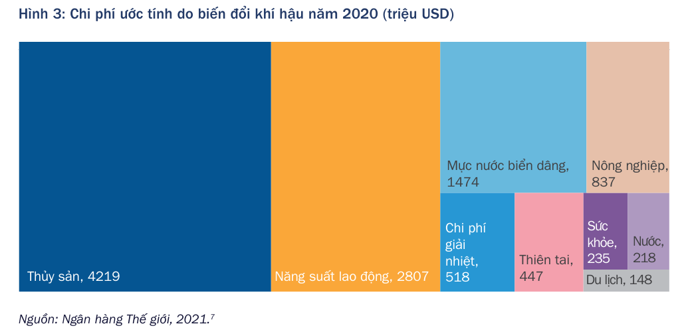
- cited CCDR-p040-t03 (PDF page 40, printed 30)
- evidence in context: n/a

### V0_dense: abstain (2 searches, 0 looks)

Các đoạn tìm được không nêu thiệt hại do biến đổi khí hậu năm 2020 của tỉnh Bến Tre. Đoạn có nêu số liệu năm 2020 chỉ nói về cả nước: Việt Nam thiệt hại khoảng 10 tỷ USD, tương đương 3,2% GDP, do tác động của biến đổi khí hậu [CCDR-p017-t01]. Báo cáo không có số liệu riêng cho tỉnh Bến Tre trong các đoạn đã tìm, nên không thể trả lời con số cho tỉnh này.

- cited CCDR-p017-t01 (PDF page 17, printed 7)
- evidence in context: n/a

## ad-t27 (thieu_bang_chung, no evidence)

**Question:** Chi phí thu giữ và lưu trữ carbon (CCS) trong ngành điện là bao nhiêu USD cho mỗi tấn CO2?

**Expected:** Từ chối: tài liệu không có thông tin này; không thêm khẳng định vô căn cứ.

**Why:** Báo cáo chỉ nói quy hoạch điện có thể đánh giá tiềm năng thu giữ và lưu trữ carbon và mô hình không tính các công nghệ này; không nêu chi phí.

### V1_rerank: abstain (4 searches, 0 looks)

Các đoạn đã tìm không nêu chi phí CCS (thu giữ và lưu trữ carbon) trong ngành điện tính bằng USD cho mỗi tấn CO2. Các đoạn liên quan chỉ cho thấy: CCS được nhắc đến như một công cụ cần đánh giá tiềm năng trong quy hoạch điện khi loại bỏ dần than, nhưng không có con số chi phí [CCDR-p061-t02]. Bảng 5 nêu chi phí vốn để lưu trữ và phát điện mới tăng 44 tỷ USD (+52%) trong kịch bản ADS giai đoạn 2022–2040, nhưng không tách riêng CCS và không tính theo đơn vị USD/tấn CO2 [CCDR-p056-B5]. Vì vậy không thể trả lời con số USD/tấn CO2 từ các đoạn đã tìm.

- cited CCDR-p061-t02 (PDF page 61, printed 51)
- cited CCDR-p056-B5 (PDF page 56, printed 46)
  
- evidence in context: n/a

### V0_dense: abstain (2 searches, 0 looks)

Các đoạn đã tìm không nêu chi phí CCS (USD/tấn CO2) trong ngành điện. Hai lần tìm kiếm chỉ cho thấy:
- Bảng 5 (chi phí đầu tư, NPV 2022–2040, kịch bản ADS so với CPS): chi phí vốn để lưu trữ và phát điện mới tăng +44 tỷ USD (+52%); than đá giảm 19 tỷ USD (-72%) và khí đốt giảm 8 tỷ USD (-42%). Bảng này không đề cập chi phí CCS theo tấn CO2 [CCDR-p056-B5].
- Hình 13 cho thấy sản lượng điện và phát thải GHG ngành điện, không có số liệu chi phí CCS [CCDR-p056-H13].
Vì vậy tôi không thể xác định chi phí CCS trên mỗi tấn CO2 từ báo cáo này.

- cited CCDR-p056-B5 (PDF page 56, printed 46)
  
- cited CCDR-p056-H13 (PDF page 56, printed 46)
  
- evidence in context: n/a

## ad-t28 (thieu_bang_chung, no evidence)

**Question:** Việt Nam hiện có bao nhiêu nhà máy sản xuất hydro xanh đang vận hành?

**Expected:** Từ chối: tài liệu không có thông tin này; không thêm khẳng định vô căn cứ.

**Why:** Báo cáo không đề cập hydro.

### V1_rerank: abstain (4 searches, 0 looks)

Không đủ bằng chứng trong các đoạn đã tìm để trả lời. Bốn lần tìm với các từ khóa "nhà máy sản xuất hydro xanh", "hydro xanh", "hydro sản xuất từ điện tái tạo", "hydrogen/ammonia xanh" không tìm thấy đoạn nào nêu số nhà máy hydro xanh đang vận hành ở Việt Nam. Các đoạn tìm được chỉ nói về tín dụng xanh, cơ cấu nguồn điện (Hình 12, Hình 13) và phát thải khí nhà kính, không đề cập hydro xanh.

- cited CCDR-p078-H22 (PDF page 78, printed 68)
  
- cited CCDR-p054-H12 (PDF page 54, printed 44)
  
- cited CCDR-p056-H13 (PDF page 56, printed 46)
  
- cited CCDR-p018-H4 (PDF page 18, printed 8)
  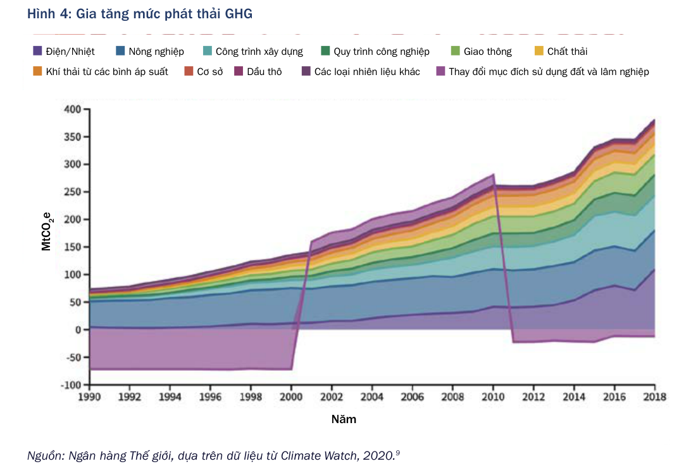
- evidence in context: n/a

### V0_dense: abstain (4 searches, 0 looks)

Các đoạn đã tìm không nêu số lượng nhà máy sản xuất hydro xanh đang vận hành ở Việt Nam. Sau ba lần tìm với các từ khóa "hydro xanh", "nhà máy sản xuất hydro xanh", "sản xuất hydro từ điện tái tạo", không có đoạn nào đề cập đến hydro xanh hay nhà máy hydro. Các đoạn liên quan chỉ nêu: công suất điện mặt trời lắp đặt khoảng 16,5 GW năm 2020 [CCDR-p059-t02]; ngành điện phụ thuộc than, với công suất lắp đặt năm 2020 tổng 68 GW [CCDR-p054-H12]; và kịch bản đến năm 2040 nhiên liệu hóa thạch giảm dưới 10% tổng công suất phát điện [CCDR-p055-t02]. Đây không phải thông tin về nhà máy hydro xanh.

- cited CCDR-p059-t02 (PDF page 59, printed 49)
- cited CCDR-p054-H12 (PDF page 54, printed 44)
  
- cited CCDR-p055-t02 (PDF page 55, printed 45)
- evidence in context: n/a

## ad-t29 (thieu_bang_chung, no evidence)

**Question:** Tỷ lệ hộ gia đình ở tỉnh An Giang có nguy cơ rơi vào nghèo do thiên tai là bao nhiêu phần trăm?

**Expected:** Từ chối: tài liệu không có thông tin này; không thêm khẳng định vô căn cứ.

**Why:** Báo cáo chỉ nêu tỷ lệ cấp quốc gia (khoảng 10%) và theo vùng, không có An Giang.

### V1_rerank: abstain (2 searches, 0 looks)

Các đoạn đã tìm không nêu tỷ lệ hộ gia đình riêng của tỉnh An Giang có nguy cơ rơi vào nghèo do thiên tai. Thông tin gần nhất trong báo cáo là số liệu toàn quốc: khoảng 10% hộ gia đình tại Việt Nam dễ rơi vào tình trạng nghèo đói do các hiện tượng liên quan đến khí hậu; mức độ này khác nhau theo loại rủi ro, gắn kết xã hội và tỷ lệ nghèo giữa các vùng. Báo cáo cũng nêu hộ ở Đồng bằng sông Cửu Long chịu ảnh hưởng nhiều nhất từ nước biển dâng, nhưng không có số liệu theo từng tỉnh như An Giang [CCDR-p043-t03]. Bản đồ rủi ro ngập lụt ven biển (Hình 11) không ghi giá trị số cho từng tỉnh [CCDR-p042-H11].

- cited CCDR-p043-t03 (PDF page 43, printed 33)
- cited CCDR-p042-H11 (PDF page 42, printed 32)
  
- evidence in context: n/a

### V0_dense: abstain (2 searches, 0 looks)

Các đoạn đã tìm không nêu tỷ lệ hộ gia đình ở riêng tỉnh An Giang có nguy cơ rơi vào nghèo do thiên tai. Đoạn liên quan duy nhất nêu con số cấp quốc gia: khoảng 10% hộ gia đình tại Việt Nam dễ rơi vào tình trạng nghèo đói do ảnh hưởng từ các hiện tượng liên quan đến khí hậu; tính dễ bị tổn thương này khác nhau theo loại rủi ro khí hậu, gắn kết xã hội và tỷ lệ nghèo giữa các vùng. Báo cáo cũng nêu các hộ nghèo ở Đồng bằng sông Cửu Long (nơi có thể có An Giang) chịu ảnh hưởng nhiều nhất từ nước biển dâng, nhưng không có số liệu riêng cho tỉnh này [CCDR-p043-t03].

- cited CCDR-p043-t03 (PDF page 43, printed 33)
- evidence in context: n/a

## ad-t30 (thieu_bang_chung, no evidence)

**Question:** VinFast đã bán được bao nhiêu xe điện trong năm 2021?

**Expected:** Từ chối: tài liệu không có thông tin này; không thêm khẳng định vô căn cứ.

**Why:** Báo cáo chỉ nêu doanh số xe điện cả nước (khoảng 1,9 triệu chiếc năm 2020), không nêu hãng nào hay năm 2021.

### V1_rerank: abstain (2 searches, 0 looks)

Các đoạn đã tìm không nêu số lượng xe điện VinFast bán ra trong năm 2021, cũng như không có số liệu doanh số riêng của VinFast. Đoạn gần nhất chỉ nêu tổng doanh số xe điện (EV) tại Việt Nam tăng từ 1.579 chiếc năm 2010 lên khoảng 1,9 triệu chiếc năm 2020, chủ yếu là xe máy điện và xe đạp điện, tương đương 7% doanh số xe cá nhân [CCDR-p064-t02]. Báo cáo không đưa số liệu năm 2021 hay số liệu riêng của VinFast trong các đoạn đã tìm.

- cited CCDR-p064-t02 (PDF page 64, printed 54)
- evidence in context: n/a

### V0_dense: abstain (4 searches, 0 looks)

Các đoạn đã tìm không nêu số lượng xe điện VinFast bán được trong năm 2021, cũng không nhắc đến doanh số riêng của VinFast. Phần liên quan duy nhất có nêu: doanh số xe điện (EV) toàn Việt Nam tăng từ 1.579 chiếc năm 2010 lên khoảng 1,9 triệu chiếc năm 2020, tương đương 7% doanh số xe cá nhân, chủ yếu là xe máy điện và xe đạp điện [CCDR-p064-t02]. Đoạn này không có số liệu năm 2021 và không tách riêng VinFast.

- cited CCDR-p064-t02 (PDF page 64, printed 54)
- evidence in context: n/a

